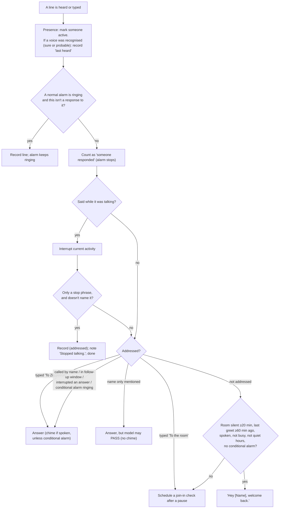
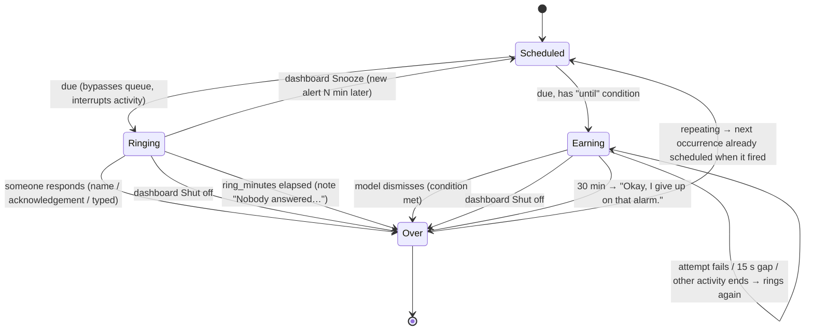

# Behavioural Specification (observed current behaviour)

This document states *precisely* how the current product behaves: decision rules, priorities, timings, thresholds and states. Values are those of the current build and defaults. They describe what exists, not what v2 must keep. Where a number is user-configurable it is marked ⚙.

## 1. Processing order and priority

- **One thing is decided at a time.** Spoken utterances, typed messages, detected sounds and "Ask" requests go through a single ordered queue and are decided strictly in order.
- **Alarms skip the queue.** A due timer, reminder or event goes off immediately, even if a transcription is in progress.
- **One activity at a time.** The assistant does at most one foreground activity: *answer*, *join*, *alert*, *greet*, *test*, *self-change announcement* or *plugin announcement*. Starting a new one usually cancels the current one. Cancelling stops speech within ~50 ms and abandons any model request in progress.
- **Background work runs alongside:** chime, ringtone preview, picture making, photo search, texting, memory sorting, weather, vitals.

## 2. Deciding what to do with each heard line

### 2.1 Addressing rules
| Situation | Classification |
|---|---|
| A clause is the name (or a nickname), optionally after greeting words (hey, hi, hello, yo, oi, ok, okay, oh, so, um, uh, and, but, well, alright) | Direct |
| Within the follow-up window | Direct |
| Line interrupted an *answer* | Direct |
| A conditional ("earned") alarm is ringing | Direct (everything is for the assistant) |
| Name appears elsewhere in the sentence | Mentioned → model may PASS |
| Otherwise | Not addressed |

**Name matching tolerance:** single words or runs of up to 3 words joined together; letter-similarity ≥0.75 to the full name and length within 3 letters; nicknames need ≥0.85 similarity and a single word. Small numbers ("8") are normalised to words.

### 2.2 Stop phrases
Stop-only utterances: contain one of *stop, wait, hold on, hang on, shut up, be quiet, quiet, never mind, enough, cancel, that's enough, ok thanks, thanks, thank you, got it*, and nothing else except filler (*a, ok, okay, alright, right, yeah, yes, no, oh, um, uh, so, just, please, now, hey, sec, second, minute, moment, it, that's, that, you, i*).

### 2.3 Alarm acknowledgements
A normal ringing alarm stops on: any typed message; any line naming the assistant; a stop phrase; or *turn/shut/switch it/that/the alarm/the timer off*, *turn/shut/switch off*, *I'm up / awake / on it / coming*, *coming*, *all right / alright*, *okay okay / ok ok*, *heard it/you*, *on it*.

## 3. Hearing pipeline

| Stage | Behaviour | Value |
|---|---|---|
| Audio frames | Mono, 16 kHz, 32 ms frames | fixed |
| Speech onset | ≥50% of the last ~0.25 s judged speech (≥75% when strict) | strict while talking or dozing |
| Speech threshold | Per-frame speech probability ⚙ | 0.5; strict = +0.25 (max 0.9) |
| Lead-in kept | Audio before onset | ~0.5 s |
| End of utterance | Silence ⚙ | 700 ms (100–5000) |
| Minimum length | Shorter is a blip | ~0.3 s of speech |
| Maximum length | ⚙ (hidden) | 20 s (1–120) |
| Max length while it talks | So barge-in is noticed fast | 2.5 s |
| Loudness echo gate | Utterance started while talking is dropped unless ≥1.3× (≈+2.3 dB) the recent echo level (80th percentile over last 3 s; needs ≥0.5 s of echo history) | fixed |
| Normalisation | Quiet audio boosted up to +30 dB before STT | fixed |
| STT + voiceprint | Run in parallel | — |
| Word echo | Dropped if ≥60% of its words were in what it said recently; or ≥40% plus a 3-word run; or ≥70% letter-block similarity. Window: sentences that finished playing within 0.5 s before the utterance started, onward | fixed |
| Own-voice | Dropped if voiceprint similarity to own voice ≥0.5 and beats best person by ≥0.10 | fixed |
| Phantom text | "thanks for watching", "subtitles by…", "please subscribe", "you", punctuation-only → discarded | fixed |
| Name-hint re-check | If ≤2 non-greeting words and contains the name → re-transcribe without hint; drop the name if absent | fixed |
| Cloud STT timeout | Then local fallback | 10 s |

## 4. Speaker identity

| Rule | Value |
|---|---|
| "Sure" label | similarity ≥0.40 **and** lead over next person ≥0.10 |
| "Probably" (`Name?`) | similarity ≥0.30 **and** lead ≥0.05 |
| Otherwise | `Someone` |
| Auto-learn from a line | similarity ≥0.50, lead ≥0.15, ≥1.0 s long, not while it was talking |
| Enrolment after naming | next 60 s, up to 4 more lines ≥0.8 s, similarity to new profile ≥0.2 and not clearly another known person |
| Samples kept per person | 60 (oldest dropped) |
| Lines correctable later | last 200 (in memory only) |
| Re-check after correction | last 30 unconfirmed lines |
| Profile save cadence | every 15 s if changed; on shutdown |
| "Last heard" written | at most once per hour per person just for that |
| Model change | Old profiles set aside; everyone re-enrols |
| Person "probably home" (for targeted reminders) | voice recognised (sure or probable) within 6 h; saved at most every 60 s and on shutdown |

## 5. Replying

- **Context:** last 40 lines ⚙ (hidden, 5–500), timestamped `[HH:MM] Speaker: text`, plus `[sound: …]`, `[done: …]`, `[didn't work: …]` lines; "situation" block (see FEAT-023); date and time ("Tuesday November 3 2026, 5:45 PM").
- **Streaming:** sentences released at `.`/`!`/`?` + whitespace. If no sentence has ended yet and the buffered text exceeds 140 characters, it is split at the last comma. Action tags `[[…]]` are held back until complete and never spoken. An unfinished tag at the end is discarded.
- **Actions:** each tag holds a JSON object (or list) with `"do"`. They run as soon as they arrive (before speech finishes). Results are recorded in the conversation after what was said.
- **Failed action follow-up:** if any action in an answer fails, one extra request is made with a "say it failed and fix it if you can" instruction. Not repeated.
- **Speakable output:** URLs → "the link"; markdown symbols removed; characters at or above the arrows block (arrows, symbols, emoji) removed.
- **Latency report** (spoken requests only): hearing = STT+ID time; thinking = request to first sentence; voice = first sentence to first audio; total = end of speech to first audio.
- **Follow-up window:** 8 s ⚙ (0–120), ×1.5 if the last sentence ended with "?".

## 6. Joining conversations

| Condition (all must hold) | Value |
|---|---|
| Pause after someone else spoke | `turn_pause_s` ⚙ 1.2 s (0.2–10); cancelled by any new speech onset |
| No activity in progress, nothing queued, not currently hearing speech | — |
| Presence awake (not dozing or away), mic open, not quiet hours | — |
| Something new said since the last check, and the last line isn't its own | — |
| Last speech less than this long ago | 60 s |
| Minimum interval since the last check | off: never · quiet: 120 s · normal: 40 s · chatty: 15 s |

Reply protocol: `PASS` or `SAY: <words>`. Only text after the last `SAY:` is spoken. Spoken only if no new line arrived and nobody is mid-speech; otherwise recorded as "the conversation moved on". If speech starts while the join is still *thinking*, it is cancelled; once *speaking*, it is an interruption.

**Actions allowed while joining in (unprompted):** remember, learn a voice, draw on its own, find a photo on its own. All others are ignored silently.

## 7. Alarms

| Parameter | Value |
|---|---|
| Normal alarm repeat-announcement interval | 30 s (if "speak between rings" on ⚙) |
| Normal alarm max ringing | `ring_minutes` ⚙ 5 (0.5–60) |
| Conditional alarm: ring burst / wait for attempts | ~4 s / 15 s |
| Conditional alarm give-up | 30 min |
| "Ringing" survives restart | yes, unless fired >12 h ago |
| Targeted reminder "home" window | 6 h |
| All-day event reminder anchor | 08:00 on the day, minus remind-minutes |
| Event without end | lasts 1 h (timed) or the whole day (all-day) |
| Repeat options | daily, weekly |
| Past reminder time | next occurrence (next day if not repeating) |
| Snooze default (status panel) | 5 min; tab offers 1/5/10/15; minimum 1 min |

**Announcements:**
- Timer: "Your timer is done." or "Your {label} timer is done."
- Reminder: "Reminder: {text}."
- Event at or after start: "{title} is starting now."
- Event before start: "Heads up: {title} today/tomorrow/on {weekday} at {h:mm AM/PM}." (no time for all-day)
- Targeted reminder, person not heard lately: "Is {name} home? Reminder for {name}: {text}."
- Conditional alarm: "… I'll keep going until {condition}." then "Still waiting: {condition}."

## 8. Presence

| State | Entered when | Mic | Joins in | Detection |
|---|---|---|---|---|
| Awake | speech heard, or motion after being away | open | yes | normal |
| Dozing | no speech for `doze_after_min` ⚙ 10 min | open | no | strict |
| Away (sensor only) | no motion for `away_after_min` ⚙ 15 min | **closed** | no | — |
| Asleep (requested) | "stop listening for N min" (default 60) | **closed** | no | — |
| Mic off (switch) | dashboard switch | **closed** | no | — |

Quiet hours ⚙ (default 23:00–07:00, crosses midnight) suppress join-ins and greetings only.

**Status precedence (dashboard/TV):** loading > speaking > mic off (paused) > asleep > away > hearing > transcribing > thinking > dozing > listening. The TV adds *offline* and *ringing*.

## 9. Memory

| Rule | Value |
|---|---|
| Max memories | 150 (oldest dropped silently) |
| Duplicate threshold | >0.9 similarity → not saved |
| Forget match | best fuzzy match ≥0.5 |
| Kinds | rule, household (always sent); person, note (sent when "about" term appears) |
| "About" terms | lowercase, ≤10 per memory, ≤40 chars each; all words of a term must appear (plurals and possessives normalised) |
| Send everything when | last line mentions remember/memory/memories/forget/forgot/"what do you know" |
| Background sorting | ≤60 per batch; every 10 min when idle |
| Calendar in context | next 30 days, ≤25 lines |
| Cancel/remove fuzzy match | ≥0.4 (spelling similarity or share of words mentioned) |

## 10. TV

| Rule | Value |
|---|---|
| Grid | 12 × 8 |
| Face sizes | large 7×8, medium 5×5, small 4×4, tiny/none 3×2 (min) |
| Box min size | 2×2 |
| Boxes per dashboard / saved dashboards | 8 / 20 |
| One-of-a-kind boxes | clock, upcoming, vitals, weather, activity |
| Text box | ≤12 lines × 200 chars |
| Unprompted picture or photo on screen | 5 min, then back to previous view |
| Gap between unprompted photos | ≥3 min |
| Caption lifetime | 60 s |
| Reaction freshness | events older than 5 s don't trigger reactions |
| Stream silence ⇒ offline | 20 s; reconnect every 3 s; reload page on return |
| Widget rail lit after request | ~15 s |
| Drawing: retries / timeout / max size / prompt max | 1 retry / 5 min / 500 KB / 1000 chars |
| Pictures kept | 50 (failed replies: 10) |
| Photo: candidates / timeout / max download / min side | 12 / 20 s / 8 MB / 300 px |
| Daily limits ⚙ | drawings 20 (own 5); photos 100 (own 30) |
| Weather refresh / retry | 30 min / 5 min |
| Vitals interval | 5 s |
| Kiosk browser restart | daily |

**Weather → clothing:** thunderstorm codes → storm; drizzle/rain/showers → umbrella; snow codes → snow hat; feels ≤40 °F (4 °C) → beanie; clear or mostly clear, daytime, feels ≥65 °F (18 °C) → sunglasses. From 1 Nov to 6 Jan, beanie → Santa hat, snow → Santa hat with snow.

## 11. Self-changes

| Rule | Value |
|---|---|
| Enabled | only if admins are configured |
| Who may suggest | a voice recognised for sure (any known person) |
| Request length cap | 1,500 chars (truncated with "…") |
| Approval validity | 10 min after suggestion (dashboard can approve any time) |
| Approver | an admin, recognised **for sure**, on a spoken line *after* the read-back |
| Blockers | change already in progress; uncommitted code edits; coding CLI missing; not in version control |
| Start-up stall detection | no activity within 30 s → treated as "waiting for an answer" |
| Auto-finish when unwatched | 20 s after the agent reports finished |
| Unwatched timeout | `timeout_min` ⚙ 30 min (1–240) |
| Steps recorded | ≤300 per change |
| Test gate | code imports, then full test suite (≤10 min); fast-forward merge only |
| History kept | 50 changes |
| Announcement wait | up to 30 min for a quiet moment |
| Restart wait | no alarm ringing, no conditional alarm, no activity, code console not busy (checked every 2 s) |

## 12. Dashboard access

| Rule | Value |
|---|---|
| Default bind | 127.0.0.1:8765 ⚙ |
| Accepted Host | IP literal, localhost, machine name, name.local, `<machine>.*.ts.net`, configured names |
| Origin | must match Host when present |
| Commands | JSON POST only |
| Password lockout | 5 wrong within 60 s → admin locked until oldest ages out |
| Terminal connection | password in first message within 10 s |
| Event history replayed on connect | last 300 conversation events + last 60 model requests + last 500 log lines + latest of each state event |
| Slow subscriber | dropped after 500 queued events; reconnects with full state |
| Mic level updates | ~10/s, only while a dashboard is connected |

## 13. Texting

| Rule | Value |
|---|---|
| Max message | 480 chars |
| Per-person daily limit ⚙ | 10 (1–100); failed attempts count |
| Request timeout | 15 s |
| Never | include numbers in prompts, notes, dashboard or speech |
| Unprompted use | not allowed |

## 14. Startup and shutdown

1. Validate settings; load secrets (warn if readable by others).
2. Start dashboard; status "loading".
3. Load STT and TTS in parallel; load voice profiles; learn own voice from 3 synthesised phrases; load sound classifier; load plugins; pre-start model connection.
4. Emit full state; announce "Ready…".
5. Start background jobs (each self-restarting).
6. On shutdown/restart: save "last heard" times and voice profiles; close model connection.
7. Restart replaces the running program in place.
8. After restart: mic on; chattiness, TV view, ringtones, own-pictures switch, memories, alerts, calendar, voices, histories restored; in-flight self-change marked stopped; ringing alarms ring again; conversation transcript and in-memory corrections lost.
