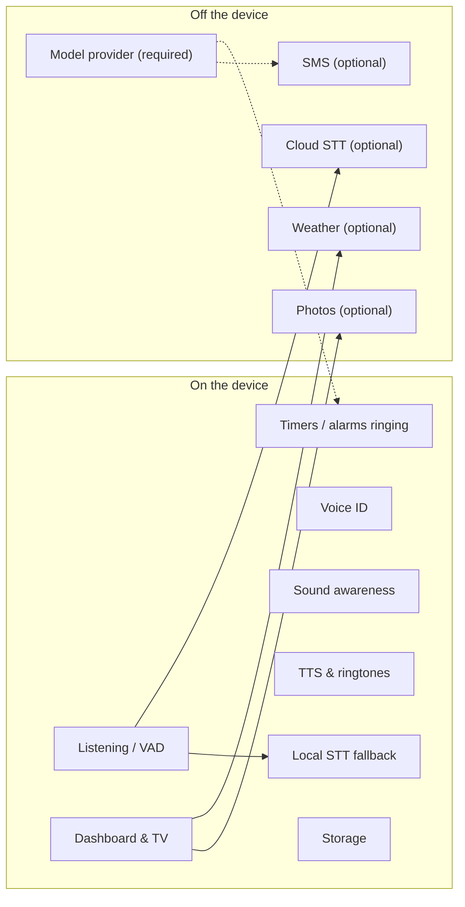

# Hardware and Runtime Requirements

What the current product needs to run, separating **genuine product constraints** (things a household deployment truly requires) from **incidental implementation choices** (things the current build happens to use, which a rebuild need not keep).

## 1. Observed reference deployment [R]

- Raspberry Pi 5 Model B (4 cores, 8 GB RAM) running a 64-bit Raspberry Pi OS (Linux 6.18, aarch64), Python 3.13. About 2.2 GB of memory in use with the assistant and TV running.
- Assistant runs as a **user-level boot service** with lingering; the TV runs as a **system kiosk service** on the console screen. Both active on 2026-11-03.
- Audio through PipeWire; microphone default device; speaker via the default sink (Bluetooth supported per docs).
- Subscription model access; cloud STT enabled; TV attached.

## 2. Genuine product constraints

| ID | Constraint | Why it is genuine |
|---|---|---|
| HC-1 | A **microphone** able to hear a room (USB mic, speakerphone or mic array). Far-field arrays with echo cancellation recommended | Always-listening voice product |
| HC-2 | A **speaker**, wired or **Bluetooth**, as the system default output | Voice output, ringtones |
| HC-3 | **Simultaneous capture and playback** (full duplex) | Barge-in and alarm responses depend on listening while speaking |
| HC-4 | A **small always-on computer** in the room (Pi 4/5 class), also usable on a laptop for development | Household appliance positioning |
| HC-5 | **Network access** for reasoning (model provider); optional for STT, weather, photos, SMS | Model is cloud-hosted |
| HC-6 | **Start at boot without a login**, recover from crashes automatically | Unattended appliance |
| HC-7 | Optional **display (TV/monitor)** driven directly from the device, no desktop, from boot | TV face and dashboards |
| HC-8 | Optional **PIR motion sensor** (GPIO) for "away" | Sound can't tell empty from quiet |
| HC-9 | **Local browser access** to a dashboard, optionally from a phone via secure remote access | Control and transparency |
| HC-10 | **Survives power cuts** without corrupting data (SD card media) | Appliance on consumer storage |
| HC-11 | **Modest storage writes** (SD card wear) | Pi storage |
| HC-12 | Works on **Pi 4** with reduced models (smaller speaker model, tiny STT) | Docs target Pi 4 and 5 |
| HC-13 | English-language speech | Only English models and heuristics exist |

## 3. Performance envelope (documented/observed)

| Metric | Typical |
|---|---|
| End of speech → transcription + speaker ID (cloud STT) | ~0.5 s |
| Model to first sentence | 1.5–3.5 s |
| First sentence → first audio | ~0.15–0.2 s |
| Stop on interruption | ≤ ~50 ms |
| Ambient sound classification budget | ≤0.5 s per 1 s window (else self-disables) |
| Picture drawing | 1–2 min (timeout 5 min) |
| Photo search | a few seconds |
| Test suite | ~70 s on the Pi (328 tests) |
| Voice profiles file | ~137 KB (compact encoding, per docs) |

## 4. Software runtime (current build)

| Need | Current choice | Genuine or incidental? |
|---|---|---|
| OS | Linux (Pi OS); macOS for laptop per docs | Linux appliance is genuine; specific distro incidental |
| Language runtime | Python ≥3.11 | Incidental |
| Audio stack | PortAudio + PipeWire/PulseAudio | Bluetooth output + full duplex genuine; library incidental |
| Volume control | `wpctl`/`pactl` | Capability genuine; tools incidental |
| VAD / STT / speaker ID / sound tagging / TTS models | Silero, Whisper (faster-whisper / Groq), TitaNet, CED-tiny, Piper | Capabilities genuine; specific models incidental |
| Web server | Embedded HTTP server with SSE and WebSocket | Live dashboard genuine; tech incidental |
| Terminal multiplexer | tmux | Incidental to the self-change design |
| Coding agent | Claude Code CLI | Incidental to the self-change design |
| Version control | git | Needed for the current self-change/undo model; incidental to v2 |
| Kiosk | cage + Chromium | Display-from-boot genuine; stack incidental |
| Process supervision | systemd user + system units | Boot/restart genuine; tool incidental |
| GPIO library | gpiozero | Incidental |
| Model access | Claude Code CLI (subscription) or Anthropic API | Provider dependency genuine today; CLI route incidental |

## 5. Installation and service management (observable)

1. A setup script creates an isolated environment with pinned dependency versions, downloads the voice and three models, and creates settings and secrets files from examples (secrets made owner-only).
2. A Pi script installs audio, Bluetooth, GPIO and tmux packages and the coding CLI.
3. One-time interactive login to the model CLI, or a long-lived token for service mode.
4. Bluetooth speaker pairing via the OS tools (documented manually).
5. Boot service: user service with restart-on-failure (5 s), depends on the audio session; lingering enabled so it starts without login.
6. TV: a script installs a system service that takes over the console screen, waits for the assistant, runs a kiosk browser in incognito, restarts it daily, and adds the user to video/render/input groups.
7. Logs: system journal (`journalctl --user -u ziggletron`, `journalctl -u ziggletron-tv`).

## 6. Local vs cloud dependency map

## 7. Constraints discovered at runtime

- Two copies on two machines do not sync and share external accounts (docs).
- The dashboard page is fixed at the version loaded at startup; code changes to it appear only after restart.
- The TV must be on the same machine (it uses `localhost`) as installed by the script; any browser on an allowed host can open `/tv`.
- The microphone always comes back on after any restart.
- Self-change requires the project folder to already be trusted by the coding CLI, otherwise the change waits for someone to answer at the terminal.
