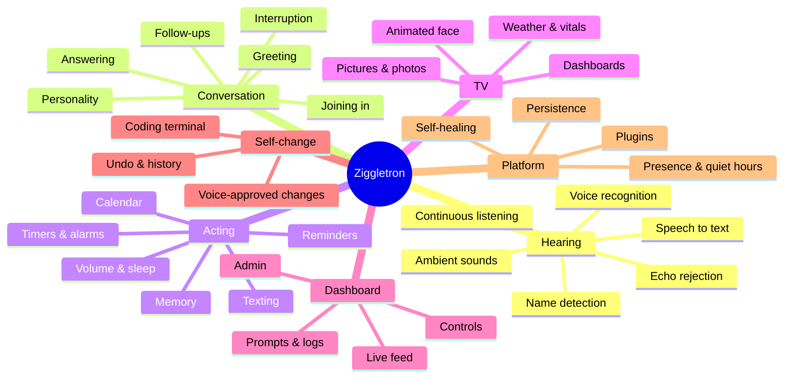

# Ziggletron — Product Overview (Discovery, Phase 01)

> **What this is:** a description of what Ziggletron *currently does*, written independently of how it is built.
> It is a discovery record, not a design. Nothing here is a requirement to reproduce the existing implementation.
> Source-level evidence lives separately in [`legacy-reference/`](legacy-reference/) and is non-authoritative.

Discovery date: 2026-11-03. Repository state examined: branch `claude-code-terminal` at `efc08c2`, plus the live running instance on the household device.

## 1. What Ziggletron is

Ziggletron is an **always-listening household voice assistant** that lives on a small computer in a shared room (designed for a Raspberry Pi 4/5, also runs on a Linux or macOS laptop). It is designed to feel like **a member of the household rather than a gadget**:

- People talk to it by **saying its name anywhere in a sentence** ("Zigg, what's the weather tomorrow?"), with no separate wake-word device.
- It **follows room conversation** and may **join in on its own** during natural pauses, the way a friend in the room would. How often is adjustable, including never.
- It **knows who is speaking** by their voice, on the device, and labels each line honestly: a name when sure, "Name?" when probably, "Someone" otherwise.
- It **does things**: timers and alarms that ring like real ones, reminders, a household calendar, long-term memories about the household, text messages, volume, "stop listening".
- It can **show things on a TV**: an animated face plus dashboards, drawn illustrations, and real photos, arranged by voice.
- It can **change its own software** when a recognised household member asks and a designated admin approves out loud. The change is tested before it is switched on.
- A **live web dashboard** shows everything it hears, decides, says and does, and lets people control it.

The assistant does not do its own language reasoning. It sends conversation context to an external large language model (Anthropic Claude), and everything around that is the product: hearing, deciding when to speak, speaking, acting, remembering, displaying, and governing itself.

## 2. Who uses it

| Role | How they interact | What they can do |
|---|---|---|
| **Household member (anyone in the room)** | Voice | Ask questions, set timers, reminders and calendar events, ask it to remember or forget, control volume, make it stop listening, ask for TV dashboards and pictures, respond to alarms, suggest self-changes (if their voice is recognised) |
| **Recognised household member** | Voice | All of the above. Also: suggest changes to its own code; their name is attached to what they say |
| **Admin (named in settings, recognised by voice for sure)** | Voice | Okay a suggested self-change out loud |
| **Dashboard viewer (anyone who can reach the web page)** | Browser | See everything (conversation, prompts, logs, memories, calendar). Use password-free controls: type messages, mic switch, chattiness, TV view, timers, calendar, memories, ringtones, shut off or snooze alarms |
| **Dashboard admin (knows the dashboard password)** | Browser | Correct, rename, merge or forget voices. Approve or reject, stop, retry or undo self-changes. Open a live AI coding terminal on its code. Commit or set aside code edits. Restart |
| **TV viewer** | Looks at the screen | Passive. The TV page has no controls |
| **Installer/maintainer** | Shell, files | Edit settings, secrets and personality files; install services; add plugins |

## 3. Major capability areas

## 4. How a typical interaction looks

1. Someone says "Zigg, set a pasta timer for ten minutes."
2. It notices speech, waits for a pause, transcribes it and works out who said it (about 0.5 s).
3. It sees it was called by name and plays a short chime.
4. It asks the language model for a reply, giving it the recent conversation, relevant memories, current timers, calendar and time.
5. It starts speaking as soon as the first sentence is ready ("Ten minutes, starting now."). The timer is created in the background.
6. For about 8 seconds it accepts a follow-up without its name.
7. Ten minutes later the timer rings: a ringtone loops, and every 30 s it says "Your pasta timer is done." It keeps going until someone says something like "okay, thanks" or its name, presses Shut off or Snooze on the dashboard, or 5 minutes pass. TV or background chatter does not stop it.

## 5. What depends on what

| Capability | Works offline? | External dependency |
|---|---|---|
| Hearing speech, voice ID, sound awareness, speaking | Yes | None (on-device models) |
| Speech-to-text | Yes (local model) | Optional cloud STT (Groq) for accuracy. Falls back to local |
| Any reply, joining in, memory sorting, drawing pictures | **No** | Anthropic Claude (subscription via Claude Code CLI, or API key) |
| Web search for current facts | No | Model provider's search tool |
| Timers/reminders/alarms ringing | Yes, once created | None. Creating them by voice needs the model; the dashboard does not |
| Weather on TV | No | Open-Meteo (free, no key) |
| Photos on TV | No | Wikimedia Commons (free, no key) |
| Text messages | No | Twilio account |
| Self-changes and coding terminal | No | Claude Code CLI, git, tmux |
| Motion-based "away" | Yes | PIR sensor on GPIO (Raspberry Pi only) |

## 6. Current maturity (summary)

- **Works today (verified):** the live instance is running with subscription backend, cloud STT, TV face, weather, voice recognition (17 profiles stored), memories (58), reminders and calendar. The full automated suite passes: **328 tests**, including real-browser dashboard and TV tests.
- **Built but unverified here:** motion sensor "away", the pay-per-use API backend at runtime, actual SMS delivery, macOS, Bluetooth pairing flow, plugins in production (none enabled).
- **Incomplete or unmerged:** music playback and "explain your own code" exist only as unmerged self-change branches. Smart-home control, calendar sync, multiple languages and a true local wake word are listed as ideas and not built.
- **Key product risks:** every utterance goes to cloud STT when it is enabled (no local wake word); the read-only dashboard has no login; self-changes run unsandboxed code; there is a concurrency defect in reply generation; voiceprints and transcripts of requests can persist indefinitely (including in git history). See [KNOWN-PROBLEMS-AND-LIMITATIONS.md](KNOWN-PROBLEMS-AND-LIMITATIONS.md).

## 7. Document map

| Document | Contents |
|---|---|
| [COMPLETE-FEATURE-CATALOG.md](COMPLETE-FEATURE-CATALOG.md) | Every feature, `FEAT-001`…`FEAT-089`, with 15 attributes each |
| [BEHAVIORAL-SPECIFICATION.md](BEHAVIORAL-SPECIFICATION.md) | Precise observable rules, thresholds, timings and state machines |
| [USER-WORKFLOWS.md](USER-WORKFLOWS.md) | End-to-end journeys with Mermaid diagrams |
| [UI-AND-SETTINGS.md](UI-AND-SETTINGS.md) | Every screen, control, indicator, notification and setting |
| [DATA-AND-PERSISTENCE-INVENTORY.md](DATA-AND-PERSISTENCE-INVENTORY.md) | What information is collected, kept, sent and deleted |
| [EXTERNAL-INTEGRATIONS.md](EXTERNAL-INTEGRATIONS.md) | Every outside service and what crosses the boundary |
| [HARDWARE-AND-RUNTIME-REQUIREMENTS.md](HARDWARE-AND-RUNTIME-REQUIREMENTS.md) | Devices, OS, network, service management; genuine vs incidental constraints |
| [KNOWN-PROBLEMS-AND-LIMITATIONS.md](KNOWN-PROBLEMS-AND-LIMITATIONS.md) | Bugs, risks, confusing behaviour, gaps |
| [UNKNOWN-AND-UNVERIFIED.md](UNKNOWN-AND-UNVERIFIED.md) | What could not be confirmed, and why |
| [DISCOVERY-COVERAGE.md](DISCOVERY-COVERAGE.md) | Checklist of what was inspected and cross-checked |
| [legacy-reference/](legacy-reference/) | Feature-to-source index and technical audit notes (non-authoritative) |

### Evidence tags used throughout

| Tag | Meaning |
|---|---|
| **[R]** | Observed on the running instance (read-only observation on 2026-11-03) |
| **[T]** | Exercised by an automated test that passed on 2026-11-03 |
| **[S]** | Supported by source-code inspection only |
| **[D]** | Claimed in project documentation; not independently confirmed |
| **[X]** | Broken, incomplete, unmerged or unreachable |
