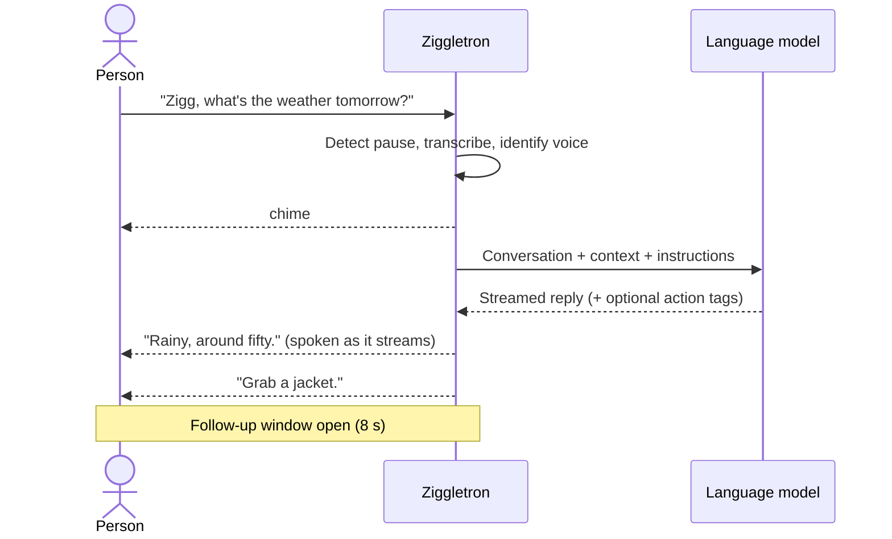
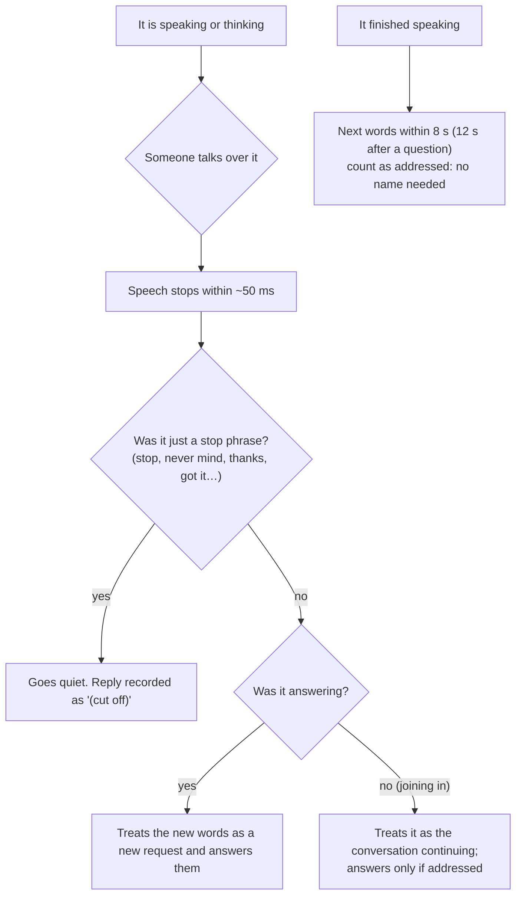
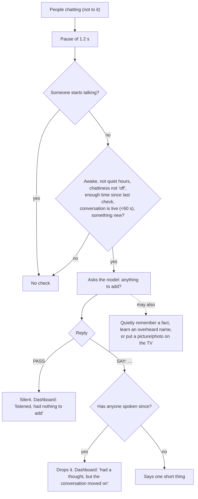
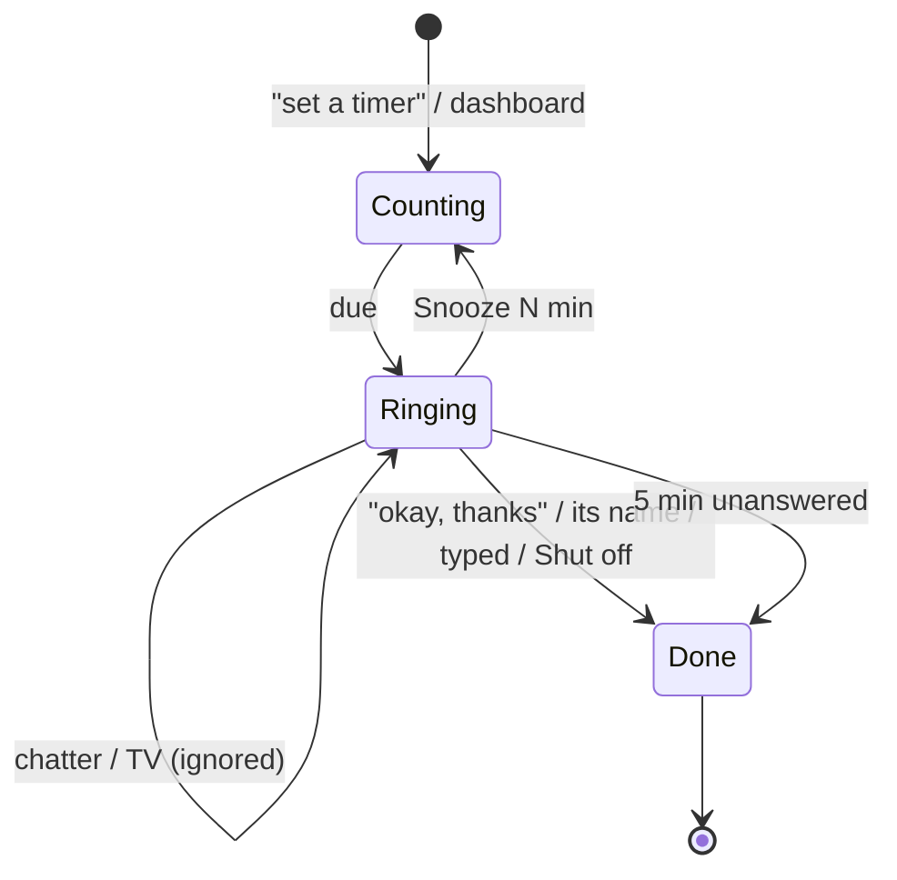
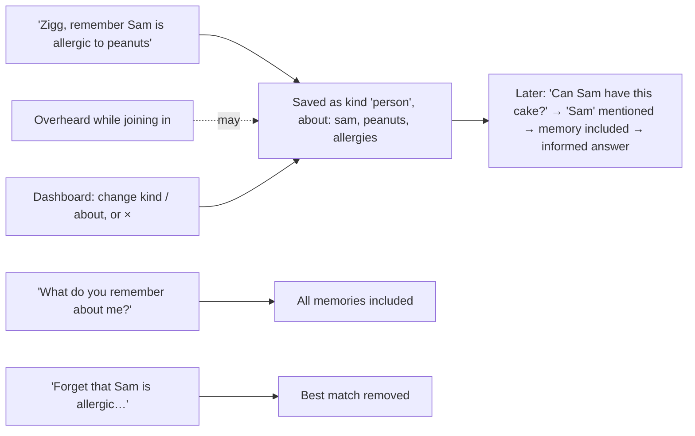
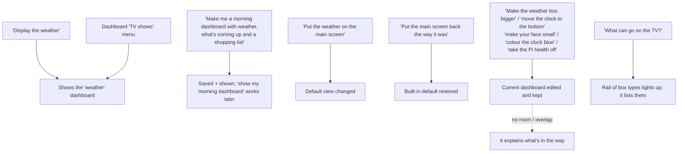
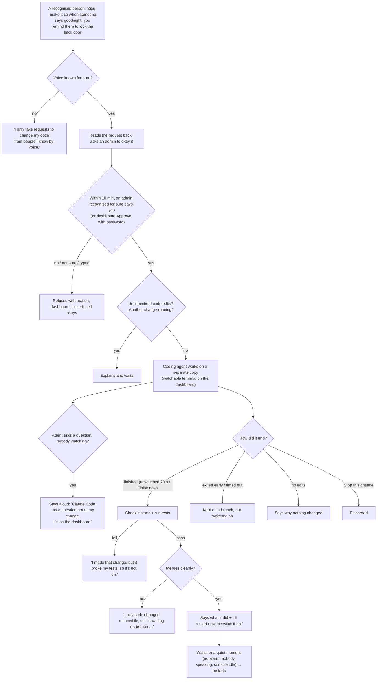

# User Workflows

End-to-end journeys as people experience them. Diagrams show **product behaviour**, not components. Timing figures are typical values from documentation and observation. Quoted phrases are fixed product wording unless marked as an example of model-generated speech (e.g. answers, which the language model words freely).

Workflow index:
1. [Asking a question by voice](#w1-asking-a-question-by-voice)
2. [Follow-up and interruption](#w2-follow-up-and-interruption)
3. [Being talked about vs. talked to](#w3-being-talked-about-vs-talked-to)
4. [It joins a conversation](#w4-it-joins-a-conversation)
5. [Welcome back](#w5-welcome-back)
6. [Setting a timer and responding when it rings](#w6-setting-a-timer-and-responding-when-it-rings)
7. [An alarm you have to earn](#w7-an-alarm-you-have-to-earn)
8. [A reminder for someone who may not be home (+ text)](#w8-a-reminder-for-someone-who-may-not-be-home)
9. [Calendar by voice and on the dashboard](#w9-calendar)
10. [Remembering, recalling and forgetting](#w10-remembering-recalling-and-forgetting)
11. [Introducing yourself and correcting voices](#w11-introducing-yourself-and-correcting-voices)
12. [Stop listening / mic off / away](#w12-stop-listening--mic-off--away)
13. [Changing what the TV shows](#w13-changing-what-the-tv-shows)
14. [Pictures and photos on the TV](#w14-pictures-and-photos-on-the-tv)
15. [Asking it to change itself](#w15-asking-it-to-change-itself)
16. [Admin coding session from the dashboard](#w16-admin-coding-session-from-the-dashboard)
17. [Undoing a self-change](#w17-undoing-a-self-change)
18. [Typing to it](#w18-typing-to-it)
19. [Startup, failure and recovery](#w19-startup-failure-and-recovery)
20. [When the model can't be reached](#w20-when-the-model-cant-be-reached)

---

## W1. Asking a question by voice

**Actors:** anyone in the room. **Preconditions:** mic open, not asleep.

1. The person says "Zigg, what's the weather tomorrow?" anywhere in a sentence.
2. Status shows *Hearing speech*; after a ~0.7 s pause, *Transcribing*.
3. The line appears on the dashboard with a speaker label (Alex / Alex? / Someone) and "to Ziggletron".
4. A chime plays; status *Thinking*.
5. The first sentence is spoken ~1.5–3.5 s later ("Rainy, around fifty."); later sentences follow without gaps. TV captions show the question and answer for 60 s.
6. Any requested actions run; results appear as notes.
7. The follow-up window opens (8 s, or 12 s after a question).



**Alternate paths:** typed instead (W18), no chime. Model unreachable → W20. Model refuses → "Sorry, I can't help with that one." Action fails → it says so and may retry once (W6 step 4a).

## W2. Follow-up and interruption



The cut-off reply is remembered as cut off, so it won't start over unless asked.

## W3. Being talked about vs. talked to

1. "Ziggletron's been weird today" → no chime.
2. The model is asked whether a reply is natural; usually it replies PASS → nothing is said; dashboard note "Heard my name, but they were talking about me, not to me."
3. If someone clearly invites it ("…right, Ziggletron?"), it answers.
4. On errors in this mode it stays silent (no apology).

## W4. It joins a conversation



**User controls:** "Joins conversations" dropdown (Never / Rarely / Sometimes / Often), quiet hours, the personality file, the "Ask" button (forces a check now, slightly more willing).

## W5. Welcome back

Room silent ≥20 min → someone speaks (not to it) → "Hey Alex, welcome back." (name only if sure; else "Hey, welcome back."). At most hourly; never in quiet hours, while busy, or during a conditional alarm. The TV face looks pleased.

## W6. Setting a timer and responding when it rings

1. "Zigg, set a pasta timer for 10 minutes." → "Ten minutes, starting now." → timer appears with a live countdown (dashboard side panel, Timers tab, TV "upcoming").
   - 4a. If the action fails, it says so in its own words (model-generated) and may re-issue a corrected action.
   - Alternative: dashboard Timers tab → minutes + label → Start timer.
2. When due, whatever is happening stops; "Your pasta timer is done."; the ringtone loops; the dashboard shows a ringing banner with Shut off / Snooze; the TV face shakes with a banner.
3. Every 30 s it repeats the announcement.
4. It stops when someone **responds** (says its name, "okay", "thanks", "got it", "turn it off", "I'm coming"…, or types anything), or presses Shut off / Snooze, or after 5 minutes with nobody answering.
5. TV audio or chatter is recorded but does not stop it.



If the assistant restarts while it rings, it rings again on startup (unless >12 h old).

## W7. An alarm you have to earn

1. "Wake us up at 7 and keep bugging us until someone recites 50 digits of pi."
2. At 7: "Reminder: wake up. I'll keep going until someone recites…" → ringtone bursts.
3. Anyone just speaks (no name, no chime). Each attempt goes to the model, which judges leniently for transcription errors.
4. Not met → playful nudge ("Still waiting: …") and ringing resumes after ~15 s.
5. Met → model dismisses it and says so.
6. "Stop" doesn't count. Dashboard Shut off always works. After 30 min: "Okay, I give up on that alarm."

## W8. A reminder for someone who may not be home

1. "Remind Alex to water the plants at 11, only if they're home, and text it to them."
2. At 11: if Alex's voice (sure or probable) was heard within 6 h → "Reminder: water the plants." Otherwise → "Is Alex home? Reminder for Alex: water the plants." with a dashboard note.
3. If text-to was set, an SMS "Reminder: water the plants" is sent at the same time (subject to daily limits). A failure is noted as an error.
4. It always goes off; it never silently skips.

## W9. Calendar

**By voice:** "Put the dentist on the calendar for Tuesday at 3, remind us 30 minutes before." → event added; confirmation. "Take the dentist off the calendar." → removed by fuzzy match.

**On the dashboard:** Timers & calendar tab → month view (‹ Today ›) → click a day → "+ Add event" → What / Day (all day, until) / Time to Time / Notes / Ring (don't remind … 1 day before) → Save. Click an event to edit or Delete.

**When it matters:** the model sees the next 30 days and is told to mention events only when relevant. If a reminder was set: "Heads up: Dentist – Sam today at 3:00 PM." / "… is starting now." Repeating events (voice-only option) move to their next time.

## W10. Remembering, recalling and forgetting



Notes: rules and household basics are always included. Unsorted memories get a guess and are sorted by the model in the background. 150 maximum, oldest dropped.

## W11. Introducing yourself and correcting voices

1. "Zigg, I'm Alex." → note "Learning Alex's voice – the next few things they say will help." It keeps you talking.
2. Over the next minute up to 4 more lines from that voice train the profile.
3. Later lines show "Alex" (sure) or "Alex?" (probably).
4. **Correcting (admin):** click a label → "Who said this?" → pick a person, type a new name, or "Not sure / not one of us" → line shows "Sam ✓"; nearby lines may relabel.
5. **Tidying (admin):** "Voices it knows" → ✎ rename (to an existing name = merge, with confirmation) or × forget.
6. **Admins are protected:** saying "I'm <admin>" won't add your voice to an existing admin's profile.

## W12. Stop listening / mic off / away

| Action | Result | How it ends |
|---|---|---|
| "Stop listening for an hour" | Mic released; status *Asleep – mic off until 3:15 PM*; TV face sleeps and dims | Time passes, or dashboard **Wake up** (it can't hear you while asleep) |
| Dashboard mic switch off | Mic released; *Mic off* | Switch on, or any restart |
| 10 min of silence | *Dozing*: answers its name only, no join-ins | Any speech |
| No motion 15 min (sensor fitted) | *Nobody around*; mic off | Motion |

## W13. Changing what the TV shows



An alarm banner shows over any dashboard. Room chatter never goes on the TV unless a conversation box is explicitly asked to show the room.

## W14. Pictures and photos on the TV

**Drawing on request:** "Draw a fox reading a newspaper" → it says (in its own words) that it's on the way → TV switches to Pictures with "making…" → ~1–2 min later the illustration appears → if it fails: "Sorry, that picture didn't work: …".

**Photo on request:** "Show me a red panda" → within seconds a real photo with title and credit appears. If none suitable: it says why.

**Unprompted:** with the "Its own pictures" switch on, it may rarely draw something a conversation inspires. It may also put up a relevant photo (no switch), at least 3 minutes apart. Both show for 5 minutes, then the TV returns to what it showed.

**Limits:** per-day caps for drawings and photos; one drawing and one search at a time; family-unsafe words are refused.

## W15. Asking it to change itself



## W16. Admin coding session from the dashboard

1. Unlock admin (password).
2. Claude Code tab → **Open terminal** → a live terminal with the coding agent in the project (live code).
3. Type requests; answer its permission questions; Esc interrupts. Closing the browser leaves it running; reopening continues. **New session** starts fresh.
4. When it leaves uncommitted changes: a box lists files with **Commit them** / **Set them aside**. Note: uncommitted edits block voice-requested changes.
5. Once committed code differs from what's running: **Restart Ziggletron** to switch it on.

## W17. Undoing a self-change

Self-changes tab → a "switched on" change → **Undo** → it is reverted as a new commit → status "undone" → automatic restart when quiet. Refused (with reason) if later changes build on it or there are uncommitted edits. Failed/kept changes can be **Try again**, **Remove**d, or have their **branch deleted**. **Clear** removes all unfinished entries.

## W18. Typing to it

Dashboard Conversation tab → type → choose **To Ziggletron** (answered as a direct request) or **To the room** (treated as overheard chat; it may join in) → Send. Typed lines carry no voice identity: they can't approve changes or claim a voice, but they always count as answering a ringing alarm.

## W19. Startup, failure and recovery

```mermaid
flowchart TD
    S["Start (boot service or manual)"] --> C{"Settings valid?"}
    C -- no --> CE["Exit with a clear message naming the bad setting"]
    C -- yes --> D["Dashboard up: 'Starting up – loading models…'"]
    D --> L["Models load; own voice learned; plugins; model connection warmed"]
    L --> R["'Ready. Say \"Ziggletron\"…'"]
    R --> RUN["Running"]
    RUN -- "a background job crashes" --> J["'Something went wrong with X; starting it again.' (backs off up to 60 s)"]
    RUN -- "mic unplugged" --> MIC["'Microphone problem…; retrying in 5 seconds.'"]
    RUN -- "cloud STT down" --> STT["'Groq … failed; using local Whisper until it works again.'"]
    RUN -- "process exits" --> SYS["Service manager restarts it after 5 s"]
    SYS --> S
    D -. "damaged data file" .-> DF["Moved aside; backup used; dashboard note"]
```

The TV shows a sad "offline" face while the assistant is down and reloads itself when it returns.

## W20. When the model can't be reached

- Direct request → "Sorry, something went wrong on my end." + dashboard error.
- Name only mentioned / joining in → silent; error noted.
- Conditional alarm → can only be shut off from the dashboard.
- Already-scheduled timers, reminders and events still ring. Dashboard timers and calendar still work. Voice-created timers do not.
- Memory sorting retries later; pictures fail with a spoken apology if asked for.
