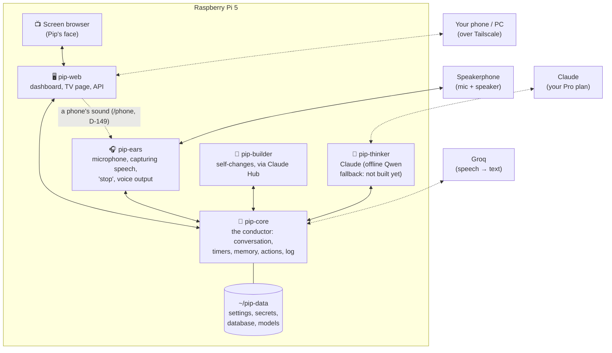
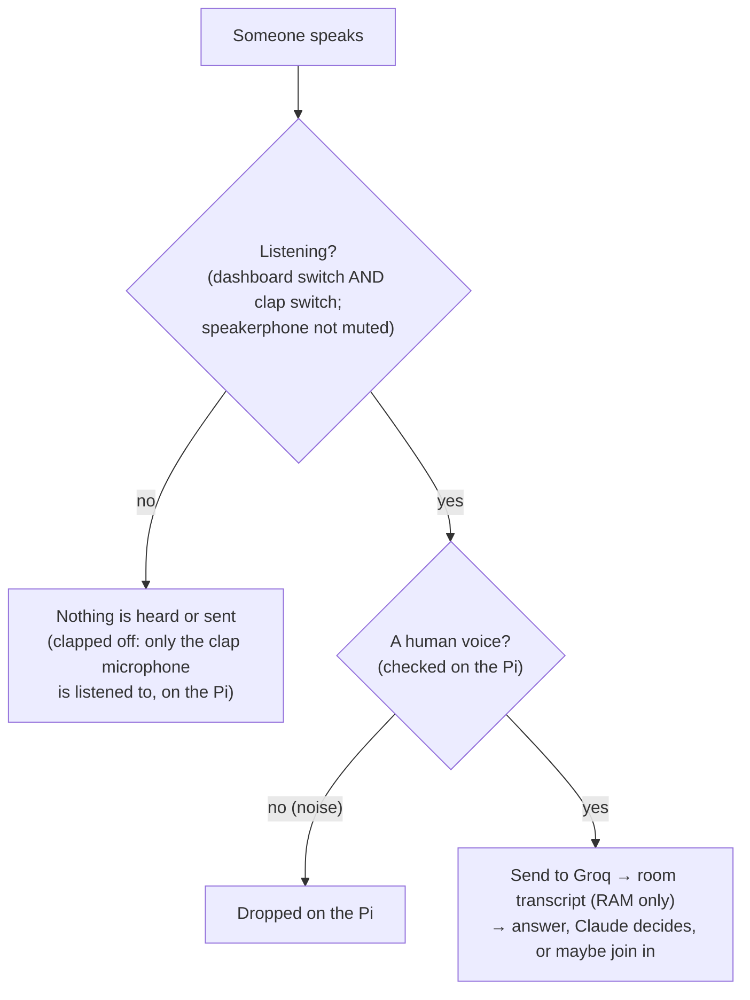
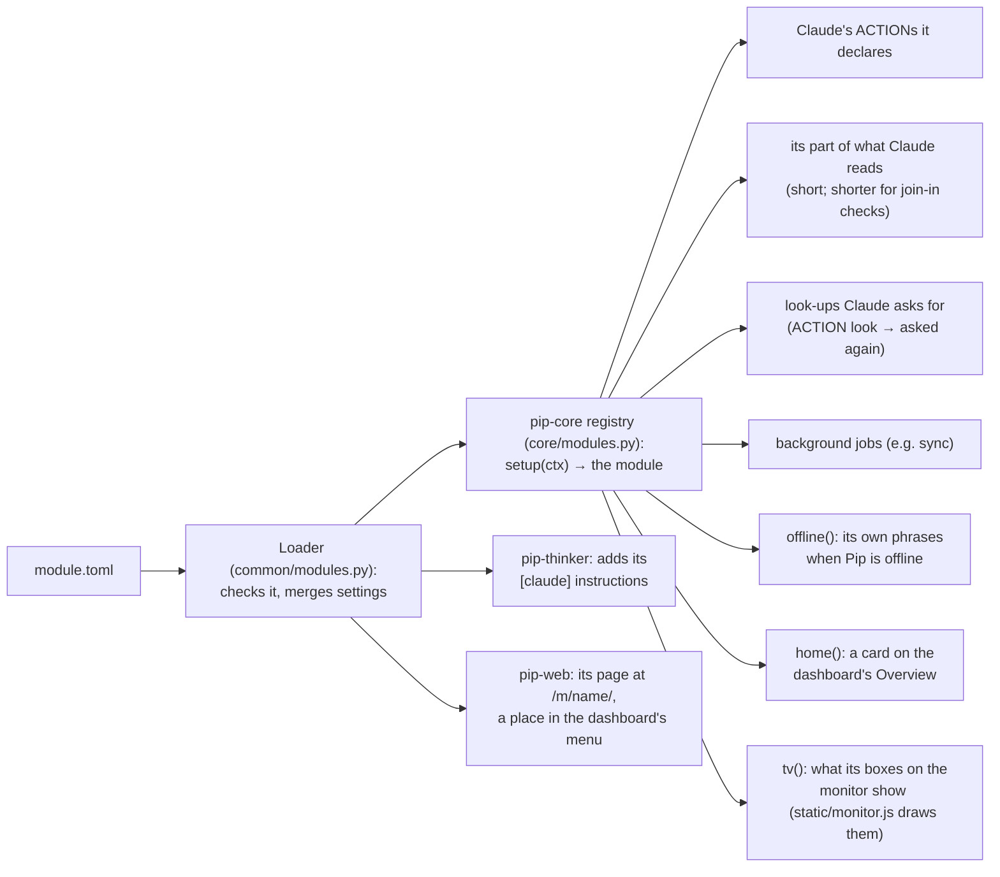
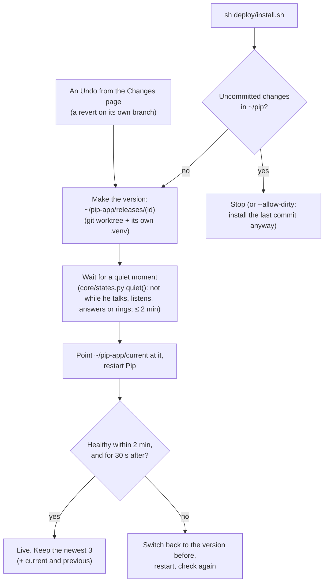

# Pip architecture

How Pip is built: the parts, how they talk, where data lives, and how new features plug in. Written so you can understand Pip from this page and its diagrams without reading code (D-71). **Status: approved by the owner on 2026-11-04 (D-78), with the D-77 privacy change.**

What Pip *does* is in [PIP-SPEC.md](PIP-SPEC.md). Requirement IDs (`PIP-NEW-nnn`) are in [REQUIREMENTS.md](REQUIREMENTS.md), and decisions (`D-nn`) in [DECISIONS.md](DECISIONS.md). Numbers marked *(M0)* were measured on this Pi; numbers marked *(est.)* are estimates to check while building.

---

## 1. Design goals

These come straight from the decisions and the M0 results:

1. **"Stop" and alarms are never blocked.** Anything slow (thinking, the internet, self-changes) runs separately from the parts that must react instantly (PIP-NEW-078).
2. **Easy to extend.** A new feature is a self-contained module with a small description file; most features need no changes anywhere else (PIP-NEW-092, D-71).
3. **Easy to understand.** Few parts, plain names, one place where every message is logged, and this document kept current (PIP-NEW-091).
4. **Swappable services.** Speech-to-text, voice and the AI brain each sit behind a simple interface (PIP-NEW-097, PIP-NEW-008).
5. **Fits the Pi.** Everyday work measured at 16% CPU and 1.5 GB *(M0)*. Every part has a memory cap, so nothing can freeze the Pi again.
6. **Private by default, publishable code.** Personal data lives only in `~/pip-data`. A fresh clone of the repo works without it (PIP-NEW-094, PIP-NEW-096).

## 2. The big picture

Pip is **five small programs** on the Pi, plus the screen's browser. All five are built (pip-builder in M1b, 2026-11-09). Each runs as its own systemd service with its own memory cap, so one misbehaving part can't take down the others.



| Program | What it does | Why it's separate | Memory cap (`deploy/systemd/`) |
|---|---|---|---|
| **pip-ears** | Listens all the time: echo-cancelled audio from the speakerphone, speech detection (everything said is captured and sent on: pip-core hears his name in the words, D-134), talking over Pip (stops him instantly), mute detection; and a second plain USB microphone used only for the two-clap switch (D-91). Also plays everything Pip says (Piper voice) and alarm sounds, and turns Pip down when someone talks over him. A phone can take over as his microphone and speaker (`ears/remote.py`, D-149) | Must react in milliseconds and never wait for the internet or the AI | 600 MB |
| **pip-core** | The conductor. Decides what to do with each thing heard; runs conversations, timers, reminders and alarms; holds memory, people and settings; runs actions; keeps the log of everything that happens; watches the other programs' health; recognises voices (TitaNet, step 5) | Everything goes through one place, so it's easy to follow and log | 700 MB (voice model + offline Whisper, D-87) |
| **pip-thinker** | Talks to Claude through the Claude Code CLI (one fresh session per request, fixing Ziggletron's collision bug P-01). Counts every Claude request in the usage meter (`common/usage.py`, PIP-NEW-089) and announces when Claude's usage limit is reached. *Not built:* the offline Qwen fallback when Claude is unavailable (D-75; not now, D-128) | Slow and memory-hungry; must never hold up the conductor | 2 GB (room for Qwen, ~1.3 GB, if it's ever built) |
| **pip-web** | The dashboard (phone/PC over Tailscale) and the TV page for the face, which gets only what it shows (D-110). Plain http on the Tailscale address, https at the Pi's Tailscale name on port 8791 (`tailscale serve`), and 127.0.0.1 for the monitor. `/phone` is the TV page on a phone, whose sound it passes to pip-ears (D-149). No logins (D-116); a same-site check (`web/security.py`) stops other websites from changing Pip | Keeps network-facing code away from the core and from secrets | 300 MB |
| **pip-builder** | Self-changes (D-152): hands each one to a Claude Hub chat (in plan mode), keeps its record, follows it there and in git, tells the room when it's live, and undoes it from the Changes page (§9) | Its own pace: it waits on Claude Hub and git, never on the conversation | 300 MB |
| *Screen browser* | Chromium in kiosk mode on the monitor (system service `pip-tv`, `deploy/tv/`), showing the TV page `/tv` from pip-web's local address | How Ziggletron's face worked; Pip's replaces it (D-110) | (existing) |

Total in everyday use (est.): about 1.5–2.5 GB plus the browser, comfortably inside 8 GB, and matching the 1.5 GB measured in M0.

## 3. How the programs talk

All messages go through **pip-core**, over local connections that never leave the Pi (Unix sockets, carrying JSON messages, one per line; each end reads lines up to 8 MB, so a big reply such as a busy month of calendar can't cut a program off). There are three kinds:

| Kind | Example | Direction |
|---|---|---|
| **Event:** something happened | `heard.utterance {reason: "room"}` · `alert.ringing {id}` · `module.screen.changed` | Any program → core → anyone interested |
| **Command:** please do this | `ears.say {text}` · `ears.stop` · `ears.ring` | Core → one program |
| **Request/reply:** ask and wait (with a timeout) | `thinker.ask {conversation, tools}` → reply streamed back sentence by sentence | Core ↔ one program |

Every message is written to the **decision trace** (48 hours; the *what*, not the words, D-34). That one log is how the dashboard shows "what's happening", how Pip explains "why didn't you answer me?" (PIP-NEW-066), and how problems get diagnosed.

## 4. A request, step by step

```mermaid
sequenceDiagram
    actor You
    participant Ears as pip-ears
    participant Core as pip-core
    participant Groq
    participant Think as pip-thinker
    You->>Ears: "Pippletron, throw ten minutes on for the laundry"
    Ears->>Ears: speech, then a pause (on the Pi)
    Ears->>Core: heard.utterance + audio of the sentence
    Core->>Core: voice check; who's speaking (on the Pi)
    Core->>Groq: audio → text (word list + household names)
    Groq-->>Core: "Pippletron, throw ten minutes on for the laundry"
    Core->>Core: add to the room transcript; his name is in it, so it's for him (D-134)
    alt A clearly worded command ("10 minute timer", D-123), or offline (D-83)
        Core->>Core: Pip's own phrasings: create timer
    else Any other wording, online (D-94)
        Core->>Think: ask Claude (room transcript, what's set, memories)
        Think-->>Core: ACTION add timer · laundry · 600 s
        Core->>Core: check it, create the timer, check it really happened
    end
    Core->>Ears: say "Laundry timer's on, 10 minutes."
    Ears-->>You: Piper voice
    Core->>Core: log to the trace; update screen and dashboard
```

**Where the time goes** (measured over 48 h before D-122, `tools/latency.py`; the target is ≤ 2.5 s to the first word):

| Step | Time |
|---|---|
| End of speech detected | 0.7 s pause |
| Groq transcription | 0.4 s |
| "Are you done?" wait | 1.55 s then; since D-122 one budget counted from the end of speech (1.0 s for a question, in all); since D-137 0.7 s, so no hold past the pause, and going on while he thinks reopens the turn (since D-145 only when he was called by name: a reply is dropped) |
| Claude's first sentence | 2.0 s |
| Piper starts speaking | 0.3 s |
| **Total** | **5.4 s** before D-122. Clearly worded commands skip Claude (D-123). Offline, Whisper on the Pi takes ~2.4 s instead of Groq. The new figure is still to be measured |

## 5. Why "stop" and alarms always work

- **Talking over Pip stops him inside pip-ears**, before anything is understood: no internet, no AI, no waiting. Only a voice does it (D-122), and since D-128 his voice first drops for about half a second: if the voice keeps going he stops, if it was a short laugh or "yeah" he carries on. Then what you said is understood: "stop", "shut up", "never mind" get silence and he goes back to idle (D-105); anything else is answered. While an alarm rings, "stop" and "snooze" work instantly on the Pi (D-94), and his name alone ("Hey Pip") quiets it at once: what's said next decides ("snooze" snoozes; anything else, or nothing for 20 s, stops it).
- **Alarms** live in the core's scheduler, which never does slow work itself: thinking happens in pip-thinker, and network calls have short timeouts. When an alarm is due, the core tells pip-ears to ring, and pip-ears plays it even if the core then gets stuck. A missed heartbeat makes the watchdog restart the stuck program (PIP-NEW-079).
- **Timers and alarms survive restarts and power cuts**: they're saved in the database the moment they're created.

## 6. Listening and privacy: what leaves the Pi



**Owner decisions D-90 to D-92 (2026-11-07):** like Ziggletron, while Pip is listening **everything said in the room is sent to Groq** and kept in a short in-memory transcript that Claude sees. There are no per-person opt-outs (D-77's "leave me out" was removed); the privacy control is **switching listening off**: the dashboard's Listening switch or two claps (separate switches; claps can't undo the dashboard), or the speakerphone's mute button.

What else leaves the Pi:

| To | What | When |
|---|---|---|
| Groq | Audio of everything said in the room while Pip is listening, plus the household's first names as spelling hints | As it happens |
| Claude | The room transcript (last 40 lines), memories (those about one person only when they're in the conversation, D-137), what's set, the last day's conversation notes (D-128), the home devices (each one's kind, nicknames and whether it's on, D-140), the calendar's today and tomorrow plus counts for the week (the rest only when Claude looks it up, D-102) and open to-dos (only what the speaker may hear; never private events or ignored calendars), the allowed actions. Join-in checks get only the rest of today | Each answer, mention or join-in check (about every 15 s in the default "chatty" mood, D-136) |
| Open-Meteo | "Lincoln, Nebraska" | Weather updates |
| Tuya's cloud (home devices, D-132, D-139, D-140) | Which device to switch on or off, for one not on Pip's own network; a request for the list of devices (Tuya sends back their names, local keys, MAC addresses and whether each is on) | When such a device is switched, and every 10 minutes |
| The plugs on Pip's own network (`pip-plugs`, D-139, D-140) | Switch on or off; are you on? (directly, never leaving the Pi's network) | When a plug is switched, and every 30 s |
| Brave Search | The search words Claude chose (the websearch module, D-125; needs the owner's key) | Only when Claude looks something up on the web |
| YouTube (Google) | The search words Claude chose for a video (the youtube module's search, D-141; needs the owner's key); and the monitor's browser plays the video from YouTube, so YouTube sees which video and the Pi's address | Only when someone asks for a video, and while one plays |
| Google | For each person who connected their account (D-97): their calendar events and to-dos, both ways (D-98, D-100). Private events are kept on the Pi too but never told to Claude | Every ~2 min, and straight after a change |
| Claude (self-changes, in Claude Hub) | Pip's write-up (what was asked, by whom, sometimes their words) and Pip's code in `~/pip` | When someone asks for a change and says yes to Pip's offer (D-152) |
| GitHub | **Code only.** Never personal data (checked on every commit). Pip never pushes; the owner does (D-118) | When changes are pushed |

## 7. Modules: how features plug in

Every new feature is a **module**: a folder with a short description file and a little code. Pip finds modules automatically at startup (D-96, built 2026-11-07). This is the main way Pip grows, whether the module is written by you, by Claude, or by Pip's own self-change. Today: **google** (accounts), **calendar**, **todos**, **screen** (what's on the monitor, D-111), **websearch** (D-125), **six_seven** (Pip's first self-change, D-121), **recall** (conversation notes, D-128), **youtube** (videos on the monitor, D-141) and **home_control** (home control: the lamps and the fan on smart plugs, directly on Pip's own Wi-Fi network, else through Tuya's cloud, D-132, D-139, D-140). (The older built-in parts, like timers and memory, live in pip-core.)

### 7.1 Kinds of module

| Kind | What it adds | Examples |
|---|---|---|
| **Skill** | Things Pip can do or answer | calendar, todos, recall, six_seven, youtube, the template's dice |
| **Widget** | Boxes on the TV screen | screen (the layout and its boxes); any module can also add a kind of box (`[monitor.<kind>]`) |
| **Provider** | A service Pip or other modules use | google (accounts), websearch (look-ups) |
| **Device** | A kind of device (M3) | home_control (the lamps and the fan on smart plugs: local Tuya on Pip's own network, else Tuya's cloud, D-132, D-139, D-140); later ESPHome over MQTT |
| **Plugin** | Anything else, with declared permissions | none yet |

### 7.2 What a module looks like

```
pip_assistant/modules/calendar/
├── module.toml      ← description: name, kind, what it does, permissions, settings, what Claude is told, its page,
│                      the kinds of box it adds to the monitor
├── module.py        ← setup(ctx): the code, in small parts (below)
├── store.py, sync.py← more code if it needs it (the calendar also has visibility.py, actions.py, dashboard.py,
│                      offline.py, and api.py: what other modules may use)
├── static/          ← its dashboard page (served at /m/calendar/); monitor.js draws its box on the monitor;
│                      account.js is its part of a Google account's page
└── test_calendar.py ← its tests (run with all the others)
```

```toml
# module.toml (the part you'd read or edit)
name = "calendar"
kind = "skill"
summary = "The calendar: events by voice or on the dashboard, synced both ways with Google Calendar."
says_examples = ["Pip, put the dentist on Friday at 3"]
offline = true                      # works without the internet
permissions = ["network:googleapis.com"]   # the only internet it may reach
needs = ["google"]                  # other modules it can't work without (off with them)
# uses = ["home_control"]          # other modules it uses only if they're on (six seven's lamps, D-142)

[settings.sync_minutes]             # shows up in Settings with this explanation
default = 2.0
explain = "How often Pip checks Google for calendar changes."

[claude]                            # added to what Claude is told
instructions = "Calendar events: … ACTION {\"do\": \"add\", \"kind\": \"event\", …}"

[monitor.calendar]                  # a kind of box it adds to the monitor ("put the calendar up")
label = "Calendar"
size = [4, 3]
once = true
aliases = ["events", "coming up", "schedule"]

[dashboard]                         # a button on the main dashboard
page = "index.html"
label = "Calendar"
account_panel = "account.js"        # its part of a Google account's settings page
```

How it plugs in:



**Pip's programs never name a module** (structure review phase 4, 2026-11-10). pip-core, pip-web, the dashboard and the monitor ask *every* module through the hooks in `core/modules.py`, so a module can be added, changed or switched off without touching them:

| Hook | What it adds | The calendar's, for example |
|---|---|---|
| `actions` | ACTION verbs Claude may use (checked first, then done) | add, change, cancel an event; look further ahead |
| `summary(call)` | its part of what Claude reads with each request | what's left of today (D-151) |
| `offline()` | its own phrases for when Pip is offline, and items the shared "move it", "cancel that" rules can change (`OfflineItems`) | "put the dentist on the calendar Friday at 3" (`offline.py`) |
| `home()` | a card on the dashboard's Overview: dated items, or things to tick off | the next two weeks (calendar); the open to-dos (todos) |
| `tv(shown)` + `[monitor.<kind>]` + `static/monitor.js` | a kind of box on the monitor: the screen module learns it at startup, the module sends its data and draws it (`h.state()` says what Pip is doing) | today's and tomorrow's shared events; a YouTube video (D-141) |
| `room_heard(text, call)` | hears everything said (room talk, or to or about Pip: `call.kind`) and may answer with something for Pip to say, instead of Claude for speech to him; may ask the monitor's face for a reaction (`ctx.publish("reaction", …)`). Offered at any hour, also for replies right after he speaks (not the rest of a turn he's holding); said only when Pip is free to talk (when he isn't, speech to him goes to Claude, unless the answer is a `Done`: already done, D-141); a join-in he's only thinking about gives way to it (D-142); the module keeps nothing of the words | the six-seven chant, freak-out and disco; "Pip, pause the video" |
| `on_alert(event, alerts)` | hears pip-core's timers and alarms ringing, stopped, snoozed or unanswered (`Schedule.listeners`), with the alerts themselves; what it returns is said once Pip is free (`Conversation.say_when_free`: after his reply to "stop", dropped if he's still busy a minute later) | (routines: the lamps on when the wake-up alarm rings, the morning briefing once it's stopped, D-143) |
| `room_may_see(alert)` | whether a heads-up may show on the room's monitor | not for an event Pip mayn't mention to everyone |
| `people_links(id)` | a chip for each person on the dashboard's People page | (Google: "Connect Google", "Google connected") |
| `account_panel` (module.toml) | its part of a Google account's settings page | its calendars, the household calendar |
| `dashboard(action, args)`, `tasks()`, `find(ref)` | its page's requests, background jobs, its items' short ids | the month view; syncing every two minutes |
| `export_data()`, `wipe_data()`, `forget_person(id, name)` | its part of Settings → Your data (download, delete everything) and of removing a person (D-129) | (recall: the notes; screen: the notes boxes; google: the person's accounts) |
| `takes_memories`, `take_memory(memory)` | a memory moved to it from the dashboard's Memory page ("Move to …"); the memory is deleted once the module has kept it (D-147) | (hall_of_fame: a memory that's really a funny moment) |
| `api` | a small documented object other modules may use (`api.py`) | `events_on(day, call)`, `add_event(…)`, both keeping its privacy rule (the screen's: `cover(kind)` / `uncover(kind)`, a box covering the monitor for a while, D-141) |

`tools/check_map.py` (run before every commit) and `tests/core/test_plugins.py` (run by the builder too) fail if a program names a module.

What a module gets (its **context**), and nothing more: its settings (`[modules.<name>]` in `~/pip-data/settings.toml` overrides the defaults; `enabled = false` switches it off); **its own tables** in `pip.db`, named `<name>_…` (`ctx.db()`: reading or writing any other table is refused, and so are triggers, views, attached databases and PRAGMAs that change the file); **its own section of `secrets.toml`**; an internet client limited to the hosts in its permissions; **heads-ups for its own items** (`ctx.alerts`: add, cancel, and the alarms set, read-only: `upcoming`; not pip-core's whole schedule); **where Pip lives** (`ctx.location`, for the weather); **who's in the household** (`ctx.people`: id, name and role only, never voices); whether Pip is online; the kinds of box every module adds to the monitor (`ctx.boxes`, for the screen module); one-off conversation notes from Claude (`ctx.summarize`, only with the `claude:summarize` permission); its own events (`ctx.publish`, sent as `module.<name>.<kind>`); and the small `api` of each module it `needs`, or `uses` (an optional link: a module that's off is just None, D-142). A background job (`tasks()`) that fails is started again after 30 s, then longer, up to 10 minutes (`Registry._guard`). Its requests from the dashboard and its events travel privately (never logged).

**Keep what Claude reads short** (D-102; what it costs: D-146): it goes with every request, including join-in checks every ~15 s (D-136). A module's summary is told whether it's for a join-in check (`call.kind == "join"`) and should send even less then. Anything bigger is a **look-up**: the module declares an action `look:<kind>`, Claude replies `ACTION {"do": "look", "kind": …}`, Pip fetches it and asks Claude again with the result (once). An action that has to wait for the internet (e.g. making a Google calendar) may be `async`. A module that adds columns to its own tables later uses `ALTER TABLE` on its own tables (allowed); test it against an old database too.

A **template** module with a worked example of every part (dice: Claude's action, an offline phrase, a dashboard page and card, a box on the monitor, tests) is in `pip_assistant/modules/_template/`. Adding a feature means copying it and keeping what you need; the step-by-step recipe is in [HOW-PIP-WORKS.md](HOW-PIP-WORKS.md) ("Making a module"). Pip's self-changes are told to do the same.

### 7.3 Swapping a provider

The voice engine is a setting: `voice_engine` under `[ears]` in `defaults.toml` (overridden in `~/pip-data/settings.toml`). Engines are classes listed in `ENGINES` in `ears/voice.py`; today only `"piper"` exists (Kokoro was considered, D-73, but isn't built). Adding an engine, or another speech-to-text service (`core/stt.py`), means writing one class with the same few functions. Nothing else changes.

## 8. Where data lives

| Where | What | In the repo? |
|---|---|---|
| `~/pip` (repo) | All code, modules, default settings, docs | Yes (public-safe) |
| `~/pip-data/settings.toml` | Your settings (location, room, mode, voice…), written by the Settings page | **No** |
| `~/pip-data/secrets.toml` | API keys, and each module's own section (`[google]`: the Google client and each connected person's sign-in key; `[websearch]`, `[home_control]`, `[youtube]`, `[plugs_wifi]`). Only pip-core reads it (`core/stt.py` for the Groq key; modules through `core/modules.py`), plus `deploy/plug-network.sh` for `[plugs_wifi]`; a module only ever sees its own section | **No** |
| `~/pip-data/pip.db` | One SQLite database: memories, people and voice profiles, timers/reminders, the Listening switches and preferences, the 48-hour decision trace, each module's own tables (`calendar_…`, `todos_…`, `google_…`, `screen_…`, `recall_notes`), self-changes (`builder_changes`) and the usage meter (`usage`) | **No** |
| `~/pip-data/models/` | The voice recognition model (`speaker/`) and Pip's Piper voice (`voices/`). | **No** |
| `~/pip-app/` | The live copy Pip runs from (§10): `releases/<id>/` (one folder per installed version, with its own `.venv`), `current` (a link to the running one), `release-state.json`, `release.log` | **No** |
| `~/pip-data/builder/` | An undo's install results (`releases/`) and its git scratch folder (`deploy/`) | **No** |
| `~/pip-data/m0/` | M0's results, the Qwen model and wake-word training output, and your consented test recordings (`recordings/`, kept, D-72) | **No** |

- **A fresh clone** starts with default settings and generic models (keys go in `~/pip-data/secrets.toml`, the location and the rest on the Settings page; there's no setup wizard), and works without anyone's personal data (PIP-NEW-096).
- **SD-card friendly:** small batched writes and size-capped logs.
- **No conversation text** is stored except the short-lived conversation context in memory (D-53 feed is live-only). The recall module keeps only short notes of each conversation (topics, plans, who was there; never the words), for 30 days (D-128).
- **Ziggletron's data:** his 80 memories (into the inbox, for approval) and his personality text were brought over once, read-only, in step 8 (D-117). Nothing else (D-117 narrowed D-07).

## 9. Security

- **Dashboard: no logins or accounts** (D-116). It's reached only on the owner's Tailscale devices: https at `https://<pi-name>.<tailnet>.ts.net` (from `tailscale serve`, set up by `deploy/install-https.sh`, the same way Ziggletron's was), or plain http on the Pi's Tailscale address; the monitor uses `http://127.0.0.1:8790/tv` on the Pi itself.
- **Same-site check** (`web/security.py`, FEAT-072, kept from Ziggletron). Without a login, this is what stops a website open on the owner's phone from changing Pip:
  - Pip answers only to its own names (its IP addresses, localhost, the machine's name and its Tailscale name). Another website can't borrow Pip's address under its own name.
  - Anything that changes something must be sent as JSON, and from Pip's own pages (the browser says which page sent it). Browsers won't let another site do that.
  - A module's page may only *read* with a plain link (GET); its changes must be sent the other way (POST).
- **Voice alone is never enough** for admin things (settings, approving changes): those need the dashboard (PIP-NEW-027).
- **Secrets:** only pip-core reads them; pip-web and pip-thinker never see them. The commit check (`tools/check_secrets.py`) blocks keys and tokens (API keys, `client_secret`, `access_secret`, `refresh_token`, `local_key`, Google keys), phone numbers and Tailscale addresses.
- **Logs:** what people said never goes in the journal; the web libraries' own request lines (which would show search words and calendar addresses) are switched off in every program (`setup_logging` in `common/program.py`).
- **Self-changes** (D-152, replacing D-118's sandboxed pipeline; PIP-NEW-069–076). A self-change is a **Claude Hub chat in `~/pip`, always started in plan mode** (`~/claude-hub/hub/inbox.py` enforces it): Claude reads and plans, and nothing changes until the owner approves the plan there. There's no sandbox: the owner judged plan mode, seeing the request (the chat's first message is Pip's write-up, saying who asked) and approving Claude's commands in the hub enough. Anyone may ask Pip, guests too, so Claude is told to treat a request as a wish, never above the owner's decisions, the privacy rules or the security checks. Voice can ask, never approve.
  - **Handing over:** pip-builder writes a request file (mode 600) into Claude Hub's inbox folder (0700). The hub accepts only folders listed in its `inbox_folders`, deletes the request once the chat has started, and keeps a small state file for Pip.
  - **Commits:** made by Claude in the chat with the normal commit checks (secrets, the map); each ends with `Pip-Change: <id>`, and Claude is told never to copy the request's words into code, docs or commits. Pip never pushes unless the owner asks.
  - **Going live:** Claude asks the owner, then runs `deploy/install.sh`: a new version with automatic rollback (§10). Undo on the Changes page installs a revert the same way.
- **Prompt safety:** device names, web results and calendar text are treated as data, never as instructions.

## 10. Updates, restarts and recovery

- Each program is a **systemd service**: started at boot, restarted if it crashes, memory-capped.
- **Watchdog** (`core/health.py`, PIP-NEW-079): each program sends a heartbeat. A missed heartbeat means it's stuck, so it gets restarted (`--no-block`, so pip-core never waits) and logged. If pip-core itself was held up, every heartbeat looks old, so that check is skipped.
- **No silent deafness:** a program whose listening, speaking or other main loop dies exits, so systemd restarts it, instead of sending heartbeats while deaf or mute (`serve()` in `common/program.py`). While pip-core is away, the others drop what they'd send instead of failing.
- **Module jobs** (a Google sync) that fail are started again after 30 s, then longer, up to 10 minutes.
- **Versioned installs** (built in M1b, PIP-NEW-080, D-118). Pip runs from a separate live copy, never straight from the repo. Every update, by you or by a self-change, goes through `pip_assistant/release.py`:



- **Healthy** means every expected program reports `ok` *on the new version* (each heartbeat carries its `release`, shown in `/api/health` and the dashboard header), and the dashboard (`/`) and the TV's data (`/api/tv`) answer.
- It runs as its own systemd job, so the restarts it causes can't cut it off.
- Alarms survive the switch: they're in the database, and the start-up catch-up re-arms them.
- The first install moves the services from `~/pip` to `~/pip-app/current`; if that version isn't healthy, the old service files are put back.
- `~/pip-app/release-state.json` records what's current, what was before, and every install and rollback; `~/pip-app/release.log` has every progress line. `python3 -m pip_assistant.release list | status [--json] | rollback` from `~/pip`.

## 11. Testing

- **Every module has its own tests.** They're run by hand (`uv run pytest`, memory-capped; see CONTRIBUTING §4),, and by Claude in a self-change's Claude Hub chat before it commits (D-152). The pre-commit check runs only `tools/check_secrets.py` and `tools/check_map.py` (the project map, and no module named in Pip's programs). Tests are sorted by the part they test (`tests/common`, `core`, `ears`, `thinker`, `web`, `builder`; a module's next to it). Shared test code lives in `tests/helpers.py` (fake programs, fake speech-to-text and voices, `registry()` loading real modules) and `tests/fakes/google.py` (a pretend Google); pytest puts `tests/` on the import path, so a module's own tests can use them too, and test files never import each other. Every test gets a throwaway data folder (the top-level `conftest.py`), so none can touch `~/pip-data`. Tests marked `pi_data` need the owner's recordings or models and skip elsewhere (`pytest -m 'not pi_data'`). Nothing test-only ships inside `pip_assistant/`.
- **Replay tests:** conversations and audio clips are fed in without anyone speaking, for listening, interruptions and alarms. Tests that use your private recordings run only on the Pi and never go to GitHub.
- The **acceptance criteria** (`AC-*` in REQUIREMENTS) become automated tests as each feature is built.

## 12. Technology choices

| Choice | Why |
|---|---|
| **Python 3.13** (D-28) | Best support for audio and AI on the Pi; Ziggletron's language |
| **asyncio** in each program | Handles many things at once without threads getting tangled |
| **uv** for packages | Fast, reproducible; only releases ≥ 2 weeks old |
| **SQLite** database | One file, built into Python, safe on power loss (WAL mode); plenty for a household |
| **TOML** settings with validation | Readable by people; errors are caught with a clear message |
| **Unix sockets + JSON** between programs | Standard library only; easy to log and to read |
| **Starlette + Uvicorn** for pip-web | Small, well-known, supports live updates (WebSockets) |
| **PipeWire's `pw-record` / `pw-play`** | Simple, proven with the speakerphone in M0; stopping playback is instant |
| **Piper** voice | 0.3 s to start speaking *(M0)*; the engine is swappable, but Kokoro isn't built |
| **Groq Whisper Turbo + word list** | Best in M0 (D-48); local Whisper as the offline fallback |
| **Claude Code CLI** (Pro plan) | D-05, D-17; one fresh session per request; Opus at low effort (D-137, chosen with `tools/model_compare.py`) |
| **llama-cpp-python + Qwen 2.5 1.5B** | Offline fallback (D-75); tested in M0, not built into Pip yet |
| **systemd** services | Already on the Pi; restarts and memory caps (the M0-tested sandbox and `unshare` were used for self-changes until D-152) |

## 13. Repository layout

```
pip/                          (the repo)
├── pip_assistant/            the application (not "pip/": that name belongs to Python's installer)
│   ├── ears/                 pip-ears program
│   ├── core/                 pip-core program (conductor, scheduler, memory, trace)
│   ├── thinker/              pip-thinker program
│   ├── web/                  pip-web program (dashboard + TV page)
│   ├── builder/              pip-builder (self-changes via Claude Hub: store, hub inbox, following, undo)
│   ├── release.py            versioned installs with automatic rollback (run with the system python3)
│   ├── common/               shared bits: messages, settings, secrets, paths, db (opening pip.db), when (times)
│   └── modules/              plug-in features: google, calendar, todos, screen, websearch, six_seven, recall, home_control, youtube (+ _template/)
├── models/                   generic, public-safe models
├── deploy/                   systemd service files (deploy/systemd/, incl. pip-builder.service), install.sh (installs the committed HEAD as a release); the monitor's kiosk (deploy/tv/, install-tv.sh); https (install-https.sh); the plugs' Wi-Fi network (plug-network.sh, network/)
├── tools/                    the commit checks, pip-change (a self-change's stage, from its Claude Hub chat), and measuring tools (latency.py, model_compare.py, home_check.py)
├── tests/                    tests, sorted by the program they test (a module's own are next to it)
├── docs/                     PIP-SPEC, HOW-PIP-WORKS, ARCHITECTURE, DECISIONS, REQUIREMENTS, PROJECT-MAP
└── m0/                       measurement tools (kept for re-runs)
```

## 14. Building it: the M1a and M1b plans

Built in small steps. Each step ends with something you can try.

| Step | What you'll be able to do |
|---|---|
| 1. Skeleton: the programs start, talk, log and show health on a new dashboard. **Done 2026-11-04** (pip-builder waits for M1b) | See Pip's status and the decision trace at `http://<pi-tailscale-ip>:8790` |
| 2. Ears: speakerphone, wake words, "stop", Piper voice. **Done 2026-11-04.** Talking over Pip stops him (the speakerphone removes his own voice). Pippletron needs strictness 0.8 because "Ziggletron" sounds similar | Say "Pippletron" and hear a chime and a fixed reply |
| 3. Core + Groq + Claude: real answers. **Done 2026-11-04.** First words ~2 s after you stop (Groq 0.4 s, pre-started Claude 1.25 s). Weather from Open-Meteo; web search only when needed ("Let me look that up"). After the owner's test: short roommate answers (D-79), name spotted in transcripts too, sonnet at low effort, "One sec." after 3 s (D-80); 0.7 s waits, listens quietly after just the name, joins a paused sentence, two-sentence cap (D-81) | Ask questions and get spoken answers |
| 4. Timers, reminders, alarms (incl. offline). **Built 2026-11-04; fixed after your test 2026-11-05** (change anything in any wording, Claude fills in what the rules miss, and since D-94 handles everything online (D-84); no phantom "Thank you" (D-85); thinking tone and Pip's state (D-86); refreshed dashboard). Pip's own commands (timers, alarms, reminders, voice calendar, "what time is it", "stop") are understood on the Pi without Claude; everything is saved instantly and survives restarts; alarms ring until answered ("okay", "stop", "I'm up", his name, "snooze ten minutes") or shut off on the dashboard. Offline, Whisper on the Pi hears commands (D-83). Not yet: "earned" alarms (need Claude to judge, later in M1a), reminders for one person (need voice recognition, step 5), ringtone settings page (step 8) | Use Pip for timers like Ziggletron |
| 5. Memory (with approval inbox), people and voices. **Built 2026-11-05, installed.** "Remember / forget" worded by Claude and checked by Pip; sensitive or about-someone-else items wait in the inbox (D-88); Memory Center on the dashboard; people list; voices recognised on the Pi with TitaNet (sure / probably / someone, D-87); learn a voice by saying "Pip, I'm …" and reading five sentences, or from M0 recordings; visitors remembered for the visit only (D-89) | "Remember that…", recognised speakers |
| 6. Social mode: room transcript, answer/mention/join-in like Ziggletron, mic switch with claps, names spelled right; everything in natural language (Pip's own phrasings only offline); small offline indicator. **Built 2026-11-07; installed and tested by the owner 2026-11-08.** (D-90–D-95) | Pip follows the room conversation and joins in like Ziggletron |
| 6b. Modules (D-96) with Google accounts per person, Google Calendar both ways, to-dos with Google Tasks, and a calendar page. **Built 2026-11-07; installed and tested 2026-11-08** (D-96–D-101) | See and change everyone's calendar and to-dos by voice or on the dashboard |
| 6c. After the owner's tests (2026-11-07/08): a short calendar summary with look-ups (D-102), managing calendars (D-103), ignored calendars (D-104), quiet means quiet and a chime switch (D-105), waiting until you're done (D-106), approving your own memory by voice (D-107), a full conversation feed and coloured state circle (D-108), per-account Google settings with heads-up rules (D-109), claps on their own mic, tuned (D-91). **Installed** | Everything above, as you use it |
| 7. Screen: face, widgets, layouts. **First part built 2026-11-08 (D-110):** Ziggletron's face brought over with Pip's states and colours and a voice-driven mouth; clock, weather, timers, next events and captions in a fixed layout; the TV's own narrow feed; Pip's kiosk (`pip-tv`) replaces Ziggletron's. **Rest built 2026-11-08 (D-111):** the screen by voice (`modules/screen`): boxes added, moved, resized and coloured, ready-made and saved screens, fixes offered when something won't fit, undo, a Screen page on the dashboard; new boxes: to-do list, Notes, Pi health, Conversation (room talk only while it's up). What Pip is doing within each state, as a face and words (D-112). **Installed 2026-11-08**; the owner is trying it | The face on the monitor; "Pip, show the morning screen" |
| 8. Settings page, personality, import from Ziggletron. **Built 2026-11-09 (D-116, D-117):** every setting on a Settings page, applied by restarting only the part that needs it when Pip is quiet; an editable personality with versions and a "try it" preview; Ziggletron's memories (to the inbox) and personality brought over read-only; no logins (D-116), a same-site check and https over Tailscale | Change any setting and Pip's personality on the dashboard |

### M1b: safe self-changes

**Built 2026-11-09 (D-118), installed 2026-11-10**: Pip runs from `~/pip-app/current`. The first real self-change (the six-seven module, D-121) was built by Pip on 2026-11-10.

| Part | What you'll be able to do |
|---|---|
| Versioned installs (PIP-NEW-080) | Every update goes live only if Pip is healthy on it, and goes back by itself if not; the dashboard header shows the running version |
| pip-builder (PIP-NEW-069–076) | Ask Pip for a change by voice or on the Changes page; approve the plan, watch it being built, review the diff and test report, approve it, and undo it later (**replaced by D-152:** a Claude Hub chat) |
| Usage meter (PIP-NEW-089) | "Claude today: N requests (≈$X)" on the dashboard; joining in pauses when Claude's usage limit is reached (self-changes too, until D-152) |

**Switch-over from Ziggletron: done.** Ziggletron is off (D-82), the monitor is Pip's (D-110), and his memories and personality were brought over (D-117). Ziggletron stays installed as the owner's fallback; only the owner touches it.

### After M1 (2026-11-10)

- **Structure review, phases 1–5 (done):** offline calendar privacy, one quiet-moment rule, big files split, **modules fully plug-in** (D-120, §7), tests sorted by part (§11).
- **Polish from the owner's feedback (2026-11-10):** a sentence under way when an alarm rings is heard whole, snoozed timers, several screen changes at once, the **Claude** page (what Pip sends and its tokens), clap measurements to tune false switch-offs. The **Guide** page (`/guide`) walks through the code.
- **Conversation rework (2026-11-12, D-122–D-124)**, from the owner's conversational-behaviour spec, measured first with `tools/latency.py` (5.4 s from the end of speech to Pip's voice): the "are you done?" wait counts from the end of speech; only a voice cuts him off, and a "yeah" doesn't end his answer; speech waits in its own queue so nothing else from pip-ears waits behind speech-to-text; clearly worded commands skip Claude; follow-ups only from the person he answered (anyone since D-136); joining in steps back more. No new program and no change to the message bus's design.
- **Fixes from the first evening of use (2026-11-12, D-126):** a laugh over him no longer ends his answer, a lone phantom "Thank you." from an unknown voice is noise, Claude's notes to itself are never said (and a reply of only notes is asked again), old talk is marked as old in the transcript. The Settings page gained a Taking turns group with live previews. All inside existing programs.

**M2 built 2026-11-13 (D-128, D-129):** explaining himself (`core/selfknow.py`: the trace, settings, health, memories, his own docs and code; `common/capabilities.py`), conversation memory (the `recall` module, notes kept 30 days, written through the module-neutral `ctx.summarize` → `thinker.summarize`), smarter memory (contradictions flagged, "that was Sam, not me"), conversation polish (ducking in pip-ears, "hold on"; "Want the rest?" was removed again by D-130: he says the whole answer, and a long one can also go in a notes box), a richer face (expressions, corner icons from `face_status`, `[face]` appearance settings read by pip-web), and your data (`core/yourdata.py`; modules join in through `export_data`, `wipe_data` and `forget_person`). No new program. Not built, by the owner's choice: the offline Qwen fallback (D-75), spoken problem notices, Room-Aware mode.

**M3 (smart home) started 2026-11-15:** a module (now `home_control`, D-140) switches the smart plugs through Tuya's cloud, a stopgap until the Pi hosts a Wi-Fi network for them (D-132), with an On/Off card on the dashboard's front page (a new kind of `home()` card, removed by D-148); and a chat box on the front page (D-131): typed messages go through `core.chat` → `Conversation.typed`, the same path as speech. **2026-11-19 (D-139):** the Pi on Ethernet hosts a Wi-Fi network for the plugs (`pip-plugs`, `deploy/plug-network.sh`); the module switches a plug there directly (tinytuya), any other through the cloud, and "all" switches every plug. **D-140:** the module is renamed `home_control` (shown as Home; keys in secrets.toml `[home_control]`); plugs are found by their MAC address (protocol-3.5 plugs don't announce themselves), each device is a light, fan or plug, "the lights" switches every light but not the fan, and the module has its own Home page. **2026-11-23 (D-141):** YouTube videos on the monitor, the `youtube` module: Claude's search, YouTube's Data API finding a video that may play outside YouTube, the screen module's new `api` covering the monitor with the video's box (the face small beside it) until it's taken down, and the controls said to Pip done at once through `room_heard`; a module's answer marked `Done` (already done) replaces Claude even when Pip can't say it, and replies right after he speaks are offered to modules too. Tested the same evening: Pip doesn't hear the video (the speakerphone's echo cancelling), and from the first real use, mute, a volume level, and taking itself down after the video ends or has been paused a while. **2026-11-23 (D-142):** six seven goes off at any six straight followed by a seven, whatever Pip is doing (modules are offered speech in the follow-up window on the room path too, and a join-in being considered gives way), never inside a request to Pip, and flashes the lamps like a disco through home control's new `api.disco` and the optional module link `uses`. **2026-11-24 (D-150):** nothing on the monitor cuts the six-seven face short (the listening-to-thinking "perked" face did), a reply without his name gets the chant (`Call.follow_up`), and no rest by default. **2026-11-24 (D-143):** routines, the `routines` module: goodnight, the wake-up alarm (the lamps on as it rings, the morning briefing once it's stopped), heading out and back, and the owner's own from its page; a module now hears the alarms (`on_alert`, from the schedule's new `listeners`), may have what it returns said once Pip is free (`say_when_free`), may read the alarms set (`ctx.alerts.upcoming`) and knows where Pip lives (`ctx.location`); home control's api gained `switch` and `devices`. **D-144:** games, the `games` module, built to plug in and out on its own (no change to pip-core): trivia (Open Trivia DB, or questions Claude writes), 20 questions, would you rather and guess the song (Deezer's clips played by the monitor), the answers heard through `room_heard`, the game covering the monitor through the screen's `api.cover`, finished games' results in `games_results`. No new program. **D-145:** a room talking among themselves no longer sets him dinging: no thinking tone for a reply without his name; such a reply that people go on talking over is dropped (not reopened, D-137) and the follow-up window closes; the window counts from when the speech started.

**Review fixes (2026-11-16, D-133)**, from a review of the whole code, inside the existing programs:
- **Typed messages and alarms:** a typed message is its own request (the `TYPED` context variable in `core/conversation.py`, `asker_now`, `typed_answers`), so Pip talking to the room meanwhile is unaffected and actions are done as the person picked; while ringing, typed "snooze" and "okay" work like spoken. "Hey Pip" quiets a ringing alarm (`Schedule.hush`, 20 s) and what's said next decides.
- **Staying up:** `serve()` exits when a main loop dies; `BusClient.emit`/`command` drop while disconnected; the watchdog skips its check after pip-core's own stall and restarts `--no-block`; the hub answers core requests in their own task and answers or forgets requests of programs that went away; failed module jobs restart (30 s → 10 min); the `ctx.db` fence also blocks reading other tables, triggers, views, ATTACH and schema PRAGMAs.
- **Privacy:** httpx/httpcore request lines are kept out of the journal; `tools/check_secrets.py` catches more kinds of key and Tailscale addresses; "only me" sharing also covers ticking off and changing to-dos and the calendar names Claude reads; conversation notes being written across "Delete everything" or a person's removal are dropped; the screen's notes boxes are part of Your data.
- **Stopping does what it says:** `thinker.cancel` with no answer id stops answers only; a cancelled answer isn't counted as an error or asked again; one warm Claude process at a time; pip-ears drops a sentence Piper was still making; "stop" or a new request drops a look-up's second round; "Let me check." followed by a look ACTION is looked up.
- **Times:** calendar times with a time zone are converted; "12 tonight" is midnight and "quarter to 12 pm" 11:45 AM (`common/when.py`).
- **Deploy:** `pip-tv` waits for tty1 before starting, and `install-tv.sh` restarts it with `--no-block`; `install.sh` stops if the voice-recognition model can't be downloaded; `[web] allowed_hosts` lets the dashboard answer to other names.

**Called by name, like Ziggletron (2026-11-16, D-134):** the wake-word detector is gone (`ears/wake.py`, the `models/wake/` detectors, openWakeWord and four settings). Everything said is transcribed and his name in the words calls him (`calls_pip` in `on_room`); with Groq's limit used up or offline, room talk is transcribed on the Pi so that still works. **Just his name** answers what was said in the 30 s before it (`said_before_name`, `Transcript.recent`, Claude's `name_after`). While an alarm rings, his name alone quiets it and what's said next decides (`Commands.while_ringing`, `hushed_until`). A joined turn waits by its newest piece; Claude's effort was set to low (in the owner's settings file).

**More like Ziggletron (2026-11-17/18, D-135–D-137):** switching listening off by claps needs a quiet moment and short, close claps (refused ones traced as `mic.clap_ignored`); Claude's notes to itself before an answer are dropped (`thinker/claude.py`); the monitor gets a fresh browser at 4 am (`pip-tv-restart.timer`). After he speaks, anything said in the follow-up window, by anyone, is taken as said to him (`ask = "follow_up"`); joining in is welcomed, the default mood is chatty (~15 s), and "set chattiness to low / normal / high" (ACTION `set_chattiness`, kept in `prefs`) overrides it. Claude is now Opus at low effort (`tools/model_compare.py`); he answers at the pause (all turn waits 0.7 s), and if they go on before he speaks the answer is dropped and it's all asked as one (`reopen_turn`); what Claude reads follows Ziggletron's order and hints, with shorter rules and memories about one person only when they're in the conversation; talking speed 1.05.

**A tidier conversation (2026-11-19, D-138):** one turn wait for everything that sounds finished (`turn_wait_seconds`; the three that were all 0.7 s since D-137 are gone), a look-up's second round asked the same way as the first, the join-in mood sent with the rest of the context, and repeated or unused code removed from `core/conversation.py`, `core/turns.py` and `thinker/`. The monitor's harmless cage lines are kept out of the journal (`pip-tv.service`).

**Cheaper requests (2026-11-24, D-146):** what Claude is told has a fixed part, which Claude caches, and a message, which is paid for in full each time. The memories that go whoever is talking (`Memory.fixed_for_claude`: household-visible and not about one person) moved from the message to the end of the fixed part (`Thinker.system_prompt`); pip-core sends them with every `thinker.ask` (`memories_fixed`) and answers `core.memory_fixed`, which pip-thinker asks every 20 s (not traced), so the Claude process started in advance has the current ones. The message keeps the memories about the people talking (`Memory.for_claude(split=True)`). The weather moved from the fixed part to the message, so the fixed part only changes with the personality, a module or a memory. Each `thinker.ask` reply carries its sizes and token counts (numbers only) into the trace.

**The Hall of Fame (2026-11-24, D-147):** a module, `hall_of_fame`, built with the hooks every module has (actions `add:moment`, `remove_moment`, `show_moment`, `look:moments`; `summary`; `tv` and a `moment` box; its page; the Your data hooks) plus one new optional hook, `takes_memories` / `take_memory`, through which pip-core's Memory page moves a memory to whichever module takes them (`Registry.memory_takers`, `core.memory_action` with `move` → `memory_move`), without naming it. It keeps the exact lines of a moment in `hall_of_fame_moments`, the owner's exception to "nothing said is kept": only on request, removable by anyone, in Your data, and never traced (its events carry numbers only). `tools/propose_moments.py` flags memories that look like moments for the owner's review.

**Talking to Pip on a phone (2026-11-24, D-149):** `/phone` is the monitor's page (`tv.html`, which now stacks the face and boxes when the screen is upright) plus `web/static/phone.js`: one button makes the phone Pip's microphone and speaker. The phone's sound goes over a websocket, `/api/phone`, which pip-web passes unchanged to pip-ears on its own Unix socket (`~/pip-data/run/ears-remote.sock`, the framing in `common/wire.py`): the one place a program talks to another without going through pip-core, because it's a live sound stream, not messages; only `ears.route` (which place Pip is in, and why) goes on the bus and in the trace. In pip-ears (`ears/remote.py`) the phone is a second route with the same shape as the speakerphone: its microphone frames go to the same segmenter and talk-over check (with its own loudness levels, `[phone]`), and `RemoteSpeaker` plays like `Speaker`, paced to real time so stopping is instant; while it has Pip the room's recorder is closed. Alarms play on both speakers, and while one rings the room's microphone is mixed in. Back to the room when the phone lets go, stops sending sound (4 s), or nobody talks for 10 minutes; the newest phone takes over; not while listening is off. The monitor's page gets `route` and `sound_here` from `/api/tv`, so only the page that has Pip's sound plays videos and song clips (`h.soundHere()` for modules' boxes). Phones need https for a microphone, so `deploy/install-https.sh` now serves port 8791 (`[web] https_port`), leaving 443 to another app. pip-core and pip-thinker didn't change.

**The dashboard redesigned (2026-11-24, D-148):** the one long page is split into pages that share a frame drawn by `web/static/pip.js`: a menu (a sidebar on a laptop, tabs at the bottom on a phone) and a status bar (Pip's state, the Listening switch, a ringing alarm's Shut off / Snooze, voice learning), on every page that has a `<main>`, module pages too, with one live stream per page (`pip.on`). pip-web serves the pages from one table (`PAGES` in `web/main.py`): the Overview (`/`), Talk (`/talk`, with `talk.js` shared with the Overview), People and each person's profile (`/people`, `/person?id=`), Memory (`/memory`), Health & trace (`/system`), Settings, Changes, Claude and the Guide (which keeps its own chapter list). `/api/modules` now lists every module that's on, with its place in the menu (`group`, `icon`, `tab` under `[dashboard]` in `module.toml`, checked by `common/modules.py`); a module without a page of its own gets `static/module.html`. Two module hooks: `person_panel` (a module's part of a profile page: Google's account settings, with the calendar's and to-dos' `account_panel`s inside) and a `home()` card of things to tick off (`check`, the to-dos). The Home module's On/Off card on the front page is gone (the owner's choice). Nothing in pip-core's behaviour changes.

**Less of the calendar with each request (2026-11-25, D-151):** the calendar's `summary` gives only what's left of today; other days and the calendars' names are look-ups (`look:calendar`, `calendar_names`). Events Pip doesn't bring up are left out of it, of heads-ups (`CalendarStore.sync_alerts`) and of `api.events_on`: those muted by name (`calendar_muted`, `CalendarStore.mute`, Claude's `mute_event`, the Calendar page's Mute) and those on a calendar marked `quiet` ("only when asked"); one check for both, `CalendarStore.not_brought_up`. A look-up still shows them, marked.

**Self-changes in Claude Hub (2026-11-24, D-152):** the sandboxed pipeline (`builder/pipeline.py`, `api.py`, `agent.py`, `sandbox.py`, `checks.py`, `workspace.py`, `tools/sandbox-test` and their tests) is gone. Pip's thinker offers "Want me to write that up as a change?" and, after a yes, answers `request_change` with a summary and a write-up (`details`); anyone may ask. pip-builder (`builder/changes.py`, `hub.py`) writes a request into Claude Hub's new inbox (`~/claude-hub/hub/inbox.py`), which opens a chat in `~/pip`, always in plan mode, and keeps a state file for Pip. Claude marks "building" or "dropped" with `tools/pip-change` (`builder/cli.py`, the store directly, system python3) and ends each commit with `Pip-Change: <id>`; pip-builder finds "ready" and "live" from those commits and the running release, and asks pip-core to say it once (`core.announce`, `Conversation.announce`: only when he's free and not in quiet hours). The Changes page is a status list with links to the chats, Undo for live ones (a revert installed with `release.py`, as before) and a link to a new Hub chat. The `builder_changes` table gained `hub_name`, `hub_session`, `hub_state`, `commits` and `announced`; the old changes stay as history, and any left mid-way were stopped.

## 15. Review

Approved 2026-11-04 (D-78). The one change requested then is in §6 (D-77, since replaced by D-90).
