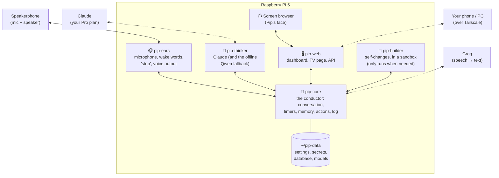
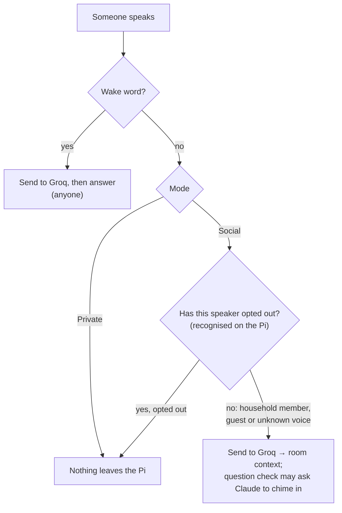

# Pip architecture

How Pip is built: the parts, how they talk, where data lives, and how new features plug in. Written so you can understand Pip from this page and its diagrams without reading code (D-71). **Status: approved by the owner on 2026-11-04 (D-78), with the D-77 privacy change.**

What Pip *does* is in [PIP-SPEC.md](PIP-SPEC.md). Requirement IDs (`PIP-NEW-nnn`) are in [REQUIREMENTS.md](REQUIREMENTS.md), and decisions (`D-nn`) in [DECISIONS.md](DECISIONS.md). Numbers marked *(M0)* were measured on this Pi; numbers marked *(est.)* are estimates to check while building.

---

## 1. Design goals

These come straight from the decisions and the M0 results:

1. **"Stop" and alarms are never blocked.** Anything slow (thinking, the internet, self-changes) runs separately from the parts that must react instantly (PIP-NEW-078).
2. **Easy to extend.** A new feature is a self-contained module with a small description file; most features need no changes anywhere else (PIP-NEW-092, D-71).
3. **Easy to understand.** Few parts, plain names, one place where every message is logged, and this document kept current (PIP-NEW-091).
4. **Swappable services.** Speech-to-text, voice, wake words and the AI brain each sit behind a simple interface (PIP-NEW-097, PIP-NEW-008).
5. **Fits the Pi.** Everyday work measured at 16% CPU and 1.5 GB *(M0)*. Every part has a memory cap, so nothing can freeze the Pi again.
6. **Private by default, publishable code.** Personal data lives only in `~/pip-data`. A fresh clone of the repo works without it (PIP-NEW-094, PIP-NEW-096).

## 2. The big picture

Pip is **five small programs** on the Pi, plus the screen's browser. Each runs as its own systemd service with its own memory cap, so one misbehaving part can't take down the others.



| Program | What it does | Why it's separate | Memory cap *(est.)* |
|---|---|---|---|
| **pip-ears** | Listens all the time: echo-cancelled audio from the speakerphone, speech detection, both wake words ("Pippletron", "Hey Pip"), the instant words ("stop", "wait"), mute detection, recognising who's speaking. Also plays everything Pip says (Piper voice) and alarm sounds, and turns Pip down when someone talks over him | Must react in milliseconds and never wait for the internet or the AI | 600 MB |
| **pip-core** | The conductor. Decides what to do with each thing heard; runs conversations, timers, reminders and alarms; holds memory, people and settings; runs actions; keeps the log of everything that happens; watches the other programs' health | Everything goes through one place, so it's easy to follow and log | 400 MB |
| **pip-thinker** | Talks to Claude through the Claude Code CLI (one fresh session per request, fixing Ziggletron's collision bug P-01). Runs the offline Qwen fallback when Claude is unavailable (loaded only when needed). Tracks Pro-plan usage | Slow and memory-hungry; must never hold up the conductor | 2.0 GB (Qwen needs ~1.3 GB while loaded) |
| **pip-web** | The dashboard (phone/PC over Tailscale with HTTPS) and the TV page for the face. Handles logins and roles, and sends each screen only what it's allowed to see | Keeps network-facing code away from the core and from secrets | 300 MB |
| **pip-builder** | Self-changes: writes and tests code changes in a sandbox (the systemd sandbox that passed in M0) and hands the result to you for approval | Untrusted code must be fenced off from your data | 2.0 GB, only while running |
| *Screen browser* | Chromium in kiosk mode, showing the TV page | Already how Ziggletron's face works | (existing) |

Total in everyday use (est.): about 1.5–2.5 GB plus the browser, comfortably inside 8 GB, and matching the 1.5 GB measured in M0.

## 3. How the programs talk

All messages go through **pip-core**, over local connections that never leave the Pi (Unix sockets, carrying small JSON messages). There are three kinds:

| Kind | Example | Direction |
|---|---|---|
| **Event:** something happened | `heard.wake {word: "pippletron", speaker: "Landen?"}` · `timer.done {id}` | Any program → core → anyone interested |
| **Command:** please do this | `ears.say {text}` · `ears.stop` · `screen.show {widget}` | Core → one program |
| **Request/reply:** ask and wait (with a timeout) | `thinker.ask {conversation, tools}` → reply streamed back sentence by sentence | Core ↔ one program |

Every message is written to the **decision trace** (48 hours; the *what*, not the words, D-34). That one log is how the dashboard shows "what's happening", how Pip explains "why didn't you answer me?" (PIP-NEW-066), and how problems get diagnosed.

## 4. A request, step by step

```mermaid
sequenceDiagram
    actor You
    participant Ears as pip-ears
    participant Core as pip-core
    participant Groq
    participant Think as pip-thinker
    You->>Ears: "Pippletron, set a timer for ten minutes"
    Ears->>Ears: wake word heard (on the Pi)
    Ears->>Core: heard.wake + audio of the sentence
    Core->>Groq: audio → text (with word list)
    Groq-->>Core: "Pippletron, set a timer for ten minutes"
    alt Simple command (works offline)
        Core->>Core: local command: create timer, check it exists
    else Anything else
        Core->>Think: ask Claude (conversation + allowed actions)
        Think-->>Core: reply + "create timer" action
        Core->>Core: run action, check it really happened
    end
    Core->>Ears: say "Timer's on, ten minutes."
    Ears-->>You: Piper voice
    Core->>Core: log to the trace; update screen and dashboard
```

**Time budget** for a typical answer (target ≤ 2.5 s to first word, AC):

| Step | Time |
|---|---|
| End of speech detected | ~0.5 s (adaptive pause) |
| Groq transcription | 0.45 s *(M0)* |
| Claude's first sentence | 1–2 s *(est., to measure in M1a)* |
| Piper starts speaking | 0.3 s *(M0)* |
| **Total** | **~2.3–3.3 s** (simple local commands: ~1.3 s) |

## 5. Why "stop" and alarms always work

- **"Stop", "wait", "go on"** are recognised **inside pip-ears**, which stops its own playback immediately (target ≤ 100 ms) and only then tells the core. No internet, no AI, no waiting.
- **Alarms** live in the core's scheduler, which never does slow work itself: thinking happens in pip-thinker, and network calls have short timeouts. When an alarm is due, the core tells pip-ears to ring, and pip-ears plays it even if the core then gets stuck. A missed heartbeat makes the watchdog restart the stuck program (PIP-NEW-079).
- **Timers and alarms survive restarts and power cuts**: they're saved in the database the moment they're created.

## 6. Listening and privacy: what leaves the Pi



**Owner decision D-77:** in Social mode, speech nobody addressed to Pip is sent to Groq for **everyone** (household members, guests and unknown voices), **except people who have opted out**, whose speech never leaves the Pi. Pip recognises the speaker on the Pi first (a fraction of a second) to check for opt-outs. Anyone can say "Pip, leave me out". For a guest, Pip remembers their voice **for that visit only**, just to keep leaving them out, then forgets it.

What else leaves the Pi:

| To | What | When |
|---|---|---|
| Groq | Audio of addressed requests, and (Social mode) room speech from everyone who hasn't opted out | As it happens |
| Claude | The text of the conversation, relevant memories, the allowed actions | Each answer or chime-in check |
| Open-Meteo | "Lincoln, Nebraska" | Weather updates |
| Google | Calendar events (M3, D-19) | Sync |
| GitHub | **Code only.** Never personal data (checked on every commit) | When changes are pushed |

## 7. Modules: how features plug in

Every feature is a **module**: a folder with a short description file and a little code. Pip finds modules automatically at startup. This is the main way Pip grows, whether the module is written by you, by Claude, or by Pip's own self-change.

### 7.1 Kinds of module

| Kind | What it adds | Examples |
|---|---|---|
| **Skill** | Things Pip can do or answer | timers, reminders, shopping list, weather, dice |
| **Widget** | A box on the TV screen | clock, timers, weather, now playing |
| **Provider** | A swappable service behind a standard interface | speech-to-text (Groq, local Whisper), voice (Piper, Kokoro), brain (Claude, Qwen), wake word |
| **Device adapter** | A kind of device (M3) | ESPHome over MQTT, Tuya (Eightree plugs) |
| **Plugin** | Anything else, owner-written, with declared permissions | — |

### 7.2 What a module looks like

```
pip/modules/dice/
├── module.toml      ← description: name, what it does, settings, permissions
├── dice.py          ← the code: small functions, one per thing it can do
└── test_dice.py     ← its test
```

```toml
# module.toml (the part you'd read or edit)
name = "dice"
kind = "skill"
summary = "Rolls dice and flips coins."
says_examples = ["Pippletron, roll a die", "flip a coin"]
offline = true                      # works without the internet
permissions = []                    # e.g. ["network"], ["devices.lights"]

[settings.sides]                    # shows up in Settings with this explanation
default = 6
explain = "How many sides a die has unless you say otherwise."
```

From that file, Pip automatically:
- adds the module to the **capability list** it uses to explain himself (PIP-NEW-064), so "what can you do?" stays accurate;
- puts its settings on the **Settings page** with their explanations (PIP-NEW-093);
- tells Claude what the module can do, and checks the **permissions** before running anything (FEAT-079).

A **template** module with a worked example will be in `pip/modules/_template/`. Adding a simple skill means copying it and filling in the marked parts.

### 7.3 Swapping a provider

Changing the voice from Piper to Kokoro (D-73), or speech-to-text from Groq to another service, is a setting: `voice.engine = "kokoro"`. A new service is one new provider module that implements the same few functions. Nothing else changes.

## 8. Where data lives

| Where | What | In the repo? |
|---|---|---|
| `~/pip` (repo) | All code, modules, default settings, generic wake-word models (synthetic voices only), docs | Yes (public-safe) |
| `~/pip-data/settings.toml` | Your settings (location, room, mode, voice…), written by the Settings page | **No** |
| `~/pip-data/secrets.toml` | API keys (only pip-core and pip-thinker can read it) | **No** |
| `~/pip-data/pip.db` | One SQLite database: memories, people and voice profiles, timers/reminders/calendar, lists, the audit trail, the 48-hour decision trace | **No** |
| `~/pip-data/models/` | Wake-word models trained on your voice, the Qwen model, voices | **No** |
| `~/pip-data/recordings/` | Your consented test recordings (kept, D-72) | **No** |

- **A fresh clone** starts with default settings and generic models, runs a first-time setup (API keys, location, room), and works without anyone's personal data (PIP-NEW-096).
- **SD-card friendly:** small batched writes and size-capped logs.
- **No conversation text** is stored except the short-lived conversation context in memory (D-53 feed is live-only).
- **Ziggletron's data** (memories into the inbox; reminders, calendar, TV layouts) is imported once, read-only, at switch-over (D-07).

## 9. Security

- **Dashboard:** reached only over Tailscale, with HTTPS from `tailscale serve`, the same way Ziggletron's is today. Viewing the feed needs no login (D-53); admin actions need a login with 2-factor (D-35, PIP-NEW-054).
- **Roles:** Admin, Member, Viewer. Voice alone is never enough for admin actions (PIP-NEW-027).
- **Secrets:** only pip-core and pip-thinker can read them; pip-web never sees them.
- **Self-changes:** pip-builder runs in the systemd sandbox (no access to your home folder, data or network beyond what's allowed; tested in M0). You approve the plan and then the actual change; it's installed alongside the current version and rolled back automatically if the health checks fail (PIP-NEW-069–076).
- **Prompt safety:** device names, web results and calendar text are treated as data, never as instructions.

## 10. Updates, restarts and recovery

- Each program is a **systemd service**: started at boot, restarted if it crashes, memory-capped.
- **Watchdog:** each program sends a heartbeat. A missed heartbeat means it's stuck, so it gets restarted and logged (PIP-NEW-079).
- **Versioned installs:** each update goes into its own folder (`~/pip-app/releases/<version>`), and a `current` link points at the running one. After an update, health checks run within 2 minutes; if they fail, the link goes back to the previous version automatically (PIP-NEW-080). The last 3 versions are kept.

## 11. Testing

- **Every module has its own tests.** They run before every commit and in pip-builder before any self-change is offered to you.
- **Replay tests:** conversations and audio clips are fed in without anyone speaking, for listening, interruptions and alarms. Tests that use your private recordings run only on the Pi and never go to GitHub.
- The **acceptance criteria** (`AC-*` in REQUIREMENTS) become automated tests as each feature is built.

## 12. Technology choices

| Choice | Why |
|---|---|
| **Python 3.13** (D-28) | Best support for audio and AI on the Pi; Ziggletron's language |
| **asyncio** in each program | Handles many things at once without threads getting tangled |
| **uv** for packages | Fast, reproducible; only releases ≥ 2 weeks old |
| **SQLite** database | One file, built into Python, safe on power loss (WAL mode); plenty for a household |
| **TOML** settings with validation | Readable by people; errors are caught with a clear message |
| **Unix sockets + JSON** between programs | Standard library only; easy to log and to read |
| **Starlette + Uvicorn** for pip-web | Small, well-known, supports live updates (WebSockets) |
| **sounddevice (PortAudio) via PipeWire** | Works with the speakerphone; Ziggletron uses it |
| **openWakeWord (ONNX)** | Trained "Pippletron" and "Hey Pip" detectors from M0 |
| **Piper** voice | 0.3 s to start speaking *(M0)*; Kokoro available as an alternative module |
| **Groq Whisper Turbo + word list** | Best in M0 (D-48); local Whisper as the offline fallback |
| **Claude Code CLI** (Pro plan) | D-05, D-17; one fresh session per request |
| **llama-cpp-python + Qwen 2.5 1.5B** | Offline fallback (D-75); built and tested in M0 |
| **systemd** services and sandbox | Already on the Pi; restarts, memory caps and the M0-tested sandbox |

## 13. Repository layout

```
pip/
├── pip/                      the application
│   ├── ears/                 pip-ears program
│   ├── core/                 pip-core program (conductor, scheduler, memory, trace)
│   ├── thinker/              pip-thinker program
│   ├── web/                  pip-web program (dashboard + TV page)
│   ├── builder/              pip-builder (self-change pipeline)
│   ├── common/               shared bits: messages, settings, database
│   └── modules/              skills, widgets, providers (+ _template/)
├── models/                   generic, public-safe models
├── deploy/                   systemd service files, install and update scripts
├── tests/                    cross-program and replay tests
├── docs/                     PIP-SPEC, ARCHITECTURE, DECISIONS, REQUIREMENTS, PROJECT-MAP
└── m0/                       measurement tools (kept for re-runs)
```

## 14. Building it: the M1a plan

Built in small steps. Each step ends with something you can try.

| Step | What you'll be able to do |
|---|---|
| 1. Skeleton: the five programs start, talk, log and show health on a new dashboard | See Pip's status and the decision trace |
| 2. Ears: speakerphone, wake words, "stop", Piper voice | Say "Pippletron" and hear a chime and a fixed reply |
| 3. Core + Groq + Claude: real answers | Ask questions and get spoken answers |
| 4. Timers, reminders, alarms (incl. offline) | Use Pip for timers like Ziggletron |
| 5. Memory (with approval inbox), people and voices | "Remember that…", recognised speakers |
| 6. Social mode: room context, question check, chime-ins | Pip joins in like Ziggletron, with the privacy rules above |
| 7. Screen: face, widgets, layouts | The face on the monitor |
| 8. Settings page, accounts, migration from Ziggletron | Switch Pip on side by side with Ziggletron |

Then **M1b** adds the safe self-change pipeline, and you switch over from Ziggletron.

## 15. Review

Approved 2026-11-04 (D-78). The one change requested is in §6 (D-77).
