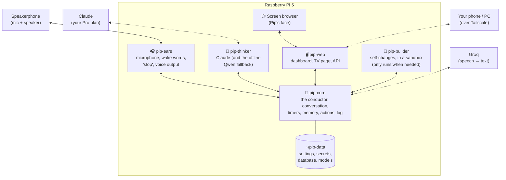
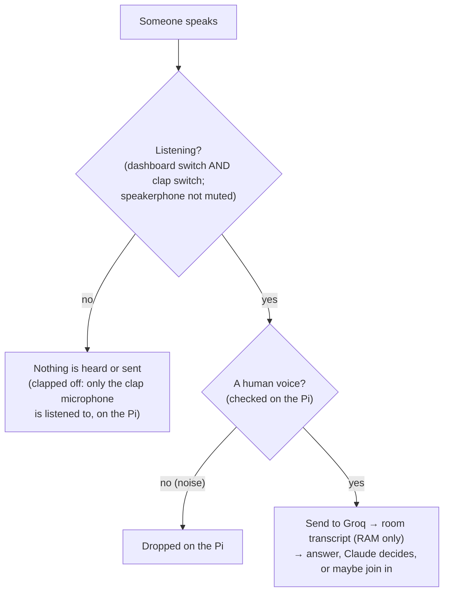
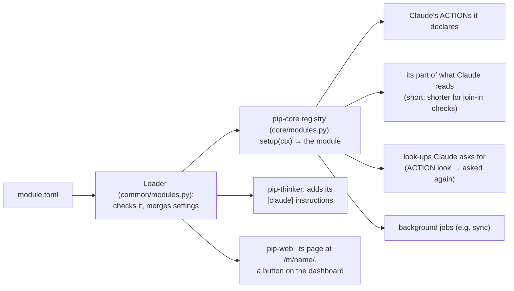

# Pip architecture

How Pip is built: the parts, how they talk, where data lives, and how new features plug in. Written so you can understand Pip from this page and its diagrams without reading code (D-71). **Status: approved by the owner on 2026-11-04 (D-78), with the D-77 privacy change.**

What Pip *does* is in [PIP-SPEC.md](PIP-SPEC.md). Requirement IDs (`PIP-NEW-nnn`) are in [REQUIREMENTS.md](REQUIREMENTS.md), and decisions (`D-nn`) in [DECISIONS.md](DECISIONS.md). Numbers marked *(M0)* were measured on this Pi; numbers marked *(est.)* are estimates to check while building.

---

## 1. Design goals

These come straight from the decisions and the M0 results:

1. **"Stop" and alarms are never blocked.** Anything slow (thinking, the internet, self-changes) runs separately from the parts that must react instantly (PIP-NEW-078).
2. **Easy to extend.** A new feature is a self-contained module with a small description file; most features need no changes anywhere else (PIP-NEW-092, D-71).
3. **Easy to understand.** Few parts, plain names, one place where every message is logged, and this document kept current (PIP-NEW-091).
4. **Swappable services.** Speech-to-text, voice, wake words and the AI brain each sit behind a simple interface (PIP-NEW-097, PIP-NEW-008).
5. **Fits the Pi.** Everyday work measured at 16% CPU and 1.5 GB *(M0)*. Every part has a memory cap, so nothing can freeze the Pi again.
6. **Private by default, publishable code.** Personal data lives only in `~/pip-data`. A fresh clone of the repo works without it (PIP-NEW-094, PIP-NEW-096).

## 2. The big picture

Pip is **five small programs** on the Pi, plus the screen's browser. Each runs as its own systemd service with its own memory cap, so one misbehaving part can't take down the others.



| Program | What it does | Why it's separate | Memory cap *(est.)* |
|---|---|---|---|
| **pip-ears** | Listens all the time: echo-cancelled audio from the speakerphone, speech detection, both wake words ("Pippletron", "Hey Pip"), talking over Pip (stops him instantly), mute detection; and a second plain USB microphone used only for the two-clap switch (D-91). Also plays everything Pip says (Piper voice) and alarm sounds, and turns Pip down when someone talks over him | Must react in milliseconds and never wait for the internet or the AI | 600 MB |
| **pip-core** | The conductor. Decides what to do with each thing heard; runs conversations, timers, reminders and alarms; holds memory, people and settings; runs actions; keeps the log of everything that happens; watches the other programs' health; recognises voices (TitaNet, step 5) | Everything goes through one place, so it's easy to follow and log | 700 MB (was 400; voice model + offline Whisper, D-87) |
| **pip-thinker** | Talks to Claude through the Claude Code CLI (one fresh session per request, fixing Ziggletron's collision bug P-01). Runs the offline Qwen fallback when Claude is unavailable (loaded only when needed). Tracks Pro-plan usage | Slow and memory-hungry; must never hold up the conductor | 2.0 GB (Qwen needs ~1.3 GB while loaded) |
| **pip-web** | The dashboard (phone/PC over Tailscale with HTTPS) and the TV page for the face. Handles logins and roles, and sends each screen only what it's allowed to see | Keeps network-facing code away from the core and from secrets | 300 MB |
| **pip-builder** | Self-changes: writes and tests code changes in a sandbox (the systemd sandbox that passed in M0) and hands the result to you for approval | Untrusted code must be fenced off from your data | 2.0 GB, only while running |
| *Screen browser* | Chromium in kiosk mode on the monitor (system service `pip-tv`, `deploy/tv/`), showing the TV page `/tv` from pip-web's local address | How Ziggletron's face worked; Pip's replaces it (D-110) | (existing) |

Total in everyday use (est.): about 1.5–2.5 GB plus the browser, comfortably inside 8 GB, and matching the 1.5 GB measured in M0.

## 3. How the programs talk

All messages go through **pip-core**, over local connections that never leave the Pi (Unix sockets, carrying JSON messages, one per line; each end reads lines up to 8 MB, so a big reply such as a busy month of calendar can't cut a program off). There are three kinds:

| Kind | Example | Direction |
|---|---|---|
| **Event:** something happened | `heard.wake {word: "pippletron", speaker: "Landen?"}` · `timer.done {id}` | Any program → core → anyone interested |
| **Command:** please do this | `ears.say {text}` · `ears.stop` · `screen.show {widget}` | Core → one program |
| **Request/reply:** ask and wait (with a timeout) | `thinker.ask {conversation, tools}` → reply streamed back sentence by sentence | Core ↔ one program |

Every message is written to the **decision trace** (48 hours; the *what*, not the words, D-34). That one log is how the dashboard shows "what's happening", how Pip explains "why didn't you answer me?" (PIP-NEW-066), and how problems get diagnosed.

## 4. A request, step by step

```mermaid
sequenceDiagram
    actor You
    participant Ears as pip-ears
    participant Core as pip-core
    participant Groq
    participant Think as pip-thinker
    You->>Ears: "Pippletron, throw ten minutes on for the laundry"
    Ears->>Ears: wake word heard (on the Pi)
    Ears->>Core: heard.wake + audio of the sentence
    Core->>Core: voice check; who's speaking (on the Pi)
    Core->>Groq: audio → text (word list + household names)
    Groq-->>Core: "Pippletron, throw ten minutes on for the laundry"
    Core->>Core: add to the room transcript
    alt Online (any wording, D-94)
        Core->>Think: ask Claude (room transcript, what's set, memories)
        Think-->>Core: ACTION add timer · laundry · 600 s
        Core->>Core: check it, create the timer, check it really happened
    else Offline (D-83)
        Core->>Core: Pip's own simple phrasings: create timer
    end
    Core->>Ears: say "Laundry timer's on, 10 minutes."
    Ears-->>You: Piper voice
    Core->>Core: log to the trace; update screen and dashboard
```

**Time budget** for a typical answer (target ≤ 2.5 s to first word, AC):

| Step | Time |
|---|---|
| End of speech detected | ~0.5 s (adaptive pause) |
| Groq transcription | 0.45 s *(M0)* |
| Claude's first sentence | 1–2 s *(est., to measure in M1a)* |
| Piper starts speaking | 0.3 s *(M0)* |
| **Total** | **~2.3–3.3 s** (timers etc. go through Claude too since D-94; offline commands: ~2.5 s with Whisper on the Pi) |

## 5. Why "stop" and alarms always work

- **Talking over Pip stops him inside pip-ears**, immediately (about a quarter of a second of speech), before anything is understood: no internet, no AI, no waiting. Then what you said is understood: "stop", "shut up", "never mind" get silence and he goes back to idle (D-105); anything else is answered. While an alarm rings, "stop" and "snooze" work instantly on the Pi (D-94).
- **Alarms** live in the core's scheduler, which never does slow work itself: thinking happens in pip-thinker, and network calls have short timeouts. When an alarm is due, the core tells pip-ears to ring, and pip-ears plays it even if the core then gets stuck. A missed heartbeat makes the watchdog restart the stuck program (PIP-NEW-079).
- **Timers and alarms survive restarts and power cuts**: they're saved in the database the moment they're created.

## 6. Listening and privacy: what leaves the Pi



**Owner decisions D-90 to D-92 (2026-11-07):** like Ziggletron, while Pip is listening **everything said in the room is sent to Groq** and kept in a short in-memory transcript that Claude sees. There are no per-person opt-outs (D-77's "leave me out" was removed); the privacy control is **switching listening off**: the dashboard's Listening switch or two claps (separate switches; claps can't undo the dashboard), or the speakerphone's mute button.

What else leaves the Pi:

| To | What | When |
|---|---|---|
| Groq | Audio of everything said in the room while Pip is listening, plus the household's first names as spelling hints | As it happens |
| Claude | The room transcript (last 40 lines), memories, what's set, the calendar's today and tomorrow plus counts for the week (the rest only when Claude looks it up, D-102) and open to-dos (only what the speaker may hear; never private events or ignored calendars), the allowed actions. Join-in checks get only the rest of today | Each answer, mention or join-in check (at most every ~40 s) |
| Open-Meteo | "Lincoln, Nebraska" | Weather updates |
| Google | For each person who connected their account (D-97): their calendar events and to-dos, both ways (D-98, D-100). Private events are kept on the Pi too but never told to Claude | Every ~2 min, and straight after a change |
| GitHub | **Code only.** Never personal data (checked on every commit) | When changes are pushed |

## 7. Modules: how features plug in

Every new feature is a **module**: a folder with a short description file and a little code. Pip finds modules automatically at startup (D-96, built 2026-11-07). This is the main way Pip grows, whether the module is written by you, by Claude, or by Pip's own self-change. Today: **google** (accounts), **calendar** and **todos**. (The older built-in parts, like timers and memory, live in pip-core.)

### 7.1 Kinds of module

| Kind | What it adds | Examples |
|---|---|---|
| **Skill** | Things Pip can do or answer | calendar, to-dos, (later) shopping list, dice |
| **Widget** | A box on the TV screen | clock, timers, weather, now playing |
| **Provider** | A service other modules use, behind a standard interface | Google accounts; (later) speech-to-text, voices, brains |
| **Device adapter** | A kind of device (M3) | ESPHome over MQTT, Tuya (Eightree plugs) |
| **Plugin** | Anything else, owner-written, with declared permissions | — |

### 7.2 What a module looks like

```
pip_assistant/modules/calendar/
├── module.toml      ← description: name, kind, what it does, permissions, settings, what Claude is told, its page
├── module.py        ← setup(ctx): the code, in small parts (below)
├── store.py, sync.py← more code if it needs it
├── static/          ← its dashboard page (served at /m/calendar/)
└── test_calendar.py ← its tests (run with all the others)
```

```toml
# module.toml (the part you'd read or edit)
name = "calendar"
kind = "skill"
summary = "The calendar: events by voice or on the dashboard, synced both ways with Google Calendar."
says_examples = ["Pip, put the dentist on Friday at 3"]
offline = true                      # works without the internet
permissions = ["network:googleapis.com"]   # the only internet it may reach
needs = ["google"]                  # other modules it uses

[settings.sync_minutes]             # shows up in Settings with this explanation
default = 2.0
explain = "How often Pip checks Google for calendar changes."

[claude]                            # added to what Claude is told
instructions = "Calendar events: … ACTION {\"do\": \"add\", \"kind\": \"event\", …}"

[dashboard]                         # a button on the main dashboard
page = "index.html"
label = "Calendar"
```

How it plugs in:



What a module gets (its **context**), and nothing more: its settings (`[modules.<name>]` in `~/pip-data/settings.toml` overrides the defaults; `enabled = false` switches it off); **its own tables** in `pip.db`, named `<name>_…` (writing anything else is refused); **its own section of `secrets.toml`**; an internet client limited to the hosts in its permissions; the timers schedule (for heads-ups), the people list, whether Pip is online, and the modules it `needs`. Its requests from the dashboard and its events travel privately (never logged).

**Keep what Claude reads short** (D-102): it goes with every request, including join-in checks every ~40 s. A module's summary is told whether it's for a join-in check (`call.kind == "join"`) and should send even less then. Anything bigger is a **look-up**: the module declares an action `look:<kind>`, Claude replies `ACTION {"do": "look", "kind": …}`, Pip fetches it and asks Claude again with the result (once). An action that has to wait for the internet (e.g. making a Google calendar) may be `async`. A module that adds columns to its own tables later uses `ALTER TABLE` on its own tables (allowed); test it against an old database too.

A **template** module with a worked example is in `pip_assistant/modules/_template/`. Adding a simple skill means copying it and filling in the marked parts.

### 7.3 Swapping a provider

Changing the voice from Piper to Kokoro (D-73), or speech-to-text from Groq to another service, is a setting: `voice.engine = "kokoro"`. A new service is one new provider module that implements the same few functions. Nothing else changes.

## 8. Where data lives

| Where | What | In the repo? |
|---|---|---|
| `~/pip` (repo) | All code, modules, default settings, generic wake-word models (synthetic voices only), docs | Yes (public-safe) |
| `~/pip-data/settings.toml` | Your settings (location, room, mode, voice…), written by the Settings page | **No** |
| `~/pip-data/secrets.toml` | API keys, and each module's own section (e.g. `[google]`: the Google client and each connected person's sign-in key). Only pip-core and pip-thinker read it; a module only ever sees its own section | **No** |
| `~/pip-data/pip.db` | One SQLite database: memories, people and voice profiles, timers/reminders, the 48-hour decision trace, and each module's own tables (`calendar_…`, `todos_…`, `google_…`) | **No** |
| `~/pip-data/models/` | Wake-word models trained on your voice, the Qwen model, voices | **No** |
| `~/pip-data/recordings/` | Your consented test recordings (kept, D-72) | **No** |

- **A fresh clone** starts with default settings and generic models, runs a first-time setup (API keys, location, room), and works without anyone's personal data (PIP-NEW-096).
- **SD-card friendly:** small batched writes and size-capped logs.
- **No conversation text** is stored except the short-lived conversation context in memory (D-53 feed is live-only).
- **Ziggletron's data** (memories into the inbox; reminders, calendar, TV layouts) is imported once, read-only, at switch-over (D-07).

## 9. Security

- **Dashboard:** reached only over Tailscale, with HTTPS from `tailscale serve`, the same way Ziggletron's is today. Viewing the feed needs no login (D-53); admin actions need a login with 2-factor (D-35, PIP-NEW-054).
- **Roles:** Admin, Member, Viewer. Voice alone is never enough for admin actions (PIP-NEW-027).
- **Secrets:** only pip-core and pip-thinker can read them; pip-web never sees them.
- **Self-changes:** pip-builder runs in the systemd sandbox (no access to your home folder, data or network beyond what's allowed; tested in M0). You approve the plan and then the actual change; it's installed alongside the current version and rolled back automatically if the health checks fail (PIP-NEW-069–076).
- **Prompt safety:** device names, web results and calendar text are treated as data, never as instructions.

## 10. Updates, restarts and recovery

- Each program is a **systemd service**: started at boot, restarted if it crashes, memory-capped.
- **Watchdog:** each program sends a heartbeat. A missed heartbeat means it's stuck, so it gets restarted and logged (PIP-NEW-079).
- **Versioned installs:** each update goes into its own folder (`~/pip-app/releases/<version>`), and a `current` link points at the running one. After an update, health checks run within 2 minutes; if they fail, the link goes back to the previous version automatically (PIP-NEW-080). The last 3 versions are kept.

## 11. Testing

- **Every module has its own tests.** They run before every commit and in pip-builder before any self-change is offered to you.
- **Replay tests:** conversations and audio clips are fed in without anyone speaking, for listening, interruptions and alarms. Tests that use your private recordings run only on the Pi and never go to GitHub.
- The **acceptance criteria** (`AC-*` in REQUIREMENTS) become automated tests as each feature is built.

## 12. Technology choices

| Choice | Why |
|---|---|
| **Python 3.13** (D-28) | Best support for audio and AI on the Pi; Ziggletron's language |
| **asyncio** in each program | Handles many things at once without threads getting tangled |
| **uv** for packages | Fast, reproducible; only releases ≥ 2 weeks old |
| **SQLite** database | One file, built into Python, safe on power loss (WAL mode); plenty for a household |
| **TOML** settings with validation | Readable by people; errors are caught with a clear message |
| **Unix sockets + JSON** between programs | Standard library only; easy to log and to read |
| **Starlette + Uvicorn** for pip-web | Small, well-known, supports live updates (WebSockets) |
| **PipeWire's `pw-record` / `pw-play`** | Simple, proven with the speakerphone in M0; stopping playback is instant |
| **openWakeWord (ONNX)** | Trained "Pippletron" and "Hey Pip" detectors from M0 |
| **Piper** voice | 0.3 s to start speaking *(M0)*; Kokoro available as an alternative module |
| **Groq Whisper Turbo + word list** | Best in M0 (D-48); local Whisper as the offline fallback |
| **Claude Code CLI** (Pro plan) | D-05, D-17; one fresh session per request |
| **llama-cpp-python + Qwen 2.5 1.5B** | Offline fallback (D-75); built and tested in M0 |
| **systemd** services and sandbox | Already on the Pi; restarts, memory caps and the M0-tested sandbox |

## 13. Repository layout

```
pip/                          (the repo)
├── pip_assistant/            the application (not "pip/": that name belongs to Python's installer)
│   ├── ears/                 pip-ears program
│   ├── core/                 pip-core program (conductor, scheduler, memory, trace)
│   ├── thinker/              pip-thinker program
│   ├── web/                  pip-web program (dashboard + TV page)
│   ├── builder/              pip-builder (self-change pipeline)
│   ├── common/               shared bits: messages, settings, database
│   └── modules/              plug-in features: google, calendar, todos (+ _template/)
├── models/                   generic, public-safe models
├── deploy/                   systemd service files (deploy/systemd/) and install.sh
├── tests/                    cross-program and replay tests
├── docs/                     PIP-SPEC, ARCHITECTURE, DECISIONS, REQUIREMENTS, PROJECT-MAP
└── m0/                       measurement tools (kept for re-runs)
```

## 14. Building it: the M1a plan

Built in small steps. Each step ends with something you can try.

| Step | What you'll be able to do |
|---|---|
| 1. Skeleton: the programs start, talk, log and show health on a new dashboard. **Done 2026-11-04** (pip-builder waits for M1b) | See Pip's status and the decision trace at `http://100.118.171.118:8790` |
| 2. Ears: speakerphone, wake words, "stop", Piper voice. **Done 2026-11-04.** Talking over Pip stops him (the speakerphone removes his own voice). Pippletron needs strictness 0.8 because "Ziggletron" sounds similar | Say "Pippletron" and hear a chime and a fixed reply |
| 3. Core + Groq + Claude: real answers. **Done 2026-11-04.** First words ~2 s after you stop (Groq 0.4 s, pre-started Claude 1.25 s). Weather from Open-Meteo; web search only when needed ("Let me look that up"). After the owner's test: short roommate answers (D-79), name spotted in transcripts too, sonnet at low effort, "One sec." after 3 s (D-80); 0.7 s waits, listens quietly after just the name, joins a paused sentence, two-sentence cap (D-81) | Ask questions and get spoken answers |
| 4. Timers, reminders, alarms (incl. offline). **Built 2026-11-04; fixed after your test 2026-11-05** (change anything in any wording, Claude fills in what the rules miss, and since D-94 handles everything online (D-84); no phantom "Thank you" (D-85); thinking tone and Pip's state (D-86); refreshed dashboard). Pip's own commands (timers, alarms, reminders, voice calendar, "what time is it", "stop") are understood on the Pi without Claude; everything is saved instantly and survives restarts; alarms ring until answered ("okay", "stop", "I'm up", his name, "snooze ten minutes") or shut off on the dashboard. Offline, Whisper on the Pi hears commands (D-83). Not yet: "earned" alarms (need Claude to judge, later in M1a), reminders for one person (need voice recognition, step 5), ringtone settings page (step 8) | Use Pip for timers like Ziggletron |
| 5. Memory (with approval inbox), people and voices. **Built 2026-11-05, installed.** "Remember / forget" worded by Claude and checked by Pip; sensitive or about-someone-else items wait in the inbox (D-88); Memory Center on the dashboard; people list; voices recognised on the Pi with TitaNet (sure / probably / someone, D-87); learn a voice by saying "Pip, I'm …" and reading five sentences, or from M0 recordings; visitors remembered for the visit only (D-89) | "Remember that…", recognised speakers |
| 6. Social mode: room transcript, answer/mention/join-in like Ziggletron, mic switch with claps, names spelled right; everything in natural language (Pip's own phrasings only offline); small offline indicator. **Built 2026-11-07; installed and tested by the owner 2026-11-08.** (D-90–D-95) | Pip follows the room conversation and joins in like Ziggletron |
| 6b. Modules (D-96) with Google accounts per person, Google Calendar both ways, to-dos with Google Tasks, and a calendar page. **Built 2026-11-07; installed and tested 2026-11-08** (D-96–D-101) | See and change everyone's calendar and to-dos by voice or on the dashboard |
| 6c. After the owner's tests (2026-11-07/08): a short calendar summary with look-ups (D-102), managing calendars (D-103), ignored calendars (D-104), quiet means quiet and a chime switch (D-105), waiting until you're done (D-106), approving your own memory by voice (D-107), a full conversation feed and coloured state circle (D-108), per-account Google settings with heads-up rules (D-109), claps on their own mic, tuned (D-91). **Installed** | Everything above, as you use it |
| 7. Screen: face, widgets, layouts. **First part built 2026-11-08 (D-110):** Ziggletron's face brought over with Pip's states and colours and a voice-driven mouth; clock, weather, timers, next events and captions in a fixed layout; the TV's own narrow feed; Pip's kiosk (`pip-tv`) replaces Ziggletron's. Still to come: layouts by voice | The face on the monitor |
| 8. Settings page, accounts, migration from Ziggletron | Switch Pip on side by side with Ziggletron |

Then **M1b** adds the safe self-change pipeline, and you switch over from Ziggletron.

## 15. Review

Approved 2026-11-04 (D-78). The one change requested then is in §6 (D-77, since replaced by D-90).
