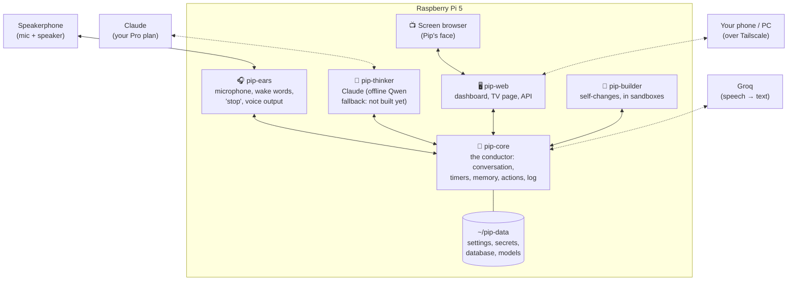
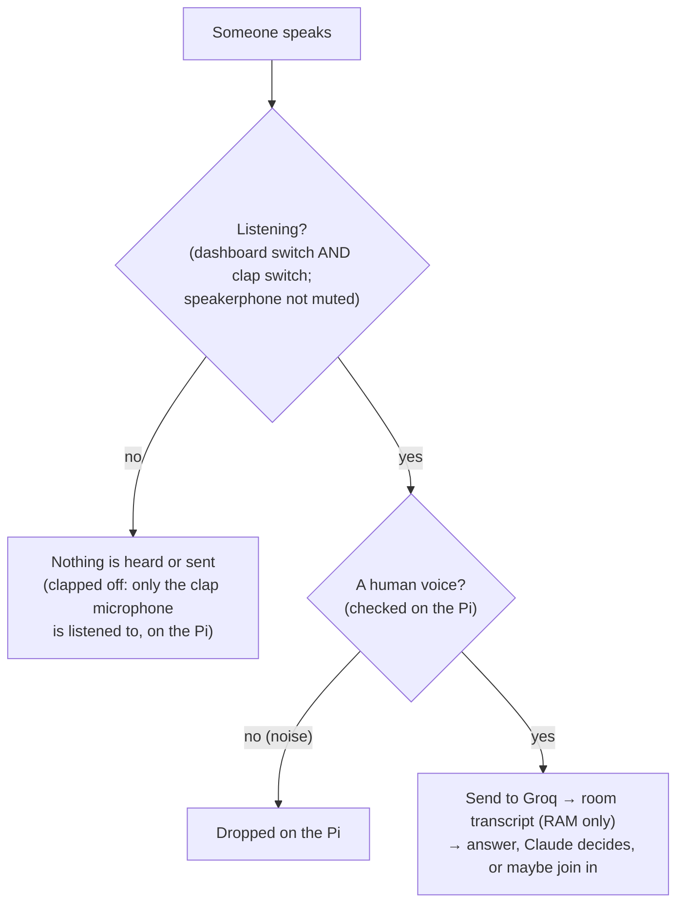
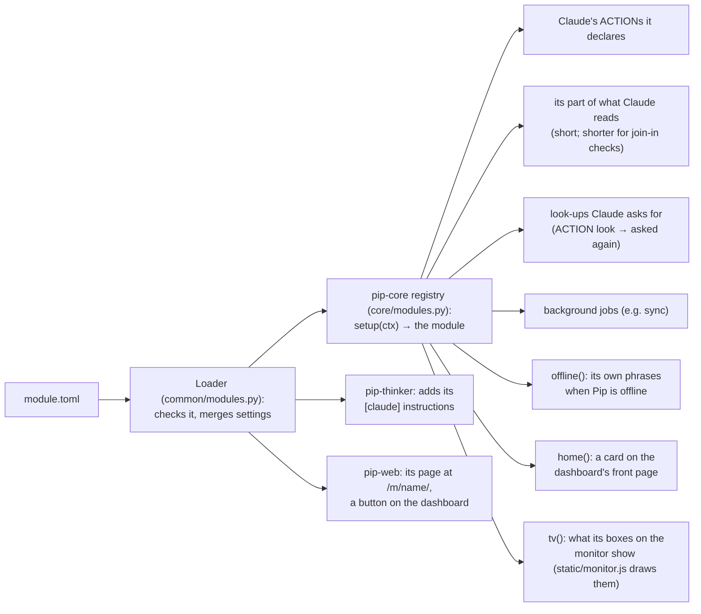
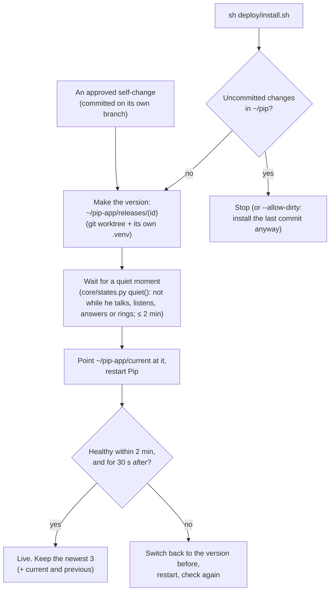

# Pip architecture

How Pip is built: the parts, how they talk, where data lives, and how new features plug in. Written so you can understand Pip from this page and its diagrams without reading code (D-71). **Status: approved by the owner on 2026-11-04 (D-78), with the D-77 privacy change.**

What Pip *does* is in [PIP-SPEC.md](PIP-SPEC.md). Requirement IDs (`PIP-NEW-nnn`) are in [REQUIREMENTS.md](REQUIREMENTS.md), and decisions (`D-nn`) in [DECISIONS.md](DECISIONS.md). Numbers marked *(M0)* were measured on this Pi; numbers marked *(est.)* are estimates to check while building.

---

## 1. Design goals

These come straight from the decisions and the M0 results:

1. **"Stop" and alarms are never blocked.** Anything slow (thinking, the internet, self-changes) runs separately from the parts that must react instantly (PIP-NEW-078).
2. **Easy to extend.** A new feature is a self-contained module with a small description file; most features need no changes anywhere else (PIP-NEW-092, D-71).
3. **Easy to understand.** Few parts, plain names, one place where every message is logged, and this document kept current (PIP-NEW-091).
4. **Swappable services.** Speech-to-text, voice, wake words and the AI brain each sit behind a simple interface (PIP-NEW-097, PIP-NEW-008).
5. **Fits the Pi.** Everyday work measured at 16% CPU and 1.5 GB *(M0)*. Every part has a memory cap, so nothing can freeze the Pi again.
6. **Private by default, publishable code.** Personal data lives only in `~/pip-data`. A fresh clone of the repo works without it (PIP-NEW-094, PIP-NEW-096).

## 2. The big picture

Pip is **five small programs** on the Pi, plus the screen's browser. All five are built (pip-builder in M1b, 2026-11-09). Each runs as its own systemd service with its own memory cap, so one misbehaving part can't take down the others.



| Program | What it does | Why it's separate | Memory cap *(est.)* |
|---|---|---|---|
| **pip-ears** | Listens all the time: echo-cancelled audio from the speakerphone, speech detection, both wake words ("Pippletron", "Hey Pip"), talking over Pip (stops him instantly), mute detection; and a second plain USB microphone used only for the two-clap switch (D-91). Also plays everything Pip says (Piper voice) and alarm sounds, and turns Pip down when someone talks over him | Must react in milliseconds and never wait for the internet or the AI | 600 MB |
| **pip-core** | The conductor. Decides what to do with each thing heard; runs conversations, timers, reminders and alarms; holds memory, people and settings; runs actions; keeps the log of everything that happens; watches the other programs' health; recognises voices (TitaNet, step 5) | Everything goes through one place, so it's easy to follow and log | 700 MB (was 400; voice model + offline Whisper, D-87) |
| **pip-thinker** | Talks to Claude through the Claude Code CLI (one fresh session per request, fixing Ziggletron's collision bug P-01). Counts every Claude request in the usage meter (`common/usage.py`, PIP-NEW-089) and announces when Claude's usage limit is reached. *Not built yet:* the offline Qwen fallback when Claude is unavailable (planned for M2, D-75) | Slow and memory-hungry; must never hold up the conductor | 2.0 GB (Qwen needs ~1.3 GB while loaded) |
| **pip-web** | The dashboard (phone/PC over Tailscale) and the TV page for the face, which gets only what it shows (D-110). Plain http on the Tailscale address, https at the Pi's Tailscale name (`tailscale serve`), and 127.0.0.1 for the monitor. No logins (D-116); a same-site check (`web/security.py`) stops other websites from changing Pip | Keeps network-facing code away from the core and from secrets | 300 MB |
| **pip-builder** | Self-changes (D-118): keeps the record of each change, runs Claude Code in a sandbox to plan and build it, checks it, and puts it live through a versioned install once you've approved it twice on the Changes page (§9) | Untrusted code must be fenced off from your data | 300 MB for the program; each sandbox job 2 GB, only while running |
| *Screen browser* | Chromium in kiosk mode on the monitor (system service `pip-tv`, `deploy/tv/`), showing the TV page `/tv` from pip-web's local address | How Ziggletron's face worked; Pip's replaces it (D-110) | (existing) |

Total in everyday use (est.): about 1.5–2.5 GB plus the browser, comfortably inside 8 GB, and matching the 1.5 GB measured in M0.

## 3. How the programs talk

All messages go through **pip-core**, over local connections that never leave the Pi (Unix sockets, carrying JSON messages, one per line; each end reads lines up to 8 MB, so a big reply such as a busy month of calendar can't cut a program off). There are three kinds:

| Kind | Example | Direction |
|---|---|---|
| **Event:** something happened | `heard.wake {word: "pippletron"}` · `alert.ringing {id}` · `module.screen.changed` | Any program → core → anyone interested |
| **Command:** please do this | `ears.say {text}` · `ears.stop` · `ears.ring` | Core → one program |
| **Request/reply:** ask and wait (with a timeout) | `thinker.ask {conversation, tools}` → reply streamed back sentence by sentence | Core ↔ one program |

Every message is written to the **decision trace** (48 hours; the *what*, not the words, D-34). That one log is how the dashboard shows "what's happening", how Pip explains "why didn't you answer me?" (PIP-NEW-066), and how problems get diagnosed.

## 4. A request, step by step

```mermaid
sequenceDiagram
    actor You
    participant Ears as pip-ears
    participant Core as pip-core
    participant Groq
    participant Think as pip-thinker
    You->>Ears: "Pippletron, throw ten minutes on for the laundry"
    Ears->>Ears: wake word heard (on the Pi)
    Ears->>Core: heard.wake + audio of the sentence
    Core->>Core: voice check; who's speaking (on the Pi)
    Core->>Groq: audio → text (word list + household names)
    Groq-->>Core: "Pippletron, throw ten minutes on for the laundry"
    Core->>Core: add to the room transcript
    alt Online (any wording, D-94)
        Core->>Think: ask Claude (room transcript, what's set, memories)
        Think-->>Core: ACTION add timer · laundry · 600 s
        Core->>Core: check it, create the timer, check it really happened
    else Offline (D-83)
        Core->>Core: Pip's own simple phrasings: create timer
    end
    Core->>Ears: say "Laundry timer's on, 10 minutes."
    Ears-->>You: Piper voice
    Core->>Core: log to the trace; update screen and dashboard
```

**Time budget** for a typical answer (target ≤ 2.5 s to first word, AC):

| Step | Time |
|---|---|
| End of speech detected | ~0.5 s (adaptive pause) |
| Groq transcription | 0.45 s *(M0)* |
| Claude's first sentence | 1–2 s *(est., to measure in M1a)* |
| Piper starts speaking | 0.3 s *(M0)* |
| **Total** | **~2.3–3.3 s** (timers etc. go through Claude too since D-94; offline commands: ~2.5 s with Whisper on the Pi) |

## 5. Why "stop" and alarms always work

- **Talking over Pip stops him inside pip-ears**, immediately (about a quarter of a second of speech), before anything is understood: no internet, no AI, no waiting. Then what you said is understood: "stop", "shut up", "never mind" get silence and he goes back to idle (D-105); anything else is answered. While an alarm rings, "stop" and "snooze" work instantly on the Pi (D-94).
- **Alarms** live in the core's scheduler, which never does slow work itself: thinking happens in pip-thinker, and network calls have short timeouts. When an alarm is due, the core tells pip-ears to ring, and pip-ears plays it even if the core then gets stuck. A missed heartbeat makes the watchdog restart the stuck program (PIP-NEW-079).
- **Timers and alarms survive restarts and power cuts**: they're saved in the database the moment they're created.

## 6. Listening and privacy: what leaves the Pi



**Owner decisions D-90 to D-92 (2026-11-07):** like Ziggletron, while Pip is listening **everything said in the room is sent to Groq** and kept in a short in-memory transcript that Claude sees. There are no per-person opt-outs (D-77's "leave me out" was removed); the privacy control is **switching listening off**: the dashboard's Listening switch or two claps (separate switches; claps can't undo the dashboard), or the speakerphone's mute button.

What else leaves the Pi:

| To | What | When |
|---|---|---|
| Groq | Audio of everything said in the room while Pip is listening, plus the household's first names as spelling hints | As it happens |
| Claude | The room transcript (last 40 lines), memories, what's set, the calendar's today and tomorrow plus counts for the week (the rest only when Claude looks it up, D-102) and open to-dos (only what the speaker may hear; never private events or ignored calendars), the allowed actions. Join-in checks get only the rest of today | Each answer, mention or join-in check (at most every ~40 s) |
| Open-Meteo | "Lincoln, Nebraska" | Weather updates |
| Google | For each person who connected their account (D-97): their calendar events and to-dos, both ways (D-98, D-100). Private events are kept on the Pi too but never told to Claude | Every ~2 min, and straight after a change |
| Claude (self-changes) | The request, Pip's code (the workspace copy) and the plan; never `~/pip-data` | When a change is planned or built (D-118) |
| GitHub | **Code only.** Never personal data (checked on every commit). Pip never pushes; the owner does (D-118) | When changes are pushed |

## 7. Modules: how features plug in

Every new feature is a **module**: a folder with a short description file and a little code. Pip finds modules automatically at startup (D-96, built 2026-11-07). This is the main way Pip grows, whether the module is written by you, by Claude, or by Pip's own self-change. Today: **google** (accounts), **calendar**, **todos** and **screen** (what's on the monitor, D-111). (The older built-in parts, like timers and memory, live in pip-core.)

### 7.1 Kinds of module

| Kind | What it adds | Examples |
|---|---|---|
| **Skill** | Things Pip can do or answer | calendar, to-dos, (later) shopping list, dice |
| **Widget** | A box on the TV screen | clock, timers, weather, now playing |
| **Provider** | A service other modules use, behind a standard interface | Google accounts; (later) speech-to-text, voices, brains |
| **Device adapter** | A kind of device (M3) | ESPHome over MQTT, Tuya (Eightree plugs) |
| **Plugin** | Anything else, owner-written, with declared permissions | — |

### 7.2 What a module looks like

```
pip_assistant/modules/calendar/
├── module.toml      ← description: name, kind, what it does, permissions, settings, what Claude is told, its page,
│                      the kinds of box it adds to the monitor
├── module.py        ← setup(ctx): the code, in small parts (below)
├── store.py, sync.py← more code if it needs it (the calendar also has visibility.py, actions.py, dashboard.py,
│                      offline.py, and api.py: what other modules may use)
├── static/          ← its dashboard page (served at /m/calendar/); monitor.js draws its box on the monitor;
│                      account.js is its part of a Google account's page
└── test_calendar.py ← its tests (run with all the others)
```

```toml
# module.toml (the part you'd read or edit)
name = "calendar"
kind = "skill"
summary = "The calendar: events by voice or on the dashboard, synced both ways with Google Calendar."
says_examples = ["Pip, put the dentist on Friday at 3"]
offline = true                      # works without the internet
permissions = ["network:googleapis.com"]   # the only internet it may reach
needs = ["google"]                  # other modules it uses

[settings.sync_minutes]             # shows up in Settings with this explanation
default = 2.0
explain = "How often Pip checks Google for calendar changes."

[claude]                            # added to what Claude is told
instructions = "Calendar events: … ACTION {\"do\": \"add\", \"kind\": \"event\", …}"

[monitor.calendar]                  # a kind of box it adds to the monitor ("put the calendar up")
label = "Calendar"
size = [4, 3]
once = true
aliases = ["events", "coming up", "schedule"]

[dashboard]                         # a button on the main dashboard
page = "index.html"
label = "Calendar"
account_panel = "account.js"        # its part of a Google account's settings page
```

How it plugs in:



**Pip's programs never name a module** (structure review phase 4, 2026-11-10). pip-core, pip-web, the dashboard and the monitor ask *every* module through the hooks in `core/modules.py`, so a module can be added, changed or switched off without touching them:

| Hook | What it adds | The calendar's, for example |
|---|---|---|
| `actions` | ACTION verbs Claude may use (checked first, then done) | add, change, cancel an event; look further ahead |
| `summary(call)` | its part of what Claude reads with each request | today, tomorrow, the calendars' names |
| `offline()` | its own phrases for when Pip is offline, and items the shared "move it", "cancel that" rules can change (`OfflineItems`) | "put the dentist on the calendar Friday at 3" (`offline.py`) |
| `home()` | a card on the dashboard's front page | the next two weeks |
| `tv(shown)` + `[monitor.<kind>]` + `static/monitor.js` | a kind of box on the monitor: the screen module learns it at startup, the module sends its data and draws it | today's and tomorrow's shared events |
| `room_heard(text, call)` | hears everything said (room talk, or to or about Pip: `call.kind`) and may answer with something for Pip to say, instead of Claude for speech to him; may ask the monitor's face for a reaction (`ctx.publish("reaction", …)`). Offered at any hour; said only when Pip is free to talk; the module keeps nothing of the words | the six-seven chant and freak-out |
| `room_may_see(alert)` | whether a heads-up may show on the room's monitor | not for an event Pip mayn't mention to everyone |
| `people_links(id)` | links on the dashboard's People card | (Google: "Connect Google", "Google settings") |
| `account_panel` (module.toml) | its part of a Google account's settings page | its calendars, the household calendar |
| `dashboard(action, args)`, `tasks()`, `find(ref)` | its page's requests, background jobs, its items' short ids | the month view; syncing every two minutes |
| `api` | a small documented object other modules may use (`api.py`) | `events_on(day, call)`, `add_event(…)`, both keeping its privacy rule |

`tools/check_map.py` (run before every commit) and `tests/core/test_plugins.py` (run by the builder too) fail if a program names a module.

What a module gets (its **context**), and nothing more: its settings (`[modules.<name>]` in `~/pip-data/settings.toml` overrides the defaults; `enabled = false` switches it off); **its own tables** in `pip.db`, named `<name>_…` (writing anything else is refused); **its own section of `secrets.toml`**; an internet client limited to the hosts in its permissions; **heads-ups for its own items** (`ctx.alerts`: add, cancel, not pip-core's whole schedule); **who's in the household** (`ctx.people`: id, name and role only, never voices); whether Pip is online; the kinds of box every module adds to the monitor (`ctx.boxes`, for the screen module); and the small `api` of each module it `needs`. Its requests from the dashboard and its events travel privately (never logged).

**Keep what Claude reads short** (D-102): it goes with every request, including join-in checks every ~40 s. A module's summary is told whether it's for a join-in check (`call.kind == "join"`) and should send even less then. Anything bigger is a **look-up**: the module declares an action `look:<kind>`, Claude replies `ACTION {"do": "look", "kind": …}`, Pip fetches it and asks Claude again with the result (once). An action that has to wait for the internet (e.g. making a Google calendar) may be `async`. A module that adds columns to its own tables later uses `ALTER TABLE` on its own tables (allowed); test it against an old database too.

A **template** module with a worked example of every part (dice: Claude's action, an offline phrase, a dashboard page and card, a box on the monitor, tests) is in `pip_assistant/modules/_template/`. Adding a feature means copying it and keeping what you need; the step-by-step recipe is in [HOW-PIP-WORKS.md](HOW-PIP-WORKS.md) ("Making a module"). Pip's self-changes are told to do the same.

### 7.3 Swapping a provider

The voice engine is a setting: `voice_engine` under `[ears]` in `defaults.toml` (overridden in `~/pip-data/settings.toml`). Engines are classes listed in `ENGINES` in `ears/voice.py`; today only `"piper"` exists (Kokoro was considered, D-73, but isn't built). Adding an engine, or another speech-to-text service (`core/stt.py`), means writing one class with the same few functions. Nothing else changes.

## 8. Where data lives

| Where | What | In the repo? |
|---|---|---|
| `~/pip` (repo) | All code, modules, default settings, generic wake-word models (synthetic voices only), docs | Yes (public-safe) |
| `~/pip-data/settings.toml` | Your settings (location, room, mode, voice…), written by the Settings page | **No** |
| `~/pip-data/secrets.toml` | API keys, and each module's own section (e.g. `[google]`: the Google client and each connected person's sign-in key). Only pip-core reads it (`core/stt.py` for the Groq key; modules through `core/modules.py`); a module only ever sees its own section | **No** |
| `~/pip-data/pip.db` | One SQLite database: memories, people and voice profiles, timers/reminders, the 48-hour decision trace, each module's own tables (`calendar_…`, `todos_…`, `google_…`, `screen_…`), self-changes (`builder_changes`) and the usage meter (`usage`) | **No** |
| `~/pip-data/models/` | The voice recognition model (`speaker/`) and Pip's Piper voice (`voices/`). The wake-word models in use are the generic ones in the repo (`models/wake/`) | **No** |
| `~/pip-app/` | The live copy Pip runs from (§10): `releases/<id>/` (one folder per installed version, with its own `.venv`), `current` (a link to the running one), `release-state.json`, `release.log` | **No** |
| `~/pip-data/builder/` | Self-change workspaces (`work/<id>/`, deleted when the change ends) and install results (`releases/`) | **No** |
| `~/pip-data/m0/` | M0's results, the Qwen model and wake-word training output, and your consented test recordings (`recordings/`, kept, D-72) | **No** |

- **A fresh clone** starts with default settings and generic models, runs a first-time setup (API keys, location, room), and works without anyone's personal data (PIP-NEW-096).
- **SD-card friendly:** small batched writes and size-capped logs.
- **No conversation text** is stored except the short-lived conversation context in memory (D-53 feed is live-only).
- **Ziggletron's data:** his 80 memories (into the inbox, for approval) and his personality text were brought over once, read-only, in step 8 (D-117). Nothing else (D-117 narrowed D-07).

## 9. Security

- **Dashboard: no logins or accounts** (D-116). It's reached only on the owner's Tailscale devices: https at `https://<pi-name>.<tailnet>.ts.net` (from `tailscale serve`, set up by `deploy/install-https.sh`, the same way Ziggletron's was), or plain http on the Pi's Tailscale address; the monitor uses `http://127.0.0.1:8790/tv` on the Pi itself.
- **Same-site check** (`web/security.py`, FEAT-072, kept from Ziggletron). Without a login, this is what stops a website open on the owner's phone from changing Pip:
  - Pip answers only to its own names (its IP addresses, localhost, the machine's name and its Tailscale name). Another website can't borrow Pip's address under its own name.
  - Anything that changes something must be sent as JSON, and from Pip's own pages (the browser says which page sent it). Browsers won't let another site do that.
  - A module's page may only *read* with a plain link (GET); its changes must be sent the other way (POST).
- **Voice alone is never enough** for admin things (settings, approving changes): those need the dashboard (PIP-NEW-027).
- **Secrets:** only pip-core reads them; pip-web and pip-thinker never see them.
- **Self-changes** (built in M1b, D-118, PIP-NEW-069–076). Fixes Ziggletron's self-edit holes (tests run with full rights, the agent could write `.git`, spoken words in commits, leftover branches, no rollback):
  - **The workspace** is a plain copy of the code with **no `.git`** (`~/pip-data/builder/work/<id>/`), and its Python environment is made *before* the agent starts, so the agent can't plant git hooks or change packages.
  - **The agent sandbox** (Claude Code, `builder/sandbox.py`): a systemd job where the home folder is empty except the change's own folder and the Claude login file (mounted, never copied); 2 GB, 2 CPUs, 10 min to plan, 30 min to build. It needs the network to reach Claude. Planning may only read; building may edit files and run **one** command: `tools/sandbox-test`. No web search, no other tools.
  - **`tools/sandbox-test`** runs the tests with **no network and no home folder** (`unshare`: only loopback; an empty home, so no secrets, no Claude login, no `~/.ssh`, no `~/pip-data`). Generated code never runs where it could reach the internet or the login.
  - **The checks** (by pip-builder, outside the agent sandbox): forbidden files are refused (`pyproject.toml`, `uv.lock`, `.venv`, service files, the commit checks, `tools/sandbox-test`, `.claude/`, `.gitignore`, git's files, binaries); a secret scan; then the full test suite and an import check in the **strict M0 sandbox** (no network at all).
  - **Your approval, twice, on the dashboard** (Changes page): the plan, then the finished change with its diff and test report. Voice can ask, never approve. A change to security-sensitive code (`web/security.py`, `builder/`, `release.py`, `deploy/`, `core/bus.py`, secrets handling, `tools/`, `CLAUDE.md`) also needs "I've read the diff". Passing the checks only makes it reviewable.
  - **Going live**: committed on its own branch with a message made from the approved summary (never the request), installed as a new version with automatic rollback (§10). Pip never pushes.
- **Prompt safety:** device names, web results and calendar text are treated as data, never as instructions.

## 10. Updates, restarts and recovery

- Each program is a **systemd service**: started at boot, restarted if it crashes, memory-capped.
- **Watchdog:** each program sends a heartbeat. A missed heartbeat means it's stuck, so it gets restarted and logged (PIP-NEW-079).
- **Versioned installs** (built in M1b, PIP-NEW-080, D-118). Pip runs from a separate live copy, never straight from the repo. Every update, by you or by a self-change, goes through `pip_assistant/release.py`:



- **Healthy** means every expected program reports `ok` *on the new version* (each heartbeat carries its `release`, shown in `/api/health` and the dashboard header), and the dashboard (`/`) and the TV's data (`/api/tv`) answer.
- It runs as its own systemd job, so the restarts it causes can't cut it off.
- Alarms survive the switch: they're in the database, and the start-up catch-up re-arms them.
- The first install moves the services from `~/pip` to `~/pip-app/current`; if that version isn't healthy, the old service files are put back.
- `~/pip-app/release-state.json` records what's current, what was before, and every install and rollback; `~/pip-app/release.log` has every progress line. `python3 -m pip_assistant.release list | status [--json] | rollback` from `~/pip`.

## 11. Testing

- **Every module has its own tests.** They're run by hand (`uv run pytest`, memory-capped; see CONTRIBUTING §4), and by pip-builder before any self-change is offered to you (the agent runs them in `tools/sandbox-test`; then the whole suite runs again in the strict sandbox). The pre-commit check runs only `tools/check_secrets.py` and `tools/check_map.py` (the project map, and no module named in Pip's programs). Tests are sorted by the part they test (`tests/common`, `core`, `ears`, `thinker`, `web`, `builder`; a module's next to it). Shared test code lives in `tests/helpers.py` (fake programs, fake speech-to-text and voices, `registry()` loading real modules) and `tests/fakes/google.py` (a pretend Google); pytest puts `tests/` on the import path, so a module's own tests can use them too, and test files never import each other. Every test gets a throwaway data folder (the top-level `conftest.py`), so none can touch `~/pip-data`. Tests marked `pi_data` need the owner's recordings or models and skip elsewhere (`pytest -m 'not pi_data'`). Nothing test-only ships inside `pip_assistant/`.
- **Replay tests:** conversations and audio clips are fed in without anyone speaking, for listening, interruptions and alarms. Tests that use your private recordings run only on the Pi and never go to GitHub.
- The **acceptance criteria** (`AC-*` in REQUIREMENTS) become automated tests as each feature is built.

## 12. Technology choices

| Choice | Why |
|---|---|
| **Python 3.13** (D-28) | Best support for audio and AI on the Pi; Ziggletron's language |
| **asyncio** in each program | Handles many things at once without threads getting tangled |
| **uv** for packages | Fast, reproducible; only releases ≥ 2 weeks old |
| **SQLite** database | One file, built into Python, safe on power loss (WAL mode); plenty for a household |
| **TOML** settings with validation | Readable by people; errors are caught with a clear message |
| **Unix sockets + JSON** between programs | Standard library only; easy to log and to read |
| **Starlette + Uvicorn** for pip-web | Small, well-known, supports live updates (WebSockets) |
| **PipeWire's `pw-record` / `pw-play`** | Simple, proven with the speakerphone in M0; stopping playback is instant |
| **openWakeWord (ONNX)** | Trained "Pippletron" and "Hey Pip" detectors from M0 |
| **Piper** voice | 0.3 s to start speaking *(M0)*; the engine is swappable, but Kokoro isn't built |
| **Groq Whisper Turbo + word list** | Best in M0 (D-48); local Whisper as the offline fallback |
| **Claude Code CLI** (Pro plan) | D-05, D-17; one fresh session per request |
| **llama-cpp-python + Qwen 2.5 1.5B** | Offline fallback (D-75); tested in M0, not built into Pip yet |
| **systemd** services and sandbox, plus `unshare` | Already on the Pi; restarts, memory caps and the M0-tested sandbox; `unshare` (no root needed) takes the network and home folder away from self-change tests |

## 13. Repository layout

```
pip/                          (the repo)
├── pip_assistant/            the application (not "pip/": that name belongs to Python's installer)
│   ├── ears/                 pip-ears program
│   ├── core/                 pip-core program (conductor, scheduler, memory, trace)
│   ├── thinker/              pip-thinker program
│   ├── web/                  pip-web program (dashboard + TV page)
│   ├── builder/              pip-builder (the self-change pipeline: store, sandbox, agent, pipeline)
│   ├── release.py            versioned installs with automatic rollback (run with the system python3)
│   ├── common/               shared bits: messages, settings, secrets, paths, db (opening pip.db), when (times)
│   └── modules/              plug-in features: google, calendar, todos, screen (+ _template/)
├── models/                   generic, public-safe models
├── deploy/                   systemd service files (deploy/systemd/, incl. pip-builder.service), install.sh (installs the committed HEAD as a release); the monitor's kiosk (deploy/tv/, install-tv.sh); https (install-https.sh)
├── tools/                    the commit checks, and sandbox-test (tests with no network and no home folder)
├── tests/                    cross-program and replay tests
├── docs/                     PIP-SPEC, HOW-PIP-WORKS, ARCHITECTURE, DECISIONS, REQUIREMENTS, PROJECT-MAP
└── m0/                       measurement tools (kept for re-runs)
```

## 14. Building it: the M1a and M1b plans

Built in small steps. Each step ends with something you can try.

| Step | What you'll be able to do |
|---|---|
| 1. Skeleton: the programs start, talk, log and show health on a new dashboard. **Done 2026-11-04** (pip-builder waits for M1b) | See Pip's status and the decision trace at `http://<pi-tailscale-ip>:8790` |
| 2. Ears: speakerphone, wake words, "stop", Piper voice. **Done 2026-11-04.** Talking over Pip stops him (the speakerphone removes his own voice). Pippletron needs strictness 0.8 because "Ziggletron" sounds similar | Say "Pippletron" and hear a chime and a fixed reply |
| 3. Core + Groq + Claude: real answers. **Done 2026-11-04.** First words ~2 s after you stop (Groq 0.4 s, pre-started Claude 1.25 s). Weather from Open-Meteo; web search only when needed ("Let me look that up"). After the owner's test: short roommate answers (D-79), name spotted in transcripts too, sonnet at low effort, "One sec." after 3 s (D-80); 0.7 s waits, listens quietly after just the name, joins a paused sentence, two-sentence cap (D-81) | Ask questions and get spoken answers |
| 4. Timers, reminders, alarms (incl. offline). **Built 2026-11-04; fixed after your test 2026-11-05** (change anything in any wording, Claude fills in what the rules miss, and since D-94 handles everything online (D-84); no phantom "Thank you" (D-85); thinking tone and Pip's state (D-86); refreshed dashboard). Pip's own commands (timers, alarms, reminders, voice calendar, "what time is it", "stop") are understood on the Pi without Claude; everything is saved instantly and survives restarts; alarms ring until answered ("okay", "stop", "I'm up", his name, "snooze ten minutes") or shut off on the dashboard. Offline, Whisper on the Pi hears commands (D-83). Not yet: "earned" alarms (need Claude to judge, later in M1a), reminders for one person (need voice recognition, step 5), ringtone settings page (step 8) | Use Pip for timers like Ziggletron |
| 5. Memory (with approval inbox), people and voices. **Built 2026-11-05, installed.** "Remember / forget" worded by Claude and checked by Pip; sensitive or about-someone-else items wait in the inbox (D-88); Memory Center on the dashboard; people list; voices recognised on the Pi with TitaNet (sure / probably / someone, D-87); learn a voice by saying "Pip, I'm …" and reading five sentences, or from M0 recordings; visitors remembered for the visit only (D-89) | "Remember that…", recognised speakers |
| 6. Social mode: room transcript, answer/mention/join-in like Ziggletron, mic switch with claps, names spelled right; everything in natural language (Pip's own phrasings only offline); small offline indicator. **Built 2026-11-07; installed and tested by the owner 2026-11-08.** (D-90–D-95) | Pip follows the room conversation and joins in like Ziggletron |
| 6b. Modules (D-96) with Google accounts per person, Google Calendar both ways, to-dos with Google Tasks, and a calendar page. **Built 2026-11-07; installed and tested 2026-11-08** (D-96–D-101) | See and change everyone's calendar and to-dos by voice or on the dashboard |
| 6c. After the owner's tests (2026-11-07/08): a short calendar summary with look-ups (D-102), managing calendars (D-103), ignored calendars (D-104), quiet means quiet and a chime switch (D-105), waiting until you're done (D-106), approving your own memory by voice (D-107), a full conversation feed and coloured state circle (D-108), per-account Google settings with heads-up rules (D-109), claps on their own mic, tuned (D-91). **Installed** | Everything above, as you use it |
| 7. Screen: face, widgets, layouts. **First part built 2026-11-08 (D-110):** Ziggletron's face brought over with Pip's states and colours and a voice-driven mouth; clock, weather, timers, next events and captions in a fixed layout; the TV's own narrow feed; Pip's kiosk (`pip-tv`) replaces Ziggletron's. **Rest built 2026-11-08 (D-111):** the screen by voice (`modules/screen`): boxes added, moved, resized and coloured, ready-made and saved screens, fixes offered when something won't fit, undo, a Screen page on the dashboard; new boxes: to-do list, Notes, Pi health, Conversation (room talk only while it's up). What Pip is doing within each state, as a face and words (D-112). **Installed 2026-11-08**; the owner is trying it | The face on the monitor; "Pip, show the morning screen" |
| 8. Settings page, personality, import from Ziggletron. **Built 2026-11-09 (D-116, D-117):** every setting on a Settings page, applied by restarting only the part that needs it when Pip is quiet; an editable personality with versions and a "try it" preview; Ziggletron's memories (to the inbox) and personality brought over read-only; no logins (D-116), a same-site check and https over Tailscale | Change any setting and Pip's personality on the dashboard |

### M1b: safe self-changes

**Built 2026-11-09 (D-118), installed 2026-11-10**: Pip runs from `~/pip-app/current`. The first real self-change (the six-seven module, D-121) was built by Pip on 2026-11-10.

| Part | What you'll be able to do |
|---|---|
| Versioned installs (PIP-NEW-080) | Every update goes live only if Pip is healthy on it, and goes back by itself if not; the dashboard header shows the running version |
| pip-builder (PIP-NEW-069–076) | Ask Pip for a change by voice or on the Changes page; approve the plan, watch it being built, review the diff and test report, approve it, and undo it later |
| Usage meter (PIP-NEW-089) | "Claude today: N requests (≈$X)" on the dashboard; joining in and self-changes pause when Claude's usage limit is reached |

**Switch-over from Ziggletron: done.** Ziggletron is off (D-82), the monitor is Pip's (D-110), and his memories and personality were brought over (D-117). Ziggletron stays installed as the owner's fallback; only the owner touches it.

### After M1 (2026-11-10)

- **Structure review, phases 1–5 (done):** offline calendar privacy, one quiet-moment rule, big files split, **modules fully plug-in** (D-120, §7), tests sorted by part (§11).
- **Polish from the owner's feedback (now):** a sentence under way when an alarm rings is heard whole, snoozed timers, several screen changes at once, the **Claude** page (what Pip sends and its tokens), clap measurements to tune false switch-offs, and the owner's own work on conversation speed and cut-offs. The **Guide** page (`/guide`) walks through the code.

**Next: M2**, smarter conversation and self-knowledge ([PIP-SPEC §5](PIP-SPEC.md#5-building-it)): among others the offline Qwen fallback (D-75) and explaining himself from his docs, code and the decision trace (PIP-NEW-064–067).

## 15. Review

Approved 2026-11-04 (D-78). The one change requested then is in §6 (D-77, since replaced by D-90).
