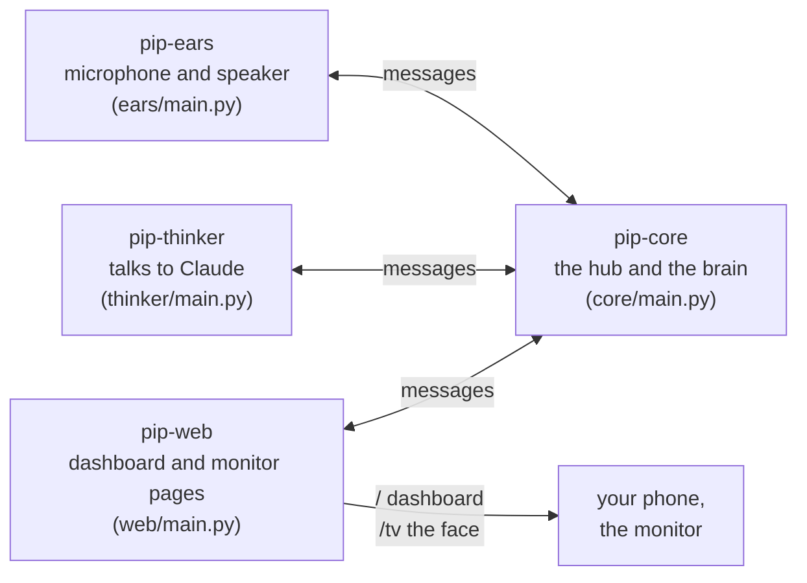
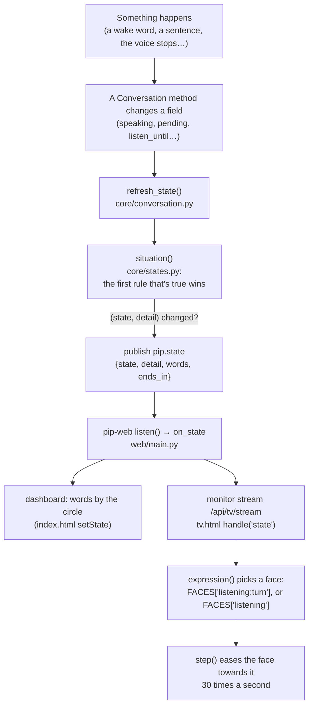

# How Pip works: a guide for reading the code

This guide is for someone who wants to open Pip's code and change it. It explains how the pieces fit, follows one request from start to finish, and then explains the **face state machine** in detail: how Pip decides what he's doing and how the monitor shows it.

What Pip *does* is in [`PIP-SPEC.md`](PIP-SPEC.md), why it was designed this way is in [`ARCHITECTURE.md`](ARCHITECTURE.md), and the owner's decisions are in [`DECISIONS.md`](DECISIONS.md). [`PROJECT-MAP.md`](PROJECT-MAP.md) lists every file.

## 1. The four programs

Pip is four small Python programs. Each runs as its own service on the Pi, so if one crashes the others keep going and it gets restarted.



| Program | Folder | What it does |
|---|---|---|
| pip-ears | `pip_assistant/ears/` | Listens to the microphone, spots the wake words ("Pippletron", "Hey Pip") and two claps, cuts speech into pieces and sends them on. Plays the chimes and speaks Pip's answers with the Piper voice. Doesn't know what any of it means. |
| pip-core | `pip_assistant/core/` | The hub every message goes through, and the brain. It turns speech into text, decides whether something was said to Pip, waits for you to finish, asks pip-thinker for an answer, and does the actions. It also runs timers and alarms, memory, people and voices, the modules, and **Pip's state**. |
| pip-thinker | `pip_assistant/thinker/` | Builds the prompt and asks Claude. It streams the answer back one sentence at a time, or an `ACTION` line when Claude wants Pip to do something. |
| pip-web | `pip_assistant/web/` | Serves the dashboard (`static/index.html`) and the monitor's face page (`static/tv.html`). It stores nothing itself and asks pip-core for everything. |

Code shared by all four is in `pip_assistant/common/`, and features that plug in (calendar, to-dos, Google, the screen) are in `pip_assistant/modules/`. Each program starts in its `main.py`.

### Messages

The programs talk by sending small JSON messages through a socket that pip-core owns (`core/bus.py`). Every message has:

- a **type**, such as `heard.utterance` or `pip.state`;
- **`data`**, which is written to the decision trace you can read on the dashboard;
- **`private`**, which is never written anywhere. What people said and Pip's answers always travel here.

There are three kinds of message:

- An **event** goes to everyone who subscribed to its type ("I heard something").
- A **command** goes to one program ("say this").
- A **request** gets a reply ("think of an answer").

`common/messages.py` defines the message; `common/client.py` is how ears, thinker and web connect. Inside pip-core, parts react to events with `bus.core_listen(...)`.

## 2. One request, start to finish

Say someone says **"Hey Pip, what time is it?"** Here's what happens, and where to find it:

1. **pip-ears hears the wake word** (`ears/wake.py`) and sends `heard.wake`. It keeps capturing until you pause (`ears/segmenter.py`).
2. **pip-core** `Conversation.on_wake` plays the chime and starts the "listening" window. *Face: listening, "Heard my name: go on".*
3. **pip-ears sends the audio** as `heard.utterance`, with the audio in `private`.
4. `Conversation.on_utterance` checks there's a voice in it (not a cough). It works out who's talking (`core/people.py`) and turns it into text with Groq (`core/stt.py`). *Face: "Working out what you said".*
5. `Conversation.addressed` **holds your words** for a moment in case you're not finished (`turn_wait`, D-106). Ending with a question mark means a short wait; a long statement means a longer one. *Face: "Waiting to see if you're done", with a countdown.*
6. Nothing more came, so `respond` calls `answer`. That sends a `thinker.ask` request with the room transcript, the schedule, who's talking and their memories. A soft thinking tone plays. *Face: thinking, "Working on an answer".*
7. **pip-thinker** (`thinker/main.py`) asks Claude and streams each sentence back as `answer.sentence`.
8. `Conversation.on_sentence` sends each sentence to pip-ears with `ears.say`. *Face: "Getting the words out", then once the voice starts (`speech.started`), speaking, "Answering".*
9. When the voice finishes (`speech.finished`), `_maybe_follow_up` opens a short window to reply without saying his name. *Face: listening, "Listening for your reply", with a countdown.*
10. Nobody replies, so the window runs out. *Face: idle, "Say my name if you need me".*

If Claude replies with an **ACTION** ("set a timer for 10 minutes"), `claude_action` checks all of it with `core/actions.py`, does it (or none of it, if any part is wrong), and says the confirmation (D-84). Each answer keeps **who asked** (`asker`), so if someone else talks while Claude works, the action is still done as the person who asked. Room talk that isn't for Pip goes through `Conversation.on_room`. It's kept in the room transcript (`core/transcript.py`) and might lead Pip to join in (`core/joining.py`).

## 3. The face state machine

### The idea

Pip is always in **one of 8 states**, each with its own colour:

| State | Colour | Means |
|---|---|---|
| idle | grey | nothing is being asked of him |
| listening | green | listening for or to someone talking to him |
| thinking | purple | working on an answer |
| speaking | blue | his voice is playing |
| interrupted | orange | someone just talked over him |
| ringing | red | an alarm, timer or reminder is going off |
| mic_off | dark grey | listening switched off (claps or the dashboard) |
| offline | slate | no internet: just the basics |

Within each state there's a **detail**, which says what exactly he's doing. Every detail has **words**, which show under the face. Both live in one table, `SITUATIONS`, in [`pip_assistant/core/states.py`](../pip_assistant/core/states.py), which is the file to read first.

### How a change reaches the monitor



### Side 1: pip-core decides (`core/states.py`)

`situation()` reads fields on the `Conversation` object (grouped under "What the face shows" in `Conversation.__init__`) and asks questions **in this order**. The first one that's true wins, so a higher rule always beats a lower one: an alarm ringing beats everything.

| # | Question | State, detail | Words | Set by (in `core/conversation.py` unless noted) |
|---|---|---|---|---|
| 1 | Is an alarm or timer ringing? | ringing, ring | Say "stop" or "snooze" | `core/schedule.py` |
| 2 | Is his voice playing? | speaking, by why he's talking (`say_reason`) | Answering / Joining in / Saying hi / Saying what I did / Saying something went wrong / Guiding voice learning | `on_speech_started`, `say()` |
| 3 | Is listening switched off? | mic_off, claps_off / switched_off | Clap twice to turn me back on / Switched off on the dashboard | `core/mic.py`, `apply_mic` |
| 4 | Did someone talk over him in the last 1.5 s? | interrupted, cut_in | Someone talked over me | `on_interrupted` (`cut_until`) |
| 5 | Is Claude working on an answer for someone, with nothing said yet? | thinking, asking / searching / looking_up | Working on an answer / Searching the web / Looking it up | `answer`, `on_searching` |
| 6 | Have words been sent to be spoken but not started yet? | thinking, voice | Getting the words out | `say()` (`say_pending_until`, 3 s) |
| 7 | Is speech said to him being turned into text? | listening, hearing | Working out what you said | `on_utterance` (`transcribing`) |
| 8 | Is he holding your words until you're done? | listening, turn (countdown) | Waiting to see if you're done | `addressed` (`pending`, `turn_until`) |
| 9 | Is a listening window open? | listening, called / follow_up / hearing / learning_voice (countdown) | Heard my name: go on / Listening for your reply / … | `listening_for(seconds, why)` |
| 10 | Did the internet drop in the last 2 minutes? | offline, no_internet | No internet: timers and alarms still work | `transcribe` (`offline_until`) |
| 11 | Is Claude deciding whether a mention was for him? | idle, mentioned | Heard my name mentioned: is it for me? | `on_room` → `answer(kind="mentioned")` |
| 12 | Is Claude deciding whether to join in? | idle, joining | Thinking about joining in | `core/joining.py` → `join_in` |
| 13 | Has there been room talk in the last 4 s? | idle, following | Following the conversation | `on_started`, `on_room` (`room_until`) |
| 14 | None of the above | idle, quiet | Say my name if you need me | |

Some of the waits are settings, in the `[conversation]` section of `pip_assistant/defaults.toml`. You can override them in `~/pip-data/settings.toml`:

- `wait_after_name_seconds`: how long he listens after hearing only his name;
- `follow_up_seconds`: the follow-up window, half as long again if he asked a question;
- `turn_wait_*`: how long he waits to see if you're done.

`refresh_state()` is called whenever one of the fields changes. It publishes only when the (state, detail) pair is different, and sets a timer to check again when the next deadline (`listen_until`, `cut_until`, …) passes. When the dashboard reconnects (pip-web restarting), `on_program_connected` sends it the current state, so it never starts blank.

If you tick **"Show what Pip is doing in the Conversation"** on the dashboard, every change also appears in the conversation feed. This is the best way to watch the state machine at work.

### Side 2: the monitor shows it (`web/static/tv.html`)

The face is drawn on a canvas, about 30 times a second. The important parts of the page are:

- **`live`** holds what the page knows: `live.state`, `live.detail` and `live.words` from pip-core, plus reactions.
- **`handle(kind, d)`** is where everything from the stream arrives. A `"state"` message sets `live.state` and calls `setDetail(d)`.
- **`shown()`** gives the state the screen is in. It's usually `live.state`, except for three states of the screen's own:
  - **loading**: the page has just opened;
  - **lost**: it can't reach Pip;
  - **dozing**: idle with nobody talking for 10 minutes. He moves less, as screen care.
- **`expression()`** picks the face. A short **reaction** comes first if there is one: pleased when thanked, perked, or the six-seven freak-out. Otherwise it's `"state:detail"` if `FACES` has that entry (for example `"listening:turn"`), or else the plain state's face.
- **`FACES`** gives each expression as a few numbers the face eases towards. Anything left out uses `REST`. The numbers are:

  | Number | What it does |
  |---|---|
  | `w`, `h` | eye width and height |
  | `open` | how open the eyes are |
  | `happy` | cheeks pushing the eyes into arcs |
  | `slant` | + worried, − focused |
  | `lookX`, `lookY` | where he's looking |
  | `smile` | −1 frown to 1 grin |
  | `mouth` | mouth width |
  | `gape` | mouth open |
  | `lean` | as if leaning in |

- **`COLORS`** sets the colour of each state. A detail uses its state's colour.
- **`WORDS`** is the big word ("Listening"). The smaller words come from pip-core. `SCREEN_WORDS` covers loading, lost and dozing.
- **`step(now)`** is the animation loop:
  - eases every face number towards the target;
  - blinks;
  - glances about: more often when following a conversation, scanning side to side when searching;
  - moves the mouth with his real voice (`speech.level`);
  - drains the countdown bar (`showCountdown`).
- **`draw(now)`** paints it. The hats and sunglasses for the weather, the thinking dots and the floating "zZz" are separate `draw…` functions.

## 4. Making changes

Two cautions before you start:

- Keep the rules in [`CLAUDE.md`](../CLAUDE.md).
- Read [`CONTRIBUTING.md`](../CONTRIBUTING.md). The ones that matter most here:
  - **Never put what anyone said into `data`**, logs or the repo. Only words *about Pip* go in the state.
  - **Owner decisions win.** The colours and states come from D-108 and D-112.

### Common changes

- **Change the words for a situation:** edit `SITUATIONS` in `core/states.py`.
- **Change how a situation looks:** edit its entry in `FACES` in `tv.html` (or add one, keyed `"state:detail"`). Nudge one number at a time.
- **Change a colour:**
  - `COLORS` in `tv.html` (the monitor);
  - `.st-…` in `web/static/pip.css` (the dashboard circle).
- **Add a new situation:**
  1. Add it to `SITUATIONS` with its words, under the state it belongs to. The detail name must not be used by any other state.
  2. In `situation()`, return it from the right place in the order. If it needs new information, add a field in `Conversation.__init__` under "What the face shows", set it where it happens, and call `self.refresh_state()` after.
  3. If it's a wait with a deadline, add that field to the `nxt` list in `refresh_state()`, so the state is checked again when it runs out.
  4. Optionally, give it a face in `FACES` as `"state:detail"`.
  5. Add a line to `tests/test_states.py`.

### Trying it

- **Run the tests**, with a memory cap, from the `pip` folder:
  ```
  systemd-run --user --same-dir -p MemoryMax=2000M --wait --pipe --collect uv run pytest -q tests/test_states.py tests/test_tv.py
  ```
  `tests/test_tv.py` checks that every face in `FACES` is a real situation and that every situation has words.
- **See it live:**
  - Pip's services run straight from this folder. `systemctl --user restart pip-core` picks up a change to `core/`.
  - `systemctl --user restart pip-web` picks up a change to `tv.html` or the dashboard (pip-web reads both pages once, when it starts). The monitor reloads itself when pip-web comes back.
  - `sh deploy/install.sh` does all of that, plus any new packages or service files.
  - Restarting doesn't make a sound, but testing by talking to Pip does: not between 23:00 and 07:00.
- **Watch it:** tick the state bars option on the dashboard, and open `http://100.118.171.118:8790/tv` in a browser to see the face next to the feed.

## 5. Settings and the personality

- **Settings** start in `pip_assistant/defaults.toml`; your changes are in `~/pip-data/settings.toml`; `common/settings.py` loads both when a program starts (`load()`).
- The Settings page (`web/static/settings.html`) asks pip-core (`core/settingsapi.py`) through `/api/settings`. `SCHEMA` in `common/settings.py` says, for every setting: its group, label, explanation, allowed values, and **which programs read it**. Saving checks every change (`validate`), writes only what differs from the defaults (`save`), then restarts just those programs once Pip is idle.
- **To add a setting:** add it to `defaults.toml` with a comment, read it where it's used, and add a `SCHEMA` entry. `tests/test_settings.py` fails if the two don't match.
- **The personality** (who he is, how he talks) is `common/personality.py`: `~/pip-data/personality.md` if you've edited it, else the built-in text, with `{name}` and `{location}` filled in. pip-thinker reads it fresh whenever the file changes, then adds `RULES` (the fixed part: actions, memory, privacy) from `thinker/main.py`.

## 6. Where to read next

| To understand… | Read |
|---|---|
| everything said in the room, and when Pip answers | `core/conversation.py`: `on_room`, `addressed`, `answer` |
| when he joins in by himself | `core/joining.py` |
| knowing who's talking | `core/people.py`, `core/peoplecmds.py` |
| timers, alarms, reminders | `core/schedule.py`, `core/when.py`, `core/commands.py` |
| what Claude is told, and the ACTION lines | `common/personality.py` (his personality, editable on the Settings page), `thinker/main.py` (`RULES`: the fixed part), `core/actions.py` |
| how a module plugs in | `modules/_template/`, `core/modules.py` |
| the boxes on the monitor | `modules/screen/` (the layout) and `BOXES` in `tv.html` (drawing them) |
| the wake word, claps, cutting up speech | `ears/wake.py`, `ears/clap.py`, `ears/segmenter.py` |
