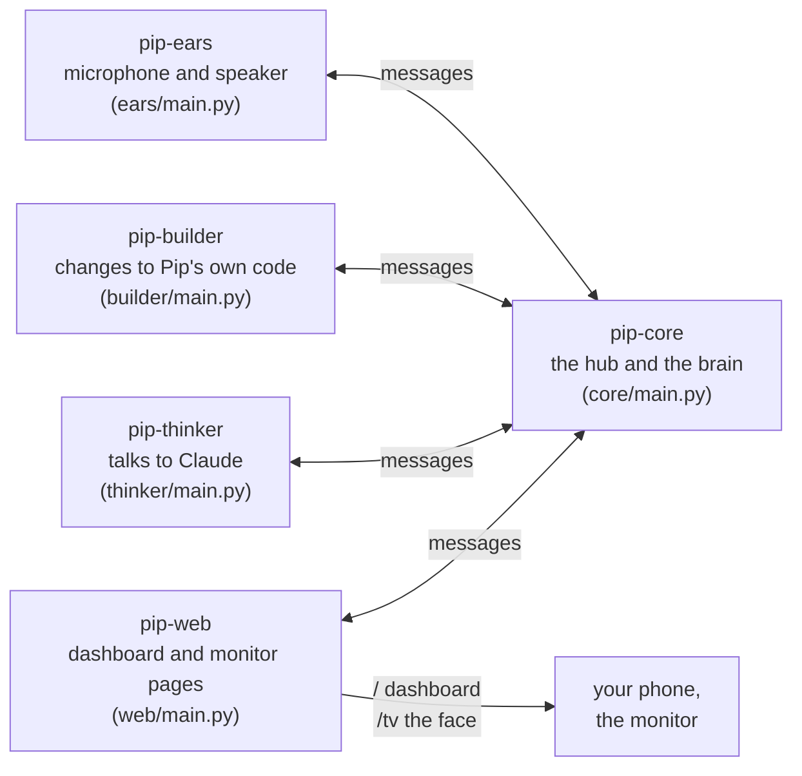
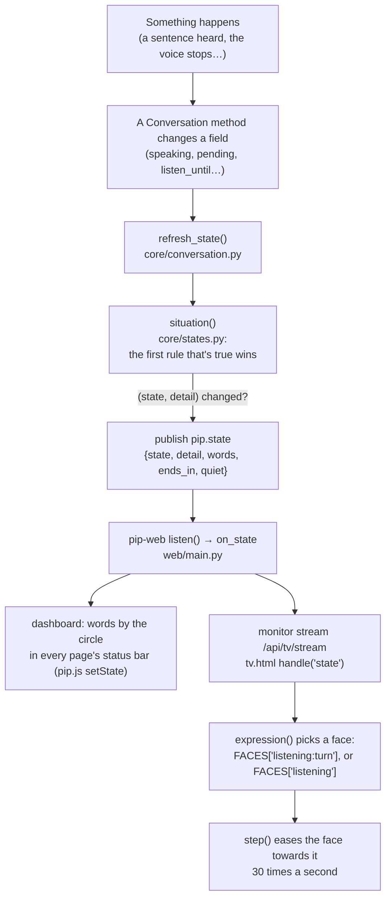
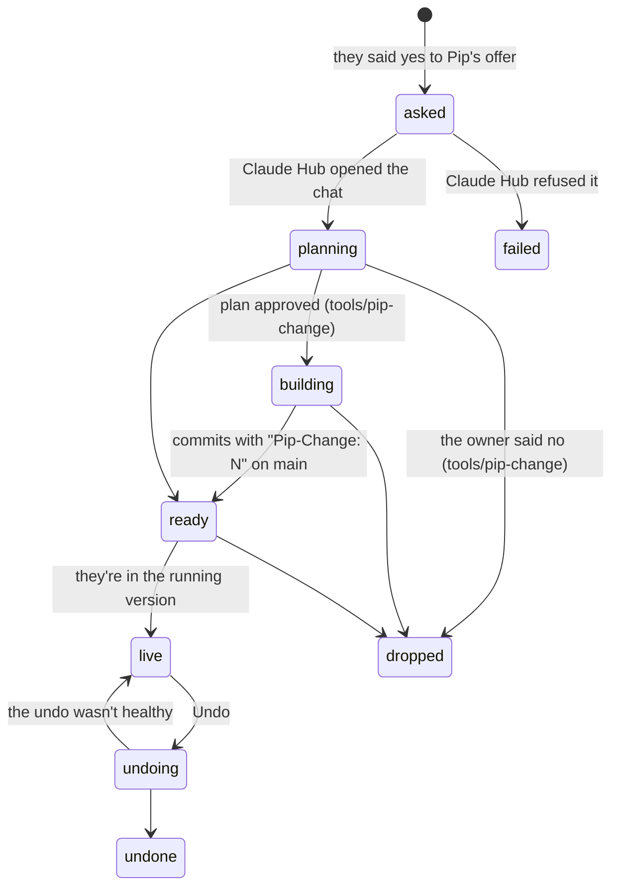

# How Pip works: a guide for reading the code

This guide is for someone who wants to open Pip's code and change it. It explains how the pieces fit, follows one request from start to finish, and then explains the **face state machine** in detail: how Pip decides what he's doing and how the monitor shows it.

What Pip *does* is in [`PIP-SPEC.md`](PIP-SPEC.md), why it was designed this way is in [`ARCHITECTURE.md`](ARCHITECTURE.md), and the owner's decisions are in [`DECISIONS.md`](DECISIONS.md). [`PROJECT-MAP.md`](PROJECT-MAP.md) lists every file.


> **Interactive version:** the dashboard's **Guide** page (`/guide`, under System in the menu) walks through all of this in the real code: chapters with diagrams you can click, and step-by-step tours (a request from your words to the timer ringing, the face, modules, making a module…) that show each function live from the version that's running. Its code links are checked by `tests/web/test_guide.py`: if you rename a function the guide points at, that test tells you which link to update in `web/static/guide.html`.

## 1. The five programs

Pip is five small Python programs. Each runs as its own service on the Pi, so if one crashes the others keep going and it gets restarted.



| Program | Folder | What it does |
|---|---|---|
| pip-ears | `pip_assistant/ears/` | Listens to the microphone, hears two claps, cuts speech into pieces and sends them all on (pip-core listens for Pip's name in the words, D-134). Plays the chimes and speaks Pip's answers with the Piper voice. A phone can take over as its microphone and speaker (`ears/remote.py`, D-149). Doesn't know what any of it means. |
| pip-core | `pip_assistant/core/` | The hub every message goes through, and the brain. It turns speech into text, decides whether something was said to Pip, waits for you to finish, asks pip-thinker for an answer, and does the actions. It also runs timers and alarms, memory, people and voices, the modules, and **Pip's state**. |
| pip-thinker | `pip_assistant/thinker/` | Builds the prompt and asks Claude. It streams the answer back one sentence at a time, or an `ACTION` line when Claude wants Pip to do something. |
| pip-web | `pip_assistant/web/` | Serves the dashboard's pages (the list is `PAGES` in `web/main.py`): the Overview (`static/index.html`: what needs you, timers, the chat box, each module's card), Talk, People and each person's profile, Memory, Health & trace, Settings, Changes, Claude and the Guide; each module's own page (`/m/<name>/`, such as the Home page; a module without one gets `static/module.html`); and the monitor's face page (`static/tv.html`, which is also `/phone`, with `static/phone.js`'s button, D-149). Every page but the Guide and the monitor gets the same menu and status bar from `static/pip.js` (D-148). It stores nothing itself and asks pip-core (or, for the Changes page, pip-builder) for everything. |
| pip-builder | `pip_assistant/builder/` | Pip changing his own code (§6): hands each change to a Claude Hub chat, keeps its record, follows it there and in git, tells the room when it's live, and undoes it. Does nothing until someone asks. |

`Conversation` (in `core/conversation.py`) is big, so its parts live in their own files and it takes them all in: `hearing.py` (speech-to-text, whose voice), `micctl.py` (the Listening switches, claps, prefs), `turns.py` (waiting for you to finish), `enrolment.py` (learning a voice), `context.py` (what Claude is told), `acting.py` (doing actions and Pip's own commands), `feed.py` (the dashboard's conversation feed). `conversation.py` keeps the state, `say()` and the main path from hearing to answering; its docstring has the full list.

Code shared by all five is in `pip_assistant/common/`, and features that plug in (calendar, to-dos, Google, the screen, web search, conversation notes, six seven, home control for the lamps and the fan) are in `pip_assistant/modules/`. Each program starts in its `main.py`.

### Messages

The programs talk by sending small JSON messages through a socket that pip-core owns (`core/bus.py`). Every message has:

- a **type**, such as `heard.utterance` or `pip.state`;
- **`data`**, which is written to the decision trace you can read on the dashboard;
- **`private`**, which is never written anywhere. What people said and Pip's answers always travel here.

There are three kinds of message:

- An **event** goes to everyone who subscribed to its type ("I heard something").
- A **command** goes to one program ("say this").
- A **request** gets a reply ("think of an answer").

`common/messages.py` defines the message; `common/client.py` (`BusClient`) is how ears, thinker, web and builder connect. Inside pip-core, parts react to events with `bus.core_listen(...)`. pip-core answers each request sent to it in its own task, so one slow answer (a typed message waiting for Claude) doesn't hold up the rest; if a program goes away, requests to or from it are answered or forgotten (`_drop_waiting` in `core/bus.py`).

**A phone's sound is the one exception** (D-149). On `/phone`, a tap on **Talk to Pip here** makes the phone Pip's microphone and speaker. Sound is a steady stream, not messages, so it doesn't go through pip-core:

```
phone.js (microphone → 16 kHz frames, phone-audio.js)  ⇄  websocket /api/phone  ⇄  pip-web (phone_relay: passes it on unread)
      ⇄  ~/pip-data/run/ears-remote.sock (common/wire.py)  ⇄  pip-ears (ears/remote.py: RemoteLink, RemoteSpeaker)
```

Inside pip-ears, `Ears.frames()` gives `listen()` the room's microphone or the phone's, and `self.speaker` is the speakerphone or the phone's `RemoteSpeaker` (`on_route` switches them, with the phone's own loudness levels). Everything after that is unchanged: the same segmenter, talk-over check and `heard.utterance`, so pip-core can't tell where it came from. Only the event `ears.route` (room or phone, and why) goes on the bus; pip-web passes it to the monitor (a "☎ On a phone" icon) and the dashboard's status bar. While a phone has Pip the room's recorder is closed; alarms play on both speakers, with the room's microphone mixed in while they ring.

**Staying alive.** Each program starts through `serve()` in `common/program.py`. If one of its main loops (listening, speaking, …) ends, the program exits so systemd restarts it, rather than sending heartbeats while deaf. While pip-core is away (restarting), `BusClient.emit` and `command` drop the message instead of failing. pip-core's watchdog (`core/health.py`) restarts a program whose heartbeats stop, without waiting for systemd (`--no-block`); if pip-core itself was held up, it skips that check, since every heartbeat looks old then.

## 2. One request, start to finish

Say someone says **"Hey Pip, what time is it?"** Here's what happens, and where to find it:

1. **pip-ears hears someone talking** and captures it until they pause (`ears/segmenter.py`). There's no wake-word detector (D-134): everything said in the room is captured, like Ziggletron.
2. **pip-ears sends the audio** as `heard.utterance` (reason `room`), with the audio in `private` and how long it waited in silence (`quiet_s`).
3. `Conversation.queue_utterance` puts it in a queue, so nothing else from pip-ears waits behind speech-to-text; one worker takes each in order. Room speech goes to `Conversation.on_room`, which checks there's a voice in it (not a cough), works out who's talking (`core/people.py`) and turns it into text with Groq (`core/stt.py`), or with Whisper on the Pi when Groq can't be used (`Hearing.transcribe` in `core/hearing.py`), so his name still works then.
4. **Was it said to him?** `calls_pip` (`core/names.py`) looks for his name in the words: "Hey Pip, …", "…, Pip?", "thanks, Pip" (Pip, Pippy, Pippletron and close mishearings; never Ziggletron). Yes, so `on_room` cancels anything he was doing and passes it on. Just his name mentioned ("ask Pip later") goes to Claude, which may stay quiet. Anything said in the follow-up window right after he spoke also counts as said to him (step 9). None of these: it's room talk.
5. `Conversation.addressed` decides whether you're finished (`turn_kind`: "unfinished" or "finished", and `turn_wait`, D-106, D-122, D-137, D-138). The wait is a budget **counted from when you stopped talking** (`speech_ended`), so the 0.7 s pause and speech-to-text already count: it's 0.7 s (`turn_wait_seconds`), so he starts at once, like Ziggletron. Only a half-finished sentence ("remind me to…") is held, for 3 s (`unfinished_wait_seconds`). Just after he's been talked over, the next turn gets 0.5 s more (`turn_wait_after_interrupt_seconds`). *Face: "Waiting to see if you're done", with a countdown.* **If you go on talking before he's said anything** (`heard.started` → `reopen_turn`), the answer he was working on is dropped and your words are held again, so what you say next is joined to them and asked once (`turn.decision` "reopened"). That's only when he was called by name: **a reply without his name** (step 9) that people go on talking over was room talk, so it's dropped and the follow-up window closes (`turn.decision` "dropped_reply", D-145); what they go on to say is room talk ("taken_as_room_talk").
   **Just his name, on its own** ("what's the weather… Pip?", or "Hey Pip" again because he missed it, D-134): `said_before_name` counts what anyone said in the 30 s before it (since his own last line, `Transcript.recent`). If something was, he chimes and holds the name for `name_alone_wait` (2.5 s from when they stopped; "Hey Pip" is often followed by a pause and then the question) with `ask="name_after"`; and Claude is told the last few lines are probably the question: it answers the most recent one meant for him, or says "Yes?". If they go on talking ("Pip… what time is it"), the pieces are joined and it's an ordinary request. If nothing was said before, he chimes and listens 5 s for the rest. A joined turn waits by its newest piece.
6. Nothing more came, so `respond` takes it. The chime plays (he was called by name). **A clearly worded command** ("what time is it", "set a timer for 10 minutes", "stop": `commands.sure`, D-123) is done at once on the Pi. Anything else goes to `answer`, which sends a `thinker.ask` request with the kind of ask (`direct`, `follow_up`, `name_after`, `mentioned` or `join`; each has its own last line for Claude, `ASK` in `thinker/main.py`). Claude reads it in Ziggletron's order (D-137, `Thinker.user_text`): what he remembers about the people talking, what's set and the weather, then the room conversation, then the time, who's speaking and what's asked. Memories about one person go only when that person is speaking or in the conversation (`Context.who_is_present`, `Memory.relevant`); the memories that go whoever is talking (rules, household facts) aren't in the message at all: they're in the fixed part, which Claude caches (D-146, `Memory.fixed_for_claude`). A soft thinking tone plays, except for a `follow_up` reply, which Claude may pass on (D-145). *Face: thinking, "Working on an answer".* Each step is traced as a `turn.decision` (`decided`), which `tools/latency.py` reads to show where the seconds went.
7. **pip-thinker** (`thinker/main.py`) asks Claude and streams each sentence back as `answer.sentence`.
8. `Conversation.on_sentence` sends each sentence to pip-ears with `ears.say`. *Face: "Getting the words out", then once the voice starts (`speech.started`), speaking, "Answering".*
9. When the voice finishes (`speech.finished`), `_maybe_follow_up` opens a short window to reply without saying his name: 8 s (`follow_up_seconds`), half as long again if he asked a question; it ends at `follow_until`. Anything said in it, by anyone, is taken as said to him and asked as `follow_up`: Claude replies (in kind to a joke or a tease) and passes only if it was clearly for someone else (D-136). The window counts from when they **started** talking (`in_follow_up`, `speech_started`, D-145): a long reply that began in it is still a reply. Speech pip-ears was still listening for that began after it (and isn't his name or more of a held turn) is room talk (`after_the_window`). *Face: listening, "Listening for your reply", with a countdown.*
10. Nobody replies, so the window runs out. *Face: idle, "Say my name if you need me".*

If Claude needs to **look something up** first (the calendar beyond tomorrow, or the web through the `websearch` module, D-125), it replies `ACTION {"do": "look", …}`; `Acting.look_up` asks the module, says "Let me look that up." if that takes over a second, and asks Claude again with what was found, the same way as the first time (`again`: the same kind of ask, and for "what's the weather… Pip?" the same lines before his name, D-138). If "stop" or a new request comes meanwhile, the second round is dropped (`requests` counts them; `fetching` keeps the face on "Looking it up"). If Claude says a line first ("Let me check.") and then the look ACTION, it's still looked up. Being called by name sends `thinker.cancel` with no answer id, which stops answers only (not conversation notes or Settings previews), and pip-ears drops a sentence Piper was still making (`Ears.stops`). If Claude replies with an **ACTION** ("set a timer for 10 minutes"), `claude_action` checks all of it with `core/actions.py`, does it (or none of it, if any part is wrong), and says the confirmation (D-84). Each answer keeps **who asked** (`asker`), so if someone else talks while Claude works, the action is still done as the person who asked. Room talk that isn't for Pip goes through `Conversation.on_room` and `room_talk`. It's kept in the room transcript (`core/transcript.py`) and might lead Pip to join in (`core/joining.py`). The transcript Claude reads marks a quiet spell of 5 minutes or more ("(25 minutes later)"), so Claude doesn't bring back a topic that's long over. Claude's answer is cut into spoken sentences as it streams in (`SentenceSplitter` in `thinker/claude.py`); if it starts with notes to itself ("Caleb's asking about…", "Keep it short and cheeky.", "Honest answer, short:"), those aren't said (`NARRATION`, `SELF_NOTE`, `unnarrate`). If the whole reply was only notes, pip-thinker asks Claude once more for just the words to say (`AGAIN` in `thinker/main.py`).

**Talked over** (D-122): pip-ears stops him only if the sound over him has a voice in it (`Ears.heard_over`). pip-core's `on_interrupted` then **pauses** the answer instead of cancelling it. If what was said turns out to be only "yeah", a laugh or nothing (`only_listening`, `listening_only` in `core/turns.py`), `resume_paused` says the rest, starting from the sentence he was cut off in; real words cancel it (`drop_paused`) and become the next turn. A laugh has a voice in it, so it does stop him; speech-to-text then writes it as "haha", "(laughs)" or its phantom "Thank you.", and `listening_only` counts all of those as a laugh. The answer stays paused until what they said comes back, however long they laugh.

**Lowered first, then stopped** (D-128): with `duck_before_stop` on, `Ears.heard_over` first only turns his voice down (`Speaker.gain`, `DUCK_GAIN`). If the voice over him keeps going `DUCK_S` (0.6 s) longer, `talked_over` stops him, keeping what they'd said meanwhile in the recording; if the room goes quiet again (`UNDUCK_AFTER_S`), `unduck` brings him back up and nothing is cut. **"Hold on"** (`pause_word` in `core/turns.py`) keeps the paused answer for up to 30 s with a listening window open (`hold_paused`); "go on" or "okay" resumes it. **Long answers** (D-130) are said in full: `on_sentence` never cuts one short. A spoken answer may end with an ACTION line (`trailing_action` in `thinker/claude.py`, which also stops `SentenceSplitter` there); `answer` does it after he's said everything, with `claude_action(..., quiet=True)`, so a recipe can go in a notes box without "Added the notes box".

**Typed to Pip** (D-131): the chat box (on the Overview and the Talk page, `web/static/talk.js`) posts to `/api/chat` → `core.chat` (`chat` in `core/dashapi.py`) → `Conversation.typed`. That puts the words in the room transcript as the person picked on the page, then runs `respond`, the same path as a finished spoken turn, so Pip's own commands and Claude both work. The request carries a context variable, `TYPED` (who typed it, out loud or not, and what he said), so it affects that request only: Pip talking to the room meanwhile is unaffected. `say` collects what he says for it as the reply, and skips pip-ears unless "out loud" is ticked; Claude's sentences for it are matched by answer id (`typed_answers`). Actions are done as the person picked, never with the room's last voice (`asker_now`). It waits for a spoken answer in progress to finish, opens no follow-up window, and a ringing alarm is answered first, as if it were said (`while_ringing`: "snooze" snoozes, "okay" stops it, anything else goes on to Claude).

**Explaining himself** (D-128): Claude's fixed instructions include what Pip can do (`common/capabilities.py`: the built-in list plus each module's summary). For "why didn't you answer?" Claude replies `ACTION {"do": "look", "kind": "why"}`; `Acting.look_up` sees it's one of `selfknow.KINDS` and answers it in pip-core (`core/selfknow.py`): `why` turns the last 10 minutes of the decision trace into plain lines ("22:46:00 speech-to-text wrote only "Thank you." … ignored"), and `settings`, `health`, `memory_why`, `docs` (his own docs, by section) and `code` (read-only search of his code) work the same way. Then Claude is asked again with that, like any look-up.

**"That was Sam, not me"** (D-128): `Feed.hear` keeps the last few lines' audio in memory (`recent_heard`, never saved). Claude's `correct_speaker` action (`Acting.correct_speaker`) relabels the line before the correction and, if the person correcting is recognised for sure, adds that line's audio to Sam's voice (`People.add_samples`).

**Your data** (D-129): Settings → Your data asks pip-core (`core/yourdata.py`, `/api/data`). Download gathers people, memories, each module's `export_data()`, the settings file and the personality (never voiceprints or secrets.toml). Delete everything needs "DELETE": memories, voices, each module's `wipe_data()`, the transcript. Removing one person calls every module's `forget_person`.

**The face's extras** (D-129): `face_status` (core/dashapi.py) sends the monitor yes/no flags for its corner icons; tv.html refreshes them every minute (`showIcons`). New reactions (`confused`, `amused`, `surprised`, `sleepy` in `FACES`) are set off by `reactIf` from captions and states. `[face]` settings reach the page through `/api/tv` (`live.look`): `eyes()` changes the eye shape in `eyePath`, `colorOf()` the colours.

**Remembering conversations** (D-128): the `recall` module gets every line through the `room_heard` hook. When the room has been quiet 10 minutes, it calls `ctx.summarize(lines)` (a module-neutral call in `core/modules.py`, allowed by its `claude:summarize` permission), which asks pip-thinker (`Thinker.on_summarize`, a separate one-off Claude) for a few lines of notes. Only the notes are kept (`recall_notes`, 30 days); the lines are dropped. Its `summary` hook adds the last day's notes to each request; `look:recall` finds older ones.

**The lamps and the fan** (D-139, D-140): the `home_control` module, shown as "Home". Each request tells Claude the devices, each with its kind (light, fan or plug, from its name and nicknames), its nicknames and whether it's on (`summary`). For "turn on the lights" Claude replies `ACTION {"do": "plug", "name": "lights", "on": true}`: a device's name, or a group ("lights" is every light, never the fan; "fans"; "everything"). `check_plug` finds which devices that means (`find`, the backstop if the name isn't exact) and `do_plug` switches them and says so ("The lights are on.", naming any it couldn't reach). `switch` talks to a device directly when it's on the Wi-Fi network the Pi hosts for the plugs, `pip-plugs` (made by `deploy/plug-network.sh`; `Local`, with the tinytuya library, no internet needed), and otherwise through Tuya's cloud. Pip finds each plug on `pip-plugs` by its MAC address in the Pi's own table of devices it talks to (`locate`, `/proc/net/arp`), and asks each one every 30 s whether it's on. Nicknames ("desk lamp") are a setting; the module has its own Home page (`static/index.html`), which is also a tab on a phone. It has no card on the Overview (D-148).

**YouTube videos** (D-141): the `youtube` module. For "pull up a YouTube video explaining matrix multiplication" Claude replies `ACTION {"do": "play_video", "query": "matrix multiplication explained"}`. `do_play` asks YouTube's Data API (`search`: only videos allowed to play outside YouTube, with their lengths) and `show` puts the first up: it asks the screen module to cover the monitor with its "video" box (the screen's `api.cover`, which the screen keeps apart from the screens themselves, so taking it off puts the screen back exactly), and Pip says which video it is. The monitor's `static/monitor.js` plays it with YouTube's own player. The controls ("Pip, pause the video", "fast forward a minute", "go to 4:30", "mute it", "set the volume to 30", "take down the video") are recognised by `control_in` in the module's `room_heard` and done by `control`, without Claude, also when said as a reply right after Pip speaks (pip-ears' follow-up path offers it to modules too); each is added to a numbered list (`commands`) the monitor carries out in order. The answer is a `Done` ("Paused."): the control has already happened, so even if Pip can't say it right now, Claude isn't asked to do it again. While Pip is listening, thinking or talking (`h.state()` on the monitor), the player turns down to `duck_volume`; while it plays, the box is marked `keep-awake` so the screen doesn't doze. A minute after the video ends, or after `paused_minutes` paused, it takes itself down (`_arm`, one timer). The speakerphone's echo cancelling keeps the video out of what Pip hears (tested). Nothing is kept: Pip restarting takes the video down.

**Routines** (D-143): the `routines` module. A routine is a list of steps (switch, say, read out), kept in `routines_list`; five are built in (`BUILT_IN` in its `module.py`) and the owner adds more on the Routines page. "Pip, goodnight" said in so many words is caught by its `room_heard` (`plain` compares the phrases without "Pip", "hey", punctuation or "everyone"): it answers a `Done` with the words at once (`words`: the say steps and `readouts.py`'s read-outs, from what's at hand) and does the switching in the background through home control's `api.switch`. Said in other words, Claude replies `ACTION {"do": "routine", "name": "goodnight"}` and `run` waits for the switching, so Pip can say what didn't answer. **The wake-up alarm** comes through a new hook: the schedule tells its `listeners` when alerts ring, stop, are snoozed or go unanswered (`Schedule._tell`); the conversation passes that to every module (`Conversation.alerts_to_modules` → `Registry.on_alert` → `Module.on_alert`). On "ringing" for an alarm labelled "wake up" the module switches the lights on; on "stopped" it returns the morning briefing, which `Conversation.say_when_free` says once Pip is free (`free_to_say`: not ringing, answering, speaking or holding anyone's turn; given up after a minute). "Unanswered" while the room is out is kept for "I'm back". A module may also read the alarms set (`ctx.alerts.upcoming`, for "your alarm's at 7:30") and knows where Pip lives (`ctx.location`, for the weather).

**Games** (D-144): the `games` module, made to plug in and out on its own (it uses only the hooks every module has). "Pip, let's play trivia" → Claude replies `ACTION {"do": "game", "game": "trivia", …}`; `Games.do_game` fetches the questions (`trivia.fetch`, Open Trivia DB; or takes the ones Claude wrote into the action) and starts it: the screen's `api.cover` puts the game's box up, and Pip asks the first question. Each game (`trivia.py`, `twenty.py`, `rather.py`, `song.py`) is a `Game` (`common.py`) the module hands everything heard (`room_heard`): an answer in the words (`Trivia.pick`: a letter, or a choice's words, compared loosely by `mentions`) gets a `Done` reply, so Claude isn't asked; the controls ("skip", "stop the game", `common.control`) are done at once; anything else said to Pip goes to Claude, who reads about the game in the module's `summary` (20 questions' secret, so Claude can answer the questions). Guess the song's clips are Deezer's previews, played by the monitor (`static/monitor.js`, one `Audio` element, quieter while Pip listens or talks). A finished game's winner and scores go in `games_results` (`finished`); `tidy` takes the box down 30 s later, or after 10 minutes of nothing.

**Events Pip doesn't bring up** (D-151): "Pip, I don't go to that" → Claude replies `ACTION {"do": "mute_event", "id": …}`; `ClaudeActions.do_mute` calls `CalendarStore.mute`, which keeps the event's name in `calendar_muted` and re-makes the heads-ups of every event with that name (`sync_alerts` skips them). A calendar can be marked `quiet` ("only when asked") the same way. `CalendarStore.not_brought_up` is the one check for both; `ClaudeActions.summary` (only what's left of today goes with each request), `sync_alerts` and `api.events_on` (briefings) use it, while `do_look` shows such events marked as muted, so Claude can still answer when asked.

**Hall of Fame** (D-147): the `hall_of_fame` module keeps funny moments word for word in `hall_of_fame_moments`, apart from memories (which go to Claude with every request, D-146). It doesn't listen to the room: "Pip, save that to the hall of fame" is an ordinary request, and Claude, which has the conversation in front of it, replies `ACTION {"do": "add", "kind": "moment", "title": …, "lines": […]}` with the lines copied word for word. `HallOfFame.checked` cuts and checks them (a few lines, no passwords or numbers), `same_as` stops a repeat, `keep` saves it. `remove_moment` takes one out, `look:moments` (`do_look`) fetches the words for a second round, `summary` gives Claude a few titles with each request, and `show_moment` covers the monitor with one for a minute (the screen's `api.cover`; `tidy` takes it down). A memory that's really a moment is moved from the Memory page: pip-core asks which modules take memories (`Registry.memory_takers`, `Module.takes_memories`), `memory_move` in `core/dashapi.py` hands it over (`take_memory`, which takes off a label like "Pip's quote list: …" and keeps the quote with who said it: `untagged`) and deletes the memory only once the module has kept it. `tools/propose_moments.py` flags the likely ones ("Move? …" in a memory's `review`) for the owner to decide. What it publishes carries numbers only, so no words reach the trace.

**Listening off, alarm ringing** (D-127): `MicControl.ears_mode` tells pip-ears "on" while something rings even if listening is switched off, and `ringing_changed` (a `schedule.watchers` callback) switches it back when the ringing stops. Meanwhile `alarm_only` is true: speech goes only to `commands.while_ringing` (stop, snooze); nothing else is kept in the transcript, shown or sent to Claude.

**"Hey Pip" while it rings:** everything said goes through `commands.while_ringing` first. His name alone calls `Schedule.hush`: the ringing goes quiet, but the alarm isn't answered yet. What's said next decides (`hushed_until`): "snooze" snoozes, anything else stops it and is answered as usual. "Hey Pip, snooze" in one go snoozes. If nothing is said within `hush_s` (20 s), saying his name stopped it, as it always has.

**Phantom "Thank you."** (D-85): sounds with no voice never reach speech-to-text (`has_voice`). But a cough, a laugh or a chair can sound enough like a voice to get through, and Whisper then writes "Thank you." (or "you", "Bye."). So after speech-to-text, `unless_phantom` treats exactly those phrases as noise unless the voice is someone Pip recognises (`is_phantom` in `core/turns.py`); a known voice saying "thank you" still gets an answer. Each one is traced as `heard.phantom`.

## 3. The face state machine

### The idea

Pip is always in **one of 8 states**, each with its own colour:

| State | Colour | Means |
|---|---|---|
| idle | grey | nothing is being asked of him |
| listening | green | listening for or to someone talking to him |
| thinking | purple | working on an answer |
| speaking | blue | his voice is playing |
| interrupted | orange | someone just talked over him |
| ringing | red | an alarm, timer or reminder is going off |
| mic_off | dark grey | listening switched off (claps or the dashboard) |
| offline | slate | no internet: just the basics |

Within each state there's a **detail**, which says what exactly he's doing. Every detail has **words**, which show under the face. Both live in one table, `SITUATIONS`, in [`pip_assistant/core/states.py`](../pip_assistant/core/states.py), which is the file to read first.

### How a change reaches the monitor



### Side 1: pip-core decides (`core/states.py`)

`situation()` reads fields on the `Conversation` object (grouped under "What the face shows" in `Conversation.__init__`) and asks questions **in this order**. The first one that's true wins, so a higher rule always beats a lower one: an alarm ringing beats everything.

| # | Question | State, detail | Words | Set by (`Conversation`; the file is `core/conversation.py` unless noted) |
|---|---|---|---|---|
| 1 | Is an alarm or timer ringing? | ringing, ring | Say "stop" or "snooze" | `core/schedule.py` |
| 2 | Is his voice playing? | speaking, by why he's talking (`say_reason`) | Answering / Joining in / Saying hi / Saying what I did / Saying something went wrong / Guiding voice learning | `on_speech_started`, `say()` |
| 3 | Is listening switched off? | mic_off, claps_off / switched_off | Clap twice to turn me back on / Switched off on the dashboard | `core/mic.py`, `apply_mic` (`core/micctl.py`) |
| 4 | Did someone talk over him in the last 1.5 s? | interrupted, cut_in | Someone talked over me | `on_interrupted` (`cut_until`) |
| 5 | Is Claude (or a look-up) working on an answer for someone, with nothing said yet? | thinking, asking / searching / looking_up | Working on an answer / Searching the web / Looking it up | `answer`, `on_searching` |
| 6 | Have words been sent to be spoken but not started yet? | thinking, voice | Getting the words out | `say()` (`say_pending_until`, 3 s) |
| 7 | Is speech said to him being turned into text? | listening, hearing | Working out what you said | `on_utterance` (`transcribing`) |
| 8 | Is he holding your words until you're done? | listening, turn (countdown) | Waiting to see if you're done | `addressed` (`core/turns.py`; `pending`, `turn_until`) |
| 9 | Is a listening window open? | listening, called / follow_up / hearing / learning_voice (countdown) | Heard my name: go on / Listening for your reply / … | `listening_for(seconds, why)` |
| 10 | Did the internet drop in the last 2 minutes? | offline, no_internet | No internet: timers and alarms still work | `transcribe` (`core/hearing.py`; `offline_until`) |
| 11 | Is Claude deciding whether a mention was for him? | idle, mentioned | Heard my name mentioned: is it for me? | `on_room` → `answer(kind="mentioned")` |
| 12 | Is Claude deciding whether to join in? | idle, joining | Thinking about joining in | `core/joining.py` → `join_in` |
| 13 | Has there been room talk in the last 4 s? | idle, following | Following the conversation | `on_started`, `on_room` (`room_until`) |
| 14 | None of the above | idle, quiet | Say my name if you need me | |

Some of the waits are settings, in the `[conversation]` section of `pip_assistant/defaults.toml`. You can override them in `~/pip-data/settings.toml`:

- `wait_after_name_seconds` (5 s): how long he listens after hearing only his name, when nothing was said before it;
- `name_lookback_seconds` (30 s) and `name_alone_wait_seconds` (2.5 s): just his name after something was said, how far back counts and how long he waits first in case the question comes next (D-134);
- `follow_up_seconds` (8 s): the follow-up window, half as long again if he asked a question;
- `turn_wait_seconds` (0.7 s) and `unfinished_wait_seconds` (3 s): how long he waits to see if you're done, counted from when you stop talking (D-122); 0.7 s since D-137 (one setting since D-138), so only half-finished sentences are held. `turn_wait_after_interrupt_seconds` (0.5 s) is added to the next turn after he's been talked over;
- `social.mood`: how often he considers joining in (chatty by default, D-136); "Pip, set chattiness to low / normal / high" overrides it (kept in `prefs`). Its line for Claude (`MOODS` in `core/joining.py`) goes with each join-in, added by `Context.for_claude`;
- `own_commands`: "sure" means clearly worded commands are done without Claude (D-123);
- `carry_on_after_backchannel`: off means anything said over him ends his answer (D-126).

Two more are elsewhere: `[social] step_back_minutes` (how long he stays out of the conversation after "not now") and `[stt] drop_phantoms` (a lone "Thank you." from a voice he doesn't know is noise). All of these are on the Settings page, most under **Taking turns**, with a live preview of what they do.

`refresh_state()` is called whenever one of the fields changes. It publishes only when the (state, detail) pair is different (or whether it's a quiet moment changed), and sets a timer to check again when the next deadline (`listen_until`, `cut_until`, …) passes. When the dashboard reconnects (pip-web restarting), `on_program_subscribed` sends it the current state, so it never starts blank.

If you tick **"Show what Pip is doing in the Conversation"** on the dashboard, every change also appears in the conversation feed. This is the best way to watch the state machine at work.

### Side 2: the monitor shows it (`web/static/tv.html`)

The face is drawn on a canvas, about 30 times a second. The important parts of the page are:

- **`live`** holds what the page knows: `live.state`, `live.detail` and `live.words` from pip-core, plus reactions.
- **`handle(kind, d)`** is where everything from the stream arrives. A `"state"` message sets `live.state` and calls `setDetail(d)`.
- **`shown()`** gives the state the screen is in. It's usually `live.state`, except for three states of the screen's own:
  - **loading**: the page has just opened;
  - **lost**: it can't reach Pip;
  - **dozing**: idle with nobody talking for 10 minutes. He moves less, as screen care.
- **`expression()`** picks the face. A short **reaction** comes first if there is one: pleased when thanked, perked, or the six-seven freak-out. Otherwise it's `"state:detail"` if `FACES` has that entry (for example `"listening:turn"`), or else the plain state's face.
- **`FACES`** gives each expression as a few numbers the face eases towards. Anything left out uses `REST`. The numbers are:

  | Number | What it does |
  |---|---|
  | `w`, `h` | eye width and height |
  | `open` | how open the eyes are |
  | `happy` | cheeks pushing the eyes into arcs |
  | `slant` | + worried, − focused |
  | `lookX`, `lookY` | where he's looking |
  | `smile` | −1 frown to 1 grin |
  | `mouth` | mouth width |
  | `gape` | mouth open |
  | `lean` | as if leaning in |

- **`COLORS`** sets the colour of each state. A detail uses its state's colour.
- **`WORDS`** is the big word ("Listening"). The smaller words come from pip-core. `SCREEN_WORDS` covers loading, lost and dozing.
- **`step(now)`** is the animation loop:
  - eases every face number towards the target;
  - blinks;
  - glances about: more often when following a conversation, scanning side to side when searching;
  - moves the mouth with his real voice (`speech.level`);
  - drains the countdown bar (`showCountdown`).
- **`draw(now)`** paints it. The hats and sunglasses for the weather, the thinking dots and the floating "zZz" are separate `draw…` functions.

## 4. Making changes

Two cautions before you start:

- Keep the rules in [`CLAUDE.md`](../CLAUDE.md).
- Read [`CONTRIBUTING.md`](../CONTRIBUTING.md). The ones that matter most here:
  - **Never put what anyone said into `data`**, logs or the repo. Only words *about Pip* go in the state.
  - **Owner decisions win.** The colours and states come from D-108 and D-112.

### Common changes

- **Change the words for a situation:** edit `SITUATIONS` in `core/states.py`.
- **Change how a situation looks:** edit its entry in `FACES` in `tv.html` (or add one, keyed `"state:detail"`). Nudge one number at a time.
- **Change a colour:**
  - `COLORS` in `tv.html` (the monitor);
  - `.st-…` in `web/static/pip.css` (the circle in the dashboard's status bar).
- **Add a new situation:**
  1. Add it to `SITUATIONS` with its words, under the state it belongs to. The detail name must not be used by any other state.
  2. In `situation()`, return it from the right place in the order. If it needs new information, add a field in `Conversation.__init__` under "What the face shows", set it where it happens, and call `self.refresh_state()` after.
  3. If it's a wait with a deadline, add that field to the `nxt` list in `refresh_state()`, so the state is checked again when it runs out.
  4. Optionally, give it a face in `FACES` as `"state:detail"`.
  5. Add a line to `tests/core/test_states.py`.

### Trying it

- **Run the tests**, with a memory cap, from the `pip` folder:
  ```
  systemd-run --user --same-dir -p MemoryMax=2000M --wait --pipe --collect uv run pytest -q tests/core/test_states.py tests/web/test_tv.py
  ```
  `tests/web/test_tv.py` checks that every face in `FACES` is a real situation and that every situation has words.
- **See it live:**
  - Pip's services run from `~/pip-app/current`, a separate copy (§7), **not** from this folder. Restarting a service (`systemctl --user restart pip-core`) no longer picks up your edits in `~/pip`.
  - To try a change: **commit it, then run `sh deploy/install.sh`**. It installs the last commit as a new version, restarts Pip at a quiet moment and checks he's healthy; if he isn't, he goes back to the version before by itself. pip-web reads `tv.html` and the dashboard once, when it starts; the monitor reloads itself when pip-web comes back.
  - Never edit `~/pip-app` by hand.
  - Restarting doesn't make a sound, but testing by talking to Pip does: not between 23:00 and 07:00.
- **Watch it:** tick the state bars option on the dashboard, and open `http://<pi-tailscale-ip>:8790/tv` in a browser to see the face next to the feed.

### Making a module

Every new feature is a module: a folder in `pip_assistant/modules/`. Pip finds it at startup; nothing else in Pip changes (`tools/check_map.py` and `tests/core/test_plugins.py` fail if pip-core or pip-web ever name one). ARCHITECTURE §7 explains the design; this is the recipe.

1. **Copy the template:** `cp -r pip_assistant/modules/_template pip_assistant/modules/shopping` (a lowercase name). Folders starting with `_` are never loaded, so the template stays an example.
2. **`module.toml`:** set `name` to the folder's name, a one-line `summary`, `says_examples`, whether it works `offline`, any internet hosts it may reach (`permissions`: `network:<host>`, or `lan:<what>` for a module that talks to devices on the local network itself, like `home_control`'s plugs), the modules it `needs` (it's switched off with them), and the ones it only `uses` if they're on (`ctx.module(name)` gives None while one is off: six seven's lamps, D-142). Each setting has a `default` and an `explain` line (they appear on the Settings page). `[claude] instructions` tells Claude its ACTION lines: keep it short.
3. **`module.py`:** `setup(ctx)` returns your Module. Keep the parts you need and delete the rest:
   - `actions`: what Claude can do (`check` first, raising `Invalid` if it doesn't make sense; then `do`, returning what Pip says).
   - `summary(call)`: what Claude should know with every request. It goes with *every* request, so keep it to a line, or nothing.
   - `offline()`: its own phrases when the internet is down (`OfflineItems`; the template's dice, the calendar's `offline.py`).
   - `home()`: a card on the dashboard's Overview: a list of dated items (the calendar), or things to tick off (the to-dos, `modules/todos/`).
   - `tv(shown)` with a `[monitor.<kind>]` table and `static/monitor.js`: a box on the monitor ("put the shopping list up"). The drawing gets helpers in `h`; `h.state()` is what Pip is doing. To cover the whole monitor with your box for a while (a video), list `"screen"` in `needs` and call `ctx.module("screen").cover(kind)`, then `uncover(kind)` (`modules/youtube/`).
   - `dashboard(action, args)` with `static/index.html`: its own page. Under `[dashboard]` in `module.toml`: its `label`, `icon` and `group` in the dashboard's menu (`house` for Around the house, `fun`, or `pip` for Pip himself), and `tab = true` to be a tab on a phone too. Without a page of its own it still gets one, made from its `module.toml` (`web/static/module.html`). The page loads `/pip.js`, which draws the menu and status bar around it (D-148). `person_panel = "person.js"` adds a part to each person's profile page (Google's account settings); `account_panel` adds a part to a Google account's settings there.
   - `room_heard(text, call)`: hears everything (room talk, and what's said to or about Pip: `call.kind`) and may return something for him to say; for speech to Pip that replaces asking Claude (`modules/six_seven/` is just this). `modules_answer` in `core/conversation.py` offers it at any hour; Pip says the answer only when he's free to talk; if he isn't, speech to him goes to Claude after all, unless the answer is a `Done` (`core/modules.py`): the module has already done it ("Pip, pause the video", D-141), so Claude mustn't do it again. Replies right after Pip speaks are offered too (pip-ears' follow-up path, and room talk in the follow-up window, D-142), except the rest of a turn he's holding; a join-in he's only thinking about gives way to a module's answer. A message typed in the dashboard's chat box is offered too (`Conversation.typed`), as said to him; the module's answer is the reply. Six seven goes off whatever he's doing: the face and the lamps at once (`SixSeven.freak_out`, home control's `api.disco`), the chant when he's free; the chant is a `Done`, except inside a request to him by name or typed ("a timer for 67 minutes"): then it answers nothing, so the request goes on. A reply without his name right after he spoke is a `Call` with `follow_up` set, so the module chants (D-150). On the monitor, `react()` in `tv.html` lets nothing replace the six-seven face while it runs. To make the monitor's face react, `ctx.publish("reaction", {"reaction": "pleased"})`. Read the words, keep nothing.
   - `on_alert(event, alerts)`: hears timers and alarms ringing, being stopped, snoozed or going unanswered (with the alerts themselves: kind, label, repeat); may return something for Pip to say once he's free (the routines module's morning briefing, D-143). Labels are what people said: don't log them.
   - `takes_memories` and `take_memory(memory)`: a module that can take over a memory from the Memory page names its button ("Hall of Fame" → "Move to Hall of Fame") and keeps the memory in its own tables (D-147).
   - `tasks()`: background jobs (syncing, checking a website). One that fails is started again after 30 s, then longer, up to 10 minutes (`Registry._guard`).
   - Its data goes in its own tables (`ctx.db()`, named `<name>_…`): it can't read or change any other table, nor reach one through a trigger, a view or an attached database. Its secrets are in its own section of `secrets.toml` (`ctx.secrets`).
4. **Tests:** `test_<name>.py` in the folder, like the template's. `tests/helpers.py` has `registry()`, which loads real modules the way pip-core does, and the other shared fakes; `tests/fakes/` has a pretend Google.
5. **Try it:** run its tests (`uv run pytest pip_assistant/modules/shopping`, memory-capped), add it to `docs/PROJECT-MAP.md` if it's a new kind of thing, commit, then `sh deploy/install.sh`. To switch it off without deleting it: `enabled = false` under `[modules.shopping]` in `~/pip-data/settings.toml`.

Or ask Pip ("Pip, I'd like a shopping list"): his self-changes are told to follow this recipe (§6).

## 5. Settings and the personality

- **Settings** start in `pip_assistant/defaults.toml`; your changes are in `~/pip-data/settings.toml`; `common/settings.py` loads both when a program starts (`load()`).
- The Settings page (`web/static/settings.html`) asks pip-core (`core/settingsapi.py`) through `/api/settings`. `SCHEMA` in `core/settings_schema.py` says, for every setting: its group, label, explanation, allowed values, and **which programs read it**. Saving checks every change (`validate`), writes only what differs from the defaults (`save`), then restarts just those programs at a quiet moment (`quiet()` in `core/states.py`).
- **Seeing what a setting does** (D-126): `PREVIEW` in `settings.html` has a small function per setting that draws what it means from the values on the page, saved or not ("Someone laughs → stops for a moment, then carries on"). `turnViz` draws the turn-taking timeline, and `DEPENDS` greys out a setting that another one switches off. They're only illustrations: the real rules stay in `core/`. After saving, `settle` marks each saved row "applying…" and then "✓ applied".
- **To add a setting:** add it to `defaults.toml` with a comment, read it where it's used, and add a `SCHEMA` entry. `tests/core/test_settings.py` fails if the two don't match.
- **The personality** (who he is, how he talks) is `common/personality.py`: `~/pip-data/personality.md` if you've edited it, else the built-in text, with `{name}` and `{location}` filled in. pip-thinker reads it fresh whenever the file changes, then adds `RULES` (the fixed part: Ziggletron's "How this works", then actions, memory, privacy) from `thinker/main.py`, what he can do (`common/capabilities.py`), each module's `[claude] instructions` and, last, the memories that go whoever is talking (`Thinker.system_prompt`). The model is Opus at low effort (D-137, chosen with `tools/model_compare.py`).
- **Why two parts** (D-146): Claude keeps the fixed part in its cache and re-reads it at about a tenth of the price, as long as it is exactly the same as last time; the message is new each time and paid for in full. So what rarely changes goes in the fixed part (the memories that always go: `Memory.fixed_for_claude`, sent by pip-core with every request and fetched every 20 s by `Thinker.fetch_memories_fixed`), and what changes often goes in the message (the time, the weather, what's set, memories about the people talking). A changed fixed part also means the Claude process waiting for the next question is started again (about a second), so: **never put a clock, the weather or anything per-request in the fixed part.** The dashboard's Claude page shows both parts' sizes; each answer's sizes and token counts are in the trace (`system_chars`, `user_chars`, `tokens_cached`, `tokens_written` on the `thinker.ask` reply).

## 6. How Pip changes himself

Someone asks Pip for a change, or complains about something he does, and he offers: "Want me to write that up as a change?" If they say yes, his write-up opens a chat in **Claude Hub** (the owner's dashboard for Claude Code chats, `~/claude-hub`), in `~/pip` and **in plan mode**. The owner does the rest in that chat: answers Claude's questions, approves the plan, and says when to install. Pip only follows along and shows where each change is on the Changes page (D-152, which replaced D-118's sandboxed pipeline). Everything is in `pip_assistant/builder/`:

| File | What it does |
|---|---|
| `main.py` | The program: answers `builder.ask` (a new change) and `builder.page` (the Changes page: `list`, `undo`), and reads the `[builder]` settings fresh each time |
| `changes.py` | `Builder`: `ask` (record it, hand it to Claude Hub), `sync` every 3 s (the hub's state file, then the commits), `_tell_the_room`, `listing`, and `undo` with its install |
| `hub.py` | `HubInbox`: the request file in Claude Hub's inbox, and the hub's state file beside it. `prompt`: the chat's first message (Pip's write-up, then how Claude should handle a self-change) |
| `store.py` | The record: one row per change in the `builder_changes` table of `~/pip-data/pip.db`. `request` (Pip's write-up, which may quote people) is private: it only goes into the chat, and `forget_old` blanks it after `keep_days` (90). D-118's changes stay as history |
| `cli.py` | `tools/pip-change <id> building` or `dropped`: what Claude runs in the chat. It writes the store directly, with the system `python3` |
| `deploy.py` | `Deployer` (git): `change_commits` (the commits with a `Pip-Change: <id>` line), `in_release`, `revert` and `fast_forward_main` for Undo. Never pushes |
| `releasejob.py` | `ReleaseRunner`: installs an undo with `release.py install` as its own job, and reads how it went |

### The steps



1. **Asking.** Claude (Pip's thinker) offers to write it up (the rule is in `RULES`, `thinker/main.py`). After a yes it answers `ACTION {"do": "request_change", "summary": …, "details": …}`: the summary is a short phrase with no names, and the details are the write-up for Claude, which may quote what was said. `Acting.request_change` (`core/acting.py`) passes both on, in the private part. Anyone may ask, guests too, and `asked_by` says who it was and how sure Pip was of the voice.
2. **Handing it over** (`Builder.ask`): a row in the store, then `HubInbox.send` writes `pip-change-<id>.request.json` (only this user can read it) into `~/.local/state/claude-hub/inbox/`. Claude Hub (`~/claude-hub/hub/inbox.py`) picks it up within seconds and opens a chat **always in plan mode** with `prompt(...)` as its first message: the write-up, who asked, and the rules for a self-change. It then deletes the request and keeps `pip-change-<id>.state.json`: the chat's id and whether Claude is working (`working`) or waiting for the owner (`waiting`, a card is open; `idle`, the owner's reply is next).
3. **In the chat**, the owner answers Claude's question cards and approves the plan. Claude runs `tools/pip-change <id> building`, builds it the usual way (CONTRIBUTING.md), and commits on main with `Pip-Change: <id>` at the end of each commit message. It asks before installing, then runs `sh deploy/install.sh` (§7).
4. **Following it** (`Builder.sync`, every 3 s while a change is open): the state file gives the chat's link and moves "asked" to "planning". `Deployer.change_commits` finds the change's commits: once there are some it's "ready", and once they're all in the running version (`in_release`) it's "live". `tools/pip-change <id> dropped` ends one the owner said no to. A status set by `tools/pip-change` is noticed on the next look.
5. **Telling the room** (`_tell_the_room`): a change that went live or was dropped is said once ("Heads up: the change to … is live now."), through pip-core's `core.announce` (`Conversation.announce`), only when Pip is free and not in quiet hours. It's tried every 30 s, for up to two days.
6. **Undo** (the Changes page's button → `undo`): `Deployer.revert` makes one new commit taking all the change's commits back out, on branch `pip/undo-<id>`, and `ReleaseRunner` installs it. That restarts pip-builder too, so a marker file in `~/pip-data/builder/releases/` lets `start` pick the result up again. Once it's live, `main` is fast-forwarded if `~/pip` is clean; otherwise the page says to merge the branch.

### Where to look

- **The Changes page** (`/changes`, under System in the dashboard's menu; a badge counts changes waiting for the owner): each change's stage, whether Claude is working or waiting for you, who asked and when, **Open chat** (Claude Hub), **Undo** for a live one, and **New change in Claude Hub** (a new chat in `~/pip`).
- **Claude Hub**: the chats, titled "Pip change #N: …".
- **Settings → `[builder]`:** on/off, the Claude model for the chat, Claude Hub's inbox and address, how long requests are kept.

## 7. How an update goes live (and comes back)

Pip runs from a separate live copy, never from `~/pip`. Every update, yours or a self-change, goes through `pip_assistant/release.py` (only the standard library, run with the system `python3`, so it works whatever state the versions are in).

```
~/pip-app/
├── releases/<id>/        one folder per version: a git worktree of ~/pip at that commit, its own .venv, a RELEASE file
├── current -> releases/<id>   the running version; the services start from here
├── release-state.json    what's current, what was before, every install and rollback
└── release.log           every progress line
```

**`sh deploy/install.sh`:**

1. Refuses if tracked files in `~/pip` have uncommitted changes (`release.py dirty`). `--allow-dirty` installs the last commit anyway, without them; `--now` skips the wait for a quiet moment.
2. Downloads the models Pip needs into `~/pip-data` (once). If a download fails, it stops and says so.
3. Runs `python3 -m pip_assistant.release install HEAD --install-units` as its own systemd job, so the restarts can't cut it off.

**`Releases.install`** (in `release.py`):

1. `make`: `git worktree add` the commit into `releases/<id>` (the id is the first 10 characters of the commit), `uv sync --frozen --offline`, write `RELEASE`.
2. `wait_quiet`: waits, at most 2 minutes, until pip-core says it's a quiet moment (`quiet` in `pip.state`, read from `/api/health`). That's `quiet()` in `core/states.py`: idle, mic off or offline, with nothing heard, held, ringing, spoken or being answered. Settings restarts (`core/settingsapi.py`) use the same rule.
3. `switch`: copies the service files (with `--install-units`), points `current` at the new version, restarts the programs.
4. `check_health`: up to 2 minutes for every expected program to be `ok` **on this version** (each heartbeat carries `release`, read from `RELEASE` by `common/program.py`), and for `/` and `/api/tv` to answer; then 30 s in which nothing may restart.
5. Healthy: recorded as live; `prune` keeps the newest 3 plus the current and previous. Not healthy: `_recover` switches back to the version before and checks again. On the very first install, it puts back the old service files that ran Pip from `~/pip`.

Exit codes: **0** live, **1** rolled back (healthy again), **2** stopped before anything changed, **3** needs the owner (look at `journalctl --user -u 'pip-*' -n 100`). By hand, from `~/pip`: `python3 -m pip_assistant.release list`, `status` (`status --json` for programs: pip-builder reads it this way), or `rollback`. The exit codes are named in `release.py` (`EXIT_LIVE`…). The tests (`tests/builder/test_release.py`) fake git, uv, systemd and the health check.

## 8. Where to read next

| To understand… | Read |
|---|---|
| everything said in the room, and when Pip answers | `core/conversation.py`: `on_room`, `answer`; `core/turns.py`: `addressed` |
| how fast he answers, and where the time goes | `tools/latency.py` (run it: `uv run tools/latency.py`), `turn.decision` in the trace, `core/turns.py` (the waits), `commands.sure` (instant commands) |
| what Claude is told about the room, people and what's set | `core/context.py` (`for_claude`) |
| how much is sent to Claude and what it costs | the dashboard's Claude page (`/prompts`), `Thinker.system_prompt` (the fixed, cached part), `Thinker.user_text` (each message), `Memory.fixed_for_claude` (D-146) |
| when he joins in by himself | `core/joining.py` |
| knowing who's talking | `core/people.py`, `core/peoplecmds.py` |
| timers, alarms, reminders | `core/schedule.py` (saving and ringing), `core/alerts.py` (making and changing them), `common/when.py`, `core/commands.py` (offline phrasings; modules add theirs, e.g. `modules/calendar/offline.py`) |
| what Claude is told, and the ACTION lines | `common/personality.py` (his personality, editable on the Settings page), `thinker/main.py` (`RULES`: the fixed part), `core/actions.py` |
| how a module plugs in | "Making a module" in §4, `modules/_template/`, `core/modules.py` (every hook), `tests/core/test_plugins.py` |
| the boxes on the monitor | `modules/screen/` (the layout), `BOXES` in `tv.html` (the screen's own boxes) and each module's `static/monitor.js` (its boxes) |
| his name in the words, claps, cutting up speech | `core/names.py`, `ears/clap.py` (switching off needs two short claps with nobody talking just before, D-135), `ears/segmenter.py` |
| YouTube videos | `modules/youtube/module.py` (`control_in`, `control`, `show`), its `static/monitor.js` (the player), `modules/screen/module.py` (`ScreenApi`: covering the monitor) |
| the lamps and the fan | `modules/home_control/module.py` (`find`, `switch`, `locate`), `deploy/plug-network.sh` (the `pip-plugs` network), `tools/home_check.py` (checks every device) |
| self-changes | `builder/changes.py` (`Builder`), `builder/hub.py` (Claude Hub's inbox, the chat's first message), `tools/pip-change`; Claude Hub's side: `~/claude-hub/hub/inbox.py` |
| installs and rollback | `release.py`, `deploy/install.sh` |
| the usage meter | `common/usage.py`, `thinker/main.py` |
