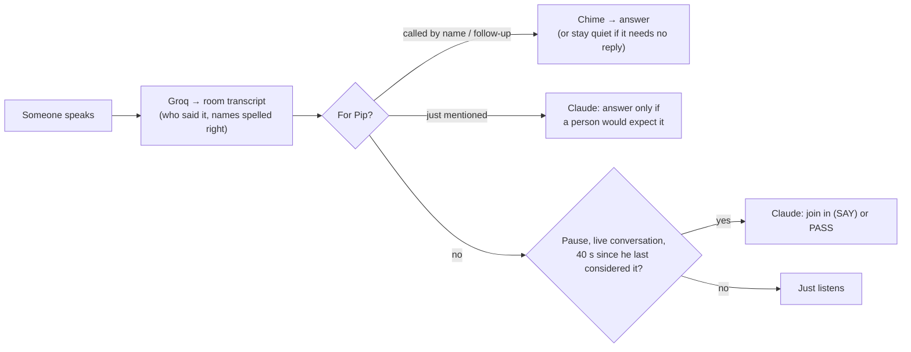
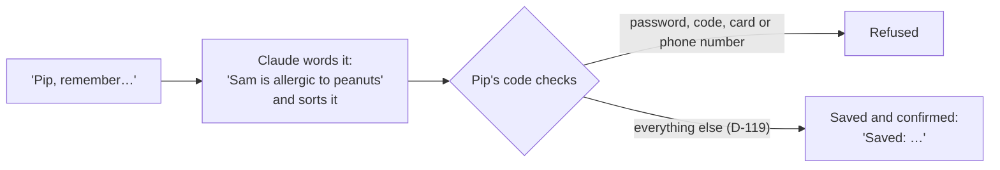
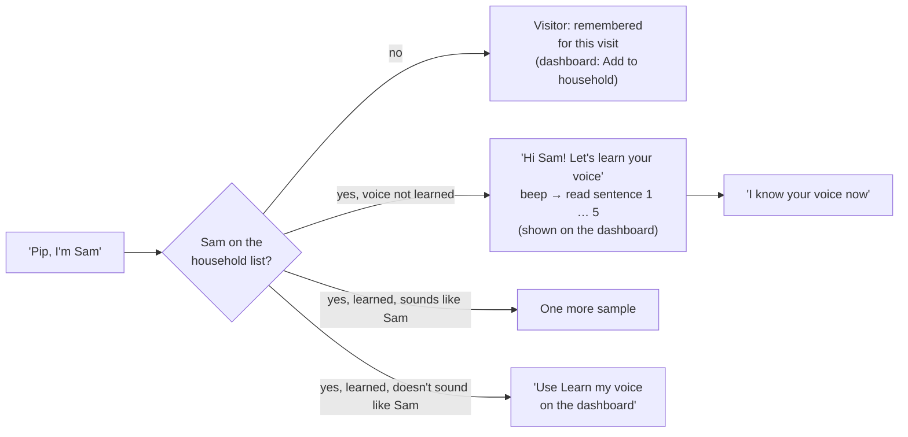
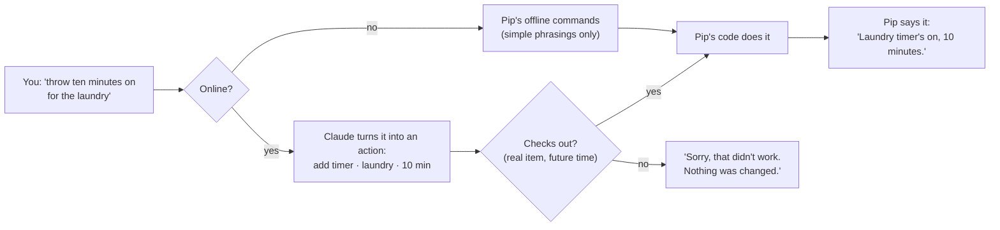
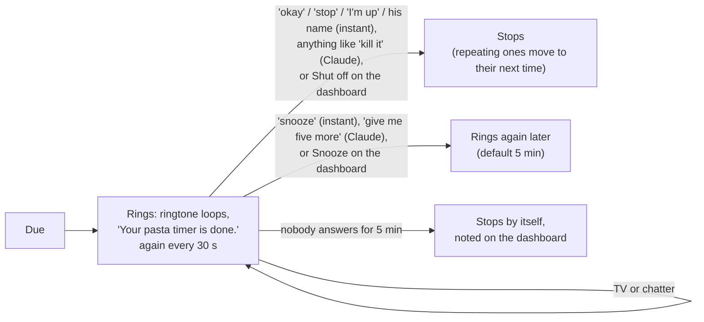
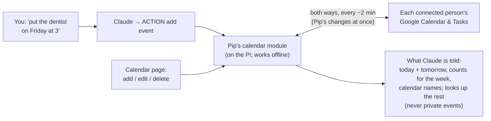
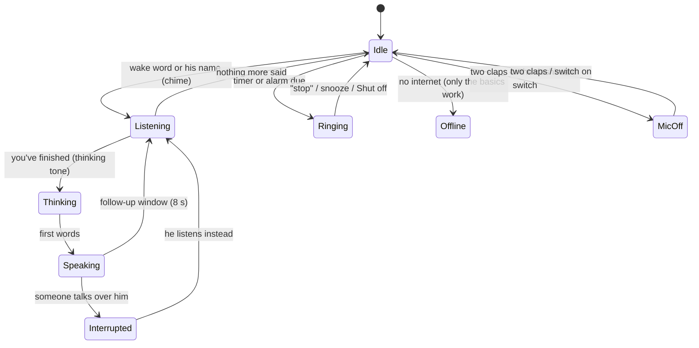
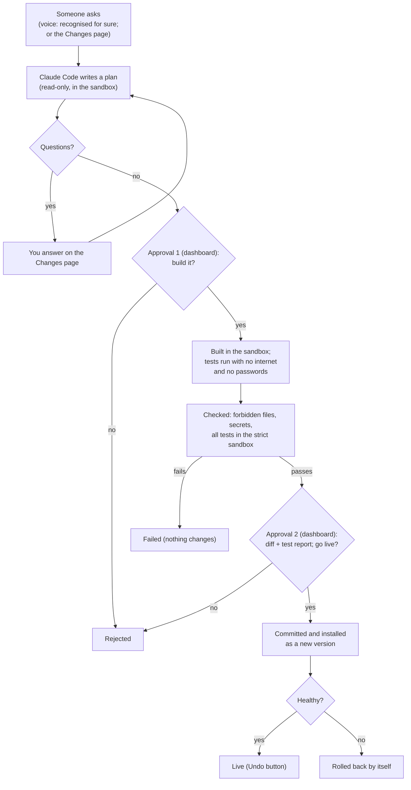
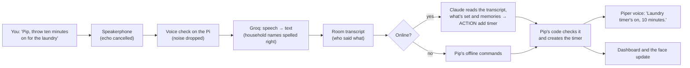

# Pip: what it does

The short, living description of Pip 2.0. Read this first.

**How the docs fit together (for building):** this page says *what* Pip does → [REQUIREMENTS.md](REQUIREMENTS.md) lists every requirement, and its **Detail** link opens the exact behaviour rules in the archived proposal ([archive/pip-v2-proposals-2026-11/](archive/pip-v2-proposals-2026-11/README.md)) → [DECISIONS.md](DECISIONS.md) (`D-nn`) **overrides** anything older, and REQUIREMENTS §0 lists the archived passages that have been overridden. What Ziggletron did (for parity) is in [archive/ziggletron-discovery/](archive/ziggletron-discovery/PRODUCT-OVERVIEW.md).

*Last updated 2026-11-09 · Phase: M1b built. M1a is done (steps 1–8, installed): hearing, answers, timers/alarms, memory, people and voices, listening to the room like Ziggletron, everything in natural language, the calendar / to-dos / Google modules, the face on the monitor and the screen by voice, the Settings page and an editable personality (D-110–D-117). M1b built 2026-11-09 (D-118): Pip changing his own code with your approval twice, versioned installs that roll back by themselves, and the usage meter; it goes live when the owner runs `sh deploy/install.sh`. Next: M2. How the code works: [HOW-PIP-WORKS.md](HOW-PIP-WORKS.md). Dashboard: `http://100.118.171.118:8790`.*

## 1. In one paragraph

Pip is a playful companion living in a dorm room on a Raspberry Pi 5, with a USB speakerphone and a monitor showing his animated face. You call him with **"Hey Pip"** or **"Pippletron"**, or just talk to him by name. He hears the whole room like Ziggletron did, answers out loud in a sentence or two, like a roommate (D-79), understands whatever words you use for timers, alarms, reminders and the calendar, remembers what you approve, and now and then joins a conversation when he has something to add (D-92, D-94). He never claims to have done something he hasn't. He can explain how he works and why he did something, and he can propose changes to his own code, which you review and approve on the dashboard before they go live. He replaces Ziggletron, keeping what worked (the face, interruptions, real ringing alarms, the personality) and fixing what didn't.

## 2. What M0 has found so far

| Question | Answer | Decision |
|---|---|---|
| Which speech-to-text? | **Groq Whisper Turbo with a word list**: 1–7% of words wrong close up, 93% of names and terms right, answers in < 0.5 s | D-48 |
| Across the room? | 35–40% of words wrong (speakerphone position). Accepted: talk from nearer; Pip asks you to repeat when unsure | D-49 |
| Can the Pi transcribe the room itself? | No, the on-device models were too slow or inaccurate, so room speech goes to Groq, like Ziggletron | D-50, D-51 |
| Can Pip be interrupted? | Yes. Echo cancellation removes Pip's own voice almost completely, and speech over him was understood 6/6 | — |
| Is the name easy to detect? | "Pip" alone is too short. Trained **"Hey Pip"**: 85% heard up close, 14% across the room, 0 false wakes. Trained **"Pippletron"**: **100% up close**, 33% across the room, 1 false wake (on "Hey Ziggletron") in 181 clips. "Hey Pip" v2 (trained with half your recordings) did *worse* (67% vs 89% up close on the same clips). All-day false-wake checks: see the strictness row below | D-68 |
| Which voice? | **Piper "lessac"** (starts in 0.3 s). Your favourite, Kokoro "puck", adds 2–3 s per answer on this Pi | D-73 |
| Can self-changes be sandboxed? | Yes, with no installs: secrets, recordings, the repo and the internet were all blocked | — |
| Local AI fallback usable? | Yes for simple questions: first word ~0.6 s, reply ~4.5 s. **Qwen 2.5 1.5B** chosen (Llama 3.2 1B said leaving cooked rice out overnight was fine). Both falsely claimed to set a timer, so the fallback may **never** claim actions; real actions use Pip's offline commands | D-05, D-75 |
| Which wake word? | **Both "Pippletron" and "Hey Pip"** | D-74 |
| Your test of Pip (step 2) | Pippletron 5/5 close and fine across the room; Hey Pip ~12/15 close, weaker far; talking over Pip stopped him every time, never by itself; no false wakes in chat; "Ziggletron" didn't wake him | — |
| How fast does Pip answer? | First words about **2 s** after you finish (Groq 0.4 s + pre-started Claude 1.25 s + voice 0.3 s). Web searches take much longer (~19 s in M0), so weather comes from Open-Meteo instead and Pip says "Let me look that up" when he must search | — |
| Does "Ziggletron" wake Pip? | With synthetic speech, "Ziggletron" woke the Pippletron detector 13/20 times at strictness 0.5 and 4/20 at 0.8 ("Pippletron" itself: 19/20 at 0.8). So Pippletron uses **0.8**, step 3 adds a transcript check, and a retrain with more "Ziggletron" examples is planned | — |
| Why did step 3 feel worse than Ziggletron? (owner test) | Answers too long and assistant-like; the detector alone missed many "Hey Pip"s (Ziggletron reads the words instead); the default Claude model is slower (first words 2.3 s vs 0.9 s for sonnet); web search ~16 s with the "look that up" line not always said. Fixed by D-79 and D-80. Owner retest: hears his name "most of the time", never woke by mistake, but still too long and slower, because saying only the name made Pip wait 1.2 s, say "Yes?" over you, then start again. Fixed by D-81 (0.7 s waits, no "Yes?", joins a paused sentence, two-sentence cap). Web search is still ~15 s: that's Claude's search itself | — |
| Can the Pi hear commands with no internet? (D-83) | Yes, with **Whisper base on the Pi**: about 2.4 s per request on your recordings (vs 0.4 s for Groq). Without its built-in speech filter it "heard" *Pippletron* in plain noise (it copies the word list), which could stop an alarm by mistake, so the filter is always on: noise now gives nothing | D-83 |
| Can Pip tell a phantom "Thank you." from a real one? (D-85) | **Not from the words or Whisper's confidence**: Groq always reports "no speech" as 0%, and a click came back as "Thank you." more confidently than real speech said "Okay." A **voice detector on the Pi (Silero)** separated them perfectly: no voice in any of 12 noises (click, knock, hiss, breath, beep), voice found in all 56 real clips, including quiet one-word "yes" and "thank you", in about 10 ms each. Your step 4 test had 24 such phantoms in one day | D-85 |
| Can Claude turn odd wordings into timer/calendar actions? (D-84) | Yes: 5 of 5 tried came back as correct actions ("remove that", "Mom's birthday November 20th all day", "half an hour earlier than my alarm", "every Sunday evening at 8, laundry"); it asked rather than guess when a dentist visit already existed; ordinary questions were still answered in words | D-84 |
| Can Pip recognise who's talking? (D-87) | Yes, on the Pi: TitaNet small, ~40 ms per request. Learned from 8 of your M0 clips, it was **sure it was you 82%** of the time (probably-you 94%) and **never took any of 24 other voices for you**. With TV in the background it can't tell (you become "Someone"). The other voices were studio recordings, so it needs a check with a roommate | D-87 |
| Can two claps switch Pip off without false alarms? (D-91) | **Yes, on the separate JLab mic** (Session F, 2026-11-08): all 7 double claps heard; a single clap, tongue clicks, snaps, knocks, three or more claps, talking and a door were not; across your 211 other recordings it went off once (tongue clicks). Rules: very loud, 25 dB above the room, over within 0.25 s, exactly two, 0.15–1.5 s apart. Before: **Not through the speakerphone** (Session E, 2026-11-07): its built-in noise filter erases claps, snaps and knocks (most clap recordings peak at 5 of 32,768; tongue clicks come through at full strength), and it has no setting to turn that off. So claps get their own cheap plain USB microphone (D-91 changed); tuned on Session F. Earlier: first live try (2026-11-07): mostly **not heard**. Through the speakerphone claps are quieter (peaks -35 to -2 dBFS), take 20–30 ms to build up, the second is often turned down by its noise suppression, and its echo looked like a third clap; tongue clicks got through instead. Loosened accordingly (claps 0.1–1.5 s apart, quieter second clap allowed, echoes ignored): still no false triggers on your 197 M0 recordings except one double click. **Telling claps from tongue clicks needs real recordings: Session E on the recording page** | D-91 |
| Does Pip know when to join in, and when not to reply? (D-92) | With real Claude, 12/12 as intended: joined in with something useful (egg timing, a movie name), stayed quiet in a tense talk about rent, in two people's own plans and after being ignored; passed when merely mentioned, answered when invited; stays quiet on "never mind, we're good" but answers questions and thanks. About 2 s per decision | D-92 |
| Can Claude run the calendar and to-dos by voice? (D-98, D-100) | Yes, 7 of 7: "add eggs to my to-do list" (onto the speaker's list), "move my 3 o'clock on Monday to 4" (the right event), "dinner with Sam Friday at 7, keep it private" (private), "I bought the milk" (ticked off), "put rent due on Sam's calendar for the 15th" (all-day, on Sam's), and answered "what does Sam have tomorrow?" from the calendar. Google sync itself was tested against a pretend Google; the real one is your first test | D-98, D-100 |
| Does Claude look the calendar up when it only sees today and tomorrow? (D-102, D-103) | Yes, 5 of 5 on the owner's real calendar: "what do I have on Wednesday?" → looked up that day, then answered (≈2 s extra); "tomorrow" → answered straight away; "which calendar is my IP Group meeting on?" → looked up within the right calendar and named it; "put a study session on my IP Group 14 calendar" and "make a Gym calendar, green" → the right actions. The calendar part of each message went from ~2,300 tokens to ~150 | D-102, D-103 |
| Does Claude go quiet when told to, and stay out of passing mentions? (D-105) | Yes, 10 of 10 with the new wording: "shut up", "stop", "enough", "never mind", "be quiet, I'm on the phone" → silence; three passing mentions ("Pip was glitchy", "I'll ask Pip later", a story about him) → silence; "does Pip know when the game starts?" and a direct question → answered | D-105 |
| Does Claude handle "remember / forget" well? (D-88) | Yes: 8 of 8 after one fix. It words memories in the third person ("Alex takes his coffee black"), marks health things sensitive (to the inbox), updates on "actually…", forgets the right one, and asks "Who's this?" when an unrecognised voice says "remember I like…" | D-88 |
| Can the Pi run Pip comfortably? | Yes: 10 min of everyday work used 16% CPU on average (55% peak), 1.5 GB memory, 68 °C; the wake detector never fell behind | — |
| How strict should the wake words be? (D-74) | **Keep Pippletron 0.8 and Hey Pip 0.5.** From 14:21 to 07:30 (17 h) they gave 0 unexplained "Hey Pip" wakes and 1 "Pippletron" (00:24), and all 55 times Pip woke someone really spoke. Looser settings would have added near-misses (Hey Pip 0.42, Pippletron 0.65). The room was silent 94% of the time, so this is about 1 h of real sound: keep watching it in daily use | D-74 |

Live results are on the dashboard (`http://100.118.171.118:8780`).

## 3. How Pip behaves

### Hearing and being called
- An on-device detector listens for **"Hey Pip"** and **"Pippletron"** (D-74). Everything said in the room is also transcribed, so he answers when he's called by name in the words, like Ziggletron (Pip, Pipp, Pippy, Pips, Pippletron and close mishearings; never "Ziggletron") (D-80, D-92).
- After an answer, anyone can follow up without the name for 8 s (12 s if he asked something).
- **He waits until you're done** (D-106): after you pause he waits a moment (0.6 s after a question or short request, 1.2 s after a statement, 1.5 s after a few sentences, 3 s if you stopped mid-sentence, a second longer for a minute after being talked over). If you carry on, he keeps waiting and takes it all as one; only then does he chime and answer.
- **"Stop", "shut up", "enough", "never mind"** (D-105): he goes silent (no "okay, stopping"), stops listening for a follow-up and goes back to idle. The chime can be switched off on the dashboard (Listening & sounds).
- **Interruptions:** talking over him stops him instantly; he then hears what you said and decides whether it needs an answer ("never mind" gets silence). "Actually…" corrects your last request instead of making a new one (D-54, D-92).
- Long silence from the speakerphone means "muted or very quiet", shown as a status, never an error (D-38).

### Listening modes and privacy
- **Pip listens like Ziggletron** (D-92, built 2026-11-07). Everything said in the room is transcribed by Groq (D-51) and kept in a short room transcript, in memory only, with who said it. Claude sees it, so Pip follows the conversation:
  - **called** ("Pip, …", "thanks, Pip", the wake word, or right after he spoke) → he chimes and answers;
  - **mentioned** ("Pip's been glitchy") → Claude decides whether a person would expect him to answer, and usually stays quiet;
  - **neither** → after a short pause in a live conversation he **may join in**, at most every ~40 s ("normal" mood, a setting), never during private or tense talk.
  - He can always **choose not to reply** ("never mind, we're good" gets silence).

- **Privacy is the mic switch** (D-90, D-91): a **Listening** switch on the dashboard. **Two claps** do the same (a falling tone, and he stops listening; clap twice again for a rising tone), heard on a **second USB microphone** (Ziggletron's old JLab mic) chosen on the dashboard (Listening & sounds), because the speakerphone's noise filter erases claps. Tuned on your Session F recordings and switched on by you; with "Two claps switch listening" unticked, claps only show on the conversation feed as a trial. The two are separate: if the dashboard switched him off, claps can't turn him on. Off only stops him hearing anything new: something he'd already heard is still answered (D-114). Clapped off, he ignores the speakerphone completely and only the clap mic listens; switched off on the dashboard, nothing at all. The speakerphone's mute button works too. "Leave me out" was removed. Pip's notice to new people will use your wording (D-61; not built yet). You tell your roommate yourself (D-67).
- Quiet hours 23:00–07:00: no joining in or welcome-backs; alarms still ring (D-66).
- **Welcome back:** after the room was quiet for 20 minutes, someone he recognises gets "Hey Landen, welcome back." (once an hour).

### Personality and voice
- **Personality like Ziggletron's** (D-92): part of the household, warm and a bit cheeky, with opinions; mostly a few words, reacts like a person ("oh nice", "ugh, Mondays"). Short answers (D-79), "he" (D-55–D-59).
- Voice: Piper "lessac" for now. The voice engine is **swappable** (PIP-NEW-097, D-73): the code allows other engines, but Piper is the only one so far, and choosing it in Settings comes with the settings page (step 8).
- He says what actually happened ("Timer's on" only once the timer exists), asks one short question when unsure, and says so when he doesn't know.

### Memory (built in step 5)
- Saves things **when you ask** ("Pip, remember the bins go out Tuesday night"). **Never** saves overheard conversation. Never deletes old memories by itself (D-54). *Later:* Pip asking first ("Want me to remember that?").
- New memories are visible to the household by default; one can be made private, and then it's only used when its owner's voice is recognised for sure. Admins can read all memories (D-15, D-16).
- **Every memory is saved straight away** (D-119, owner, 2026-11-10): sensitive ones, ones about someone else, ones from a voice Pip doesn't recognise, and ones said while he's offline. Only passwords, codes, card and phone numbers are refused. A memory asked to be private stays private; if Pip didn't recognise the voice, it's used for nobody until its owner is set in the Memory Center.
- A **Memory Center** on the dashboard: search, add, edit, make private, archive (kept but not used) and delete. Its inbox only holds memories brought over from Ziggletron (D-117) or waiting from before D-119; a private one there is only shown to, or approvable by, the person who made it.
- No conversation transcripts or recordings are kept as logs. Your test recordings and voice-trained models stay on the Pi (D-72).

| Say | Pip |
|---|---|
| "Remember the bins go out Tuesday night" · "remember I take my coffee black" | "Saved: The bins go out Tuesday night." (exact wording, so you know what he kept) |
| "Remember Sam is allergic to peanuts" (sensitive, or about someone else) | "Saved: Sam is allergic to peanuts." (saved straight away, D-119) |
| "Remember the spare key is under the plant, keep it private" (a voice Pip doesn't recognise) | "Saved privately: … I didn't recognise your voice, so set whose it is in the Memory Center on the dashboard." |
| Sam, about one still waiting in the inbox: "Yeah, that's right, save it" (Pip sure it's Sam) | "Saved: …" (only the person it's about can approve by voice, D-107) |
| "Actually, I take it with oat milk now" · "forget what I said about coffee" | "Updated: …" · "Forgot: …" |
| "Remember the door code is 4821" | Refused: passwords, codes, card and phone numbers aren't memories |
| "What do you remember about me?" · "how do I take my coffee?" | Answers from what he remembers |

### People and voices (built in step 5)
- **People** are added on the dashboard (you first, as Admin). Pip recognises voices on the Pi; the voiceprints never leave it and are never sent to Claude (D-87, D-89).
- **Learning a voice:** once your name is on the list, **introduce yourself however you like** ("Pip, I'm Sam", "hey, it's Sam", "learn my voice"; Claude understands it, D-94). Pip says hi and beeps; **five short sentences appear on the dashboard**, and you read one after each beep (about a minute). If one is too short or he hears nothing, he asks again; if that happens twice in a row he stops. The "Learn my voice" button does the same, and the owner can use his M0 recordings instead (nothing to read). What you read is only turned into a voiceprint on the Pi, never transcribed.

- Pip is **sure** ("Landen"), **probably** ("Landen?") or doesn't know ("Someone"). Claude is told who's talking, so "my" and "me" mean the right person. The conversation feed shows the name.
- **Visitors** who say "Pip, I'm Jordan" are remembered for that visit only (forgotten after 2 hours of quiet or a restart).
- "Pip, who am I?" says who he thinks you are.
- **Names are spelled the household's way** (D-93): Groq is told the names on the list, and a name that sounds the same ("Landon") is corrected to "Landen" everywhere, so "Pip, I'm Landon" finds you instead of making a new person.
- Voice alone is never enough for admin things (settings, approving changes); those need the dashboard.

### Timers, reminders, calendar, lists
- Everything Ziggletron did (timers, repeating and person-targeted reminders, calendar, alarms that keep ringing until answered, "earned" alarms), plus voice snooze and dashboard creation.
- **Any wording** (D-94): there are no phrasings you have to learn. What you say goes to Claude, which turns it into an action; **Pip's own code checks it, does it and confirms**, so he only says "Timer's on" once it's really saved (PIP-NEW-039, D-84). It takes about 2 s (the thinking tone plays). If it's unclear, he asks.
- **Offline** (no internet), simple phrasings still work for the basics, understood on the Pi (D-83).

Examples (any similar wording works; tested with real Claude, test `natural-language`):

| Say | Pip |
|---|---|
| "Throw ten minutes on the clock for the laundry" | "Laundry timer's on, 10 minutes." |
| "I gotta be up at like quarter to seven" · "set an alarm for 6:30 every weekday" | "Alarm set for 6:45 AM tomorrow." |
| "Bug me about calling Mom at 6" · "every Monday at 9, bins" | "Okay, I'll remind you at 6 PM." |
| "Bump my alarm back half an hour" · "make it 15 minutes" · "move the dentist to Saturday" | Moves the **same** item (never adds a second one). Works for timers, alarms, reminders and events alike |
| "Ditch the pasta one" · "cancel that" · "take the dentist off the calendar" | "That" / "it" means the item just talked about, or the one that just rang |
| "What have I got going on?" · "how long's left on the pasta?" · "what time is it?" | Answers from what's set |
| While ringing: "okay" / "stop" / "snooze" / his name | Instant, no Claude needed |
| While ringing: "ugh, five more" · "I'm awake, kill it" | Claude: snoozes 5 minutes / turns it off |

A time with no AM/PM means the next one coming ("at 6" in the afternoon is 6 PM), except an **alarm for a named day** is the morning ("wake me up tomorrow at 6" is 6 AM). "Tonight at 1" means after midnight. **"Tomorrow" means after you next sleep** (D-114): until 4 AM it's still the day before, so at 00:30 "wake me up tomorrow at 7" is that same morning. A time already past means tomorrow. "In 8 hours" is 8 real hours, even across a clock change. Repeats keep their clock time across daylight saving, and **snoozing a repeating alarm doesn't move it** (tomorrow's is still at its usual time). Moving something that's ringing stops it and it rings again at the new time. A bare "later" while ringing doesn't snooze ("okay, I'll do it later" stops it). If a request has several parts and one is wrong, **none** of it is done.

- **Survives restarts and power cuts**: saved the moment it's made. If Pip was off when something was due, it still rings if it's less than 30 minutes late; otherwise the dashboard shows it as missed.
- **The dashboard** (`:8790`) shows Pip's state, live countdowns, alarms, reminders and the next two weeks of the calendar. When something rings: one big **Shut off** and one **Snooze** (5 min; ▾ for other lengths). Plus Cancel, a "Start timer" form and a box to type a command.
- **Offline**: Whisper on the Pi hears the request (about 2.4 s, more mistakes), and Pip's simple built-in phrasings do the basics ("timer ten minutes", "stop", "snooze", "wake me up at 7"). Anything else: he stays quiet (no repeated "I'm offline" line, D-115); his face says "Offline" and a small grey **offline** label shows at the top of the dashboard while he can't reach the internet (D-95).
- **Speech-to-text's daily limit** (D-115): Groq's free plan allows 2,000 requests a day per model, and Pip hears the whole room, so a busy day can use them up. He then switches to a second model with its own 2,000. If both run out, that's **not** offline: what's said to him is heard by Whisper on the Pi (slower, more mistakes) and Claude answers as usual, while room talk isn't written down until the limit resets. The Conversation feed shows a bar when this starts and ends.
- **Still to come**: alarms you have to earn (FEAT-038, needs Claude to judge), reminders for one person (needs person-bound delivery), ringtone and ring-length settings on the dashboard (step 8; four ringtones exist: classic, kitchen, chimes, gentle).
- Later (M3): shared shopping lists, phone notifications via ntfy on the Pi (D-66).

### Calendar, to-dos and Google (built as modules, 2026-11-07)
The calendar, to-dos and Google accounts are **modules** that plug into Pip (D-96; how modules work: ARCHITECTURE §7).

- **Connect Google, per person** (D-97): on Pip's dashboard → **Google**, the owner sets up a free Google Cloud "client" once (4 guided steps, ~10 minutes). Then **each person connects their own account** (People → Connect Google): sign in, **tick "Select all" on Google's "what Pip can access" screen** (the boxes start unticked; if they're left unticked, the Google page says so in red instead of pretending it's connected), then paste back the address Google sends you to (it won't load; that's expected). A roommate can connect his too.
- **Settings for each account** (D-109): Google page → **Settings** (or "Google settings" next to the person on Pip's dashboard). Per calendar: use or ignore it, show it on the calendar page, list it in the dashboard's two weeks, and **heads-ups**: off / **only ones you set** (default: events where you added a reminder in Google yourself, so classes stay quiet) / every event / a fixed time. Per account: no heads-ups at night (on), the household calendar, who Pip may mention it to. To-do lists: use or ignore. The timers list shows only the next 24 hours of heads-ups.
- **Two-way calendar** (D-98): your Google events show on Pip's calendar and he knows about them ("what have I got tomorrow?"); events added by voice or on the dashboard appear in Google within a couple of minutes, and changes on your phone reach Pip the same way. If both sides changed the same event, Google's version wins. Offline, Pip's changes wait and go when he's back.
- **Whose calendar?** "Put it on Sam's calendar" → Sam's. Otherwise the speaker's (if Pip is sure who it is and they're connected), else the **household calendar** (the first admin's).
- **Who may hear about it:** each person chooses on the Google page whether Pip mentions their events and to-dos **to everyone** (default) or **only to them**. "Only to them" also keeps their events and heads-ups **off the room's monitor**.
- **Keeping in step with Google:** once a week Pip fetches the whole calendar again, so events far ahead arrive as they come into his 6-month window. If Google refuses one change (say a heads-up longer than its 4-week limit, or a calendar Pip may no longer write to), only that change is dropped (a new event stays on Pip) and the rest keeps syncing. An event running past midnight is listed once, at its start, and told to Claude with its days ("Sun 9:00–Tue 17:00").
- **Private events** (D-99): mark an event private (in Google, by saying "make it private", or the Private box on the page) and Pip **ignores it**: never mentioned, no heads-up. It still shows on the calendar page, marked private.
- **The Calendar page** (D-101, the Calendar button): month grid with a colour per calendar, tap a day to see its events, add / edit / delete, tick calendars on or off.
- **Which calendar** (D-103): Pip knows each event's calendar ("Landen: Work"). "Put it on my Work calendar", "move standup to my main calendar", "make a Gym calendar, green", "rename Gym to Fitness", "hide the Family calendar", "delete the Gym calendar" (he asks first; main calendars can't be deleted). The Calendar page's **Calendars** button does the same. Making, renaming and deleting need Google's full calendar permission: press Connect Google again and tick Select all (the Google page says so if it's missing).
- **Ignoring calendars** (D-104): on the Google page, under your account, **Calendars → Ignore** on any you don't want (e.g. Holidays). Ignored calendars aren't fetched, don't appear on the Calendar page, and Pip never hears about them.
- **To-dos** (D-100): "Pip, add milk to my to-do list", "I bought the milk", "what's on my list?"; a To-dos page; synced both ways with Google Tasks. Without Google there's a household list on the Pi.

### Pip's state (what the face shows)
Pip is always in **one of 8 states**, each with its own colour, shown by the face on the monitor and the circle on the dashboard (D-86, D-91, D-108). When a question goes to Claude, a **soft thinking tone** plays straight away (instead of "One sec."); it can be set to always, only-if-slow, or off.

**What exactly he's doing** (D-112, D-113). Within each state he's in a situation, with words under his face (also next to the dashboard's circle, and as Conversation bars if you tick the box under Listening & sounds). The busier ones have their own face too. Nothing is ever blank:

| State (colour) | Situations: the words shown |
|---|---|
| Idle (grey) | Say my name if you need me · Following the conversation · Heard my name mentioned: is it for me? · Thinking about joining in |
| Listening (green) | Heard my name: go on (counts down) · Working out what you said · Waiting to see if you're done (counts down) · Listening for your reply (counts down) · Learning a voice |
| Thinking (purple) | Working on an answer · Searching the web · Looking it up · Getting the words out |
| Speaking (blue) | Answering · Joining in · Saying hi · Saying what I did · Saying something went wrong · Guiding voice learning |
| Interrupted (orange) | Someone talked over me |
| Ringing (red) | Say "stop" or "snooze" |
| Not listening (dark grey) | Clap twice to turn me back on · Switched off on the dashboard |
| Offline (slate) | No internet: timers and alarms still work |

The monitor has three of its own: **Starting up** (connecting to Pip), **Can't reach Pip** (trying again), and **Dozing** after 10 quiet minutes. How it all works in the code, and how to change it: [HOW-PIP-WORKS.md §3](HOW-PIP-WORKS.md#3-the-face-state-machine).

Sounds without a human voice in them (a click, a cough, a hiss) are dropped before speech-to-text, so Pip no longer "hears" a phantom "Thank you." (D-85).

### Screen and dashboard
- **What Pip hears and does** (D-108): the Conversation box shows everything heard (grey = not for Pip, green = to Pip, "mentioned Pip"), his replies, and small bars for what happened (chimed, waiting for you to finish, stayed quiet, interrupted, mic off/on and for how long, timers ringing, offline). Live only, never saved. The **coloured circle** at the top shows his state: grey idle, green listening, purple thinking, blue speaking, orange interrupted, red ringing, dark grey mic off, slate offline, with what exactly he's doing next to it. The face on the monitor uses the same colours.
- **The face on the monitor** (D-110, built 2026-11-08): Ziggletron's face, with Pip's state colours and a face and words for each situation (see Pip's state above), weather clothing (Santa hat in the holidays, umbrella in rain, sunglasses when it's sunny and warm), reactions (six-seven, pleased when thanked) and a mouth that moves with his voice. He dozes after 10 quiet minutes. Next to it: the clock, the weather, timers and alarms with countdowns, and today's and tomorrow's events (never private ones). Captions under the face show what was said to Pip and his reply for a minute (only those). A ringing alarm shows a banner. The screen drifts slightly so nothing burns in. Six seven: see below (the `six_seven` module sets it off, with the chant).
- **Changing the screen by voice** (D-111, built 2026-11-08): "show the morning screen", "put the weather up", "take the calendar off", "make the clock bigger", "make your face small", "colour the clock blue", "put the shopping list up", "put a note up called Hall of Fame with …", "save this as the study screen", "undo that", "what can go on the screen?". Ready-made screens: **Default** (big face; clock, weather, timers, calendar), **Morning** (clock, weather, calendar, to-do list), **Focus** (big clock and timers), **Night** (dimmed, clock only). Boxes: clock, weather, timers & alarms, calendar, a to-do list (only lists Pip may mention to everyone), Notes, Pi health, and Conversation (what's said to Pip and his replies, plus **room talk in grey**, unless you ask for it without; room talk reaches the monitor only while that box is up, and is never saved). Pip moves other boxes out of the way himself; if something still won't fit he offers a fix and waits for "okay". "Undo that" goes back one change (up to 10). Pip's dashboard has a **Screen** page with a preview, the screens to pick from, and Undo.
- **The dashboard has no logins** (D-116). It works from your phone and computer over Tailscale, and only devices on your Tailscale network can open it: **`https://ziggletronshome.tail3ae254.ts.net`** (a proper https address, once you've run `sudo sh ~/pip/deploy/install-https.sh`) or `http://100.118.171.118:8790`. A **same-site check** stops any other website open on your phone from changing Pip: changes are only accepted from Pip's own pages (D-10, D-53).
- *Idea for later, not planned:* **YouTube videos on the monitor**: ask for a video and Pip finds it and plays it in a box (asked on the Changes page 2026-11-10; the owner set it aside as a future idea). It would be a module with its own kind of box (D-120); open questions were how Pip finds the right video and whether it plays sound.

### Settings and personality (built in step 8, 2026-11-09)
- **The Settings page** (Settings button on the dashboard, D-117): every setting Pip has, grouped (Voice & sounds, Listening, Conversation & joining in, Location & weather, Brain, Personality, the calendar/to-do/Google modules, and Advanced folded away), each with a one-line explanation and its default. Pip checks a change before saving it. Saving restarts only the part of Pip that uses it, **once he's quiet** (he waits up to 2 minutes), so a change never cuts him off mid-sentence. Sounds, claps and the state bars still change instantly. A new voice is downloaded first. "Try it" plays a ringtone or says a sentence in his current voice.
- **His personality** is editable there: who he is, how he talks, joining in. "Try it" asks a question and shows his answer as text (nothing is said out loud). The last 20 versions are kept, and any can be used again. The rules for actions, memory and privacy are fixed in the code, so a personality can't change what he's allowed to do.
- **Brought over from Ziggletron** (once, read-only; Ziggletron's files are checked unchanged): his **80 memories go to the memory inbox** for you to approve or reject, and his **personality text** becomes Pip's (Pip's own stays in the version list, one click away). Nothing else (reminders, screens, people, voices, passwords) is brought over.
- **No logins** (D-116): the dashboard is reachable only on your Tailscale devices.

### Switched over from Ziggletron (done)
- Pip has taken over: Ziggletron is switched off (D-82), the monitor shows Pip's face (D-110), and Ziggletron's memories and personality were brought over (D-117). Ziggletron stays installed as the owner's fallback; only the owner starts it.

### Explaining himself (later, M2)
- Answers "how does your memory work?" from an up-to-date feature list, the docs and his own code (read-only), and says when the docs and code disagree (PIP-NEW-064–067).
- Answers "why didn't you answer me?" from a 48-hour record of what he decided and why, never by guessing (PIP-NEW-066).

### Six seven (built 2026-11-10, D-121)
- Pip offers everything he hears (room talk, and what's said to him) to his modules, and a module may answer with something for him to say. The `six_seven` module uses it, and is the one place the joke lives: **said to Pip**, "six seven" together ("six seven", "6-7", "67"; not "6:07", or "a timer for 6 minutes and 7 seconds", which still reach Claude); **in the room**, a six and a seven anywhere in a sentence. Then Pip says "six seven, six seven, six fucking seven" **and his face on the monitor freaks out** at the same moment, then both rest for 30 seconds (setting `pause_seconds`). **Any hour**, quiet hours too (owner, 2026-11-10). He says it only when he's free to talk; the face still reacts if he isn't. It keeps nothing of what was said. Switch it off with `enabled = false` under `[modules.six_seven]`.

### Changing himself (built in M1b, 2026-11-09)
- **Asking:** say it to Pip ("Pip, keep track of whose turn it is for the dishes"), or type it on the dashboard's **Changes** page. By voice, only people he recognises for sure may ask; guests and voices he isn't sure of are told to ask on the dashboard. Questions about how he works never start a change (D-118).
- **Two approvals, both on the dashboard.** Claude Code reads his code and writes a plan (what changes, why, which files, how risky, how it's tested, how to undo it). If something is unclear, its questions wait on the Changes page. You approve the plan; then it's built in a **sandbox** and tested; you see the diff and the test report and approve again. Voice can ask, never approve. A change to security-sensitive code also needs "I've read the diff".
- **Undo:** the Undo button on a live change takes it back out (a new commit, installed the same way).
- One change at a time; you can stop one while it's being planned, built or checked. The words of a request are private (shown only on the Changes page) and deleted after 90 days. Commit messages are made from the approved summary, never your words. Pip never pushes to GitHub.

- He can suggest improvements from recurring problems, but never acts on them himself (M4).

### Reliability
- Alarms and "stop" can never be blocked by slower work. A watchdog restarts stuck parts.
- **Every update rolls back by itself** (built in M1b, PIP-NEW-080): Pip runs from a separate copy (`~/pip-app`); a new version goes live only after he's healthy on it for 2½ minutes, otherwise he switches back to the one before. The last 3 versions are kept. The dashboard header shows which version is running.
- Brain: your **Claude Pro subscription** via Claude Code, plus, later (M2), a small local model when Claude is unavailable (D-75); for now his own offline commands do the basics.
- **Usage meter** (built in M1b, PIP-NEW-089): the dashboard shows "Claude today: N requests (≈$X)". When Claude says the plan's usage limit is reached, he stops joining in and pauses self-changes until it resets (or for an hour); replies to people keep trying (D-69). There's no early "80%" warning: the Pro plan doesn't say how much is left (D-05, D-17, D-65).
- Heavy jobs run under a memory cap (lesson from the M0 freeze).

### Devices (later, M3)
- Pip becomes the device hub on the Pi, with no Home Assistant: ESP32/ESPHome devices announce themselves over MQTT and appear on the dashboard for approval; Eightree plugs via the local Tuya protocol (D-18, D-36). New brands are added as one adapter module each.
- Music from local files on Pip's speaker (D-20).

## 4. A request, start to finish

### What Claude sees
Each time Pip asks Claude something (an answer, a mention, or whether to join in), Claude gets:
- **The room conversation**: the last 40 lines (up to 3 hours back), with who said each ("Landen", "Landen?" if he's only fairly sure, "Someone"), including Pip's own lines and where someone talked over him. Kept in memory only, never saved.
- **Who's speaking** and who lives here; **what's set** (timers, alarms, reminders, and what's ringing); **the calendar: today and tomorrow** in full, how many events each later day this week has, and the calendars' names; for anything else Claude asks Pip to **look it up** first, which adds about 2 s (D-102); and **open to-dos** (only what this speaker may hear; never private events or ignored calendars). **Join-in checks** get only the rest of today and no to-dos, since they run every ~40 s; **what Pip remembers** (household memories, plus the speaker's private ones if he's sure who it is); the date and time; the weather.
- **What's asked**: answer (it was said to you), decide (your name came up), or join in or stay quiet.

**Compared with Ziggletron:** the same idea, since step 6: Ziggletron also sent the recent conversation (40 lines, with speaker names) plus what's set and memories. Two differences: Ziggletron picked only memories that matched words in the conversation (Pip sends all active ones, up to 200), and Ziggletron added sound tags like "[sound: Doorbell]" (Pip doesn't detect sounds yet). Before step 6, Pip only sent his own back-and-forth with one person.

## 5. Building it

- **Milestones:** M0 measure (done) → architecture design (approved, D-78) → **M1a** groundwork + Ziggletron's features (done) → **M1b** safe self-changes (built 2026-11-09) → **M2** (next) smarter conversation and self-knowledge → **M3** devices, lists, calendar, music → **M4** self-improvement suggestions (D-08, D-29).
- **Made to be understood and extended** (D-70, D-71): plain-language docs and diagrams for every part; module templates so a new feature (a command, a widget, a device type) is fill-in-the-blanks; swappable speech, voice and AI services; a fresh clone of the repo works without anyone's personal data (PIP-NEW-091–097).
- **May be open-sourced later:** nothing personal ever goes to GitHub, enforced by a commit check.
- **How it's built:** [ARCHITECTURE.md](ARCHITECTURE.md) (approved, D-78).
- **Changing the project:** see [CONTRIBUTING.md](../CONTRIBUTING.md) and [PROJECT-MAP.md](PROJECT-MAP.md).
