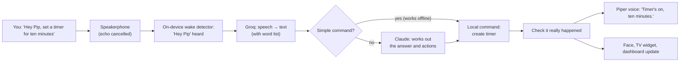

# Pip: what it does

The short, living description of Pip 2.0. Read this first.

**How the docs fit together (for building):** this page says *what* Pip does → [REQUIREMENTS.md](REQUIREMENTS.md) lists every requirement, and its **Detail** link opens the exact behaviour rules in the archived proposal ([archive/pip-v2-proposals-2026-11/](archive/pip-v2-proposals-2026-11/README.md)) → [DECISIONS.md](DECISIONS.md) (`D-nn`) **overrides** anything older, and REQUIREMENTS §0 lists the archived passages that have been overridden. What Ziggletron did (for parity) is in [archive/ziggletron-discovery/](archive/ziggletron-discovery/PRODUCT-OVERVIEW.md).

*Last updated 2026-11-04 · Phase: architecture design (M0 measurements done; no Pip code yet).*

## 1. In one paragraph

Pip is a playful companion living in a dorm room on a Raspberry Pi 5, with a USB speakerphone and a monitor showing his animated face. You call him with **"Hey Pip"** (and maybe **"Pippletron"**). He answers out loud in a few sentences, sets timers and reminders, remembers what you approve, and now and then joins a conversation when he has something useful to say. He never claims to have done something he hasn't. He can explain how he works and why he did something, and he can propose changes to his own code, which you review and approve on the dashboard before they go live. He replaces Ziggletron, keeping what worked (the face, interruptions, real ringing alarms, the personality) and fixing what didn't.

## 2. What M0 has found so far

| Question | Answer | Decision |
|---|---|---|
| Which speech-to-text? | **Groq Whisper Turbo with a word list**: 1–7% of words wrong close up, 93% of names and terms right, answers in < 0.5 s | D-48 |
| Across the room? | 35–40% of words wrong (speakerphone position). Accepted: talk from nearer; Pip asks you to repeat when unsure | D-49 |
| Can the Pi transcribe the room itself? | No, the on-device models were too slow or inaccurate, so room speech goes to Groq, like Ziggletron | D-50, D-51 |
| Can Pip be interrupted? | Yes. Echo cancellation removes Pip's own voice almost completely, and speech over him was understood 6/6 | — |
| Is the name easy to detect? | "Pip" alone is too short. Trained **"Hey Pip"**: 85% heard up close, 14% across the room, 0 false wakes. Trained **"Pippletron"**: **100% up close**, 33% across the room, 1 false wake (on "Hey Ziggletron") in 181 clips. "Hey Pip" v2 (trained with half your recordings) did *worse* (67% vs 89% up close on the same clips). All-day false-wake checks for both are running | D-68 |
| Which voice? | **Piper "lessac"** (starts in 0.3 s). Your favourite, Kokoro "puck", adds 2–3 s per answer on this Pi | D-73 |
| Can self-changes be sandboxed? | Yes, with no installs: secrets, recordings, the repo and the internet were all blocked | — |
| Local AI fallback usable? | Yes for simple questions: first word ~0.6 s, reply ~4.5 s. **Qwen 2.5 1.5B** chosen (Llama 3.2 1B said leaving cooked rice out overnight was fine). Both falsely claimed to set a timer, so the fallback may **never** claim actions; real actions use Pip's offline commands | D-05, D-75 |
| Which wake word? | **Both "Pippletron" and "Hey Pip"** | D-74 |
| Can the Pi run Pip comfortably? | Yes: 10 min of everyday work used 16% CPU on average (55% peak), 1.5 GB memory, 68 °C; the wake detector never fell behind | — |
| Still running | Overnight false-wake checks for both wake words (until 07:30); they tune sensitivity only | — |

Live results are on the dashboard (`http://100.118.171.118:8780`).

## 3. How Pip behaves

### Hearing and being called
- An on-device detector listens for **"Hey Pip"** (and "Pippletron" if it tests well). Pip also answers to Pippy, Pips and Pippletron in transcripts (D-60).
- After an answer, the **same person** can follow up without the name (D-54).
- **Interruptions:** "stop" halts him instantly, "wait" pauses and "go on" resumes, "actually…" corrects your last request instead of making a new one. He goes quieter when someone else starts talking (D-54).
- Long silence from the speakerphone means "muted or very quiet", shown as a status, never an error (D-38).

### Listening modes and privacy
- **Social mode is the default** (D-02). Room speech is transcribed by Groq (D-51). A quick on-device check spots questions, and only then does Pip ask Claude whether to chime in, at most every ~3 minutes (D-52, D-58).
- **Private mode:** "Pip, private please" stops anything being sent, for a while or until switched back.
- **Opt-out consent** (D-13): household adults are included unless they say "Pip, leave me out". Guests are never included. Pip's notice to new people uses your wording (D-61). You tell your roommate yourself (D-67).
- Quiet hours 23:00–07:00: no joining in or greetings; alarms still ring (D-66).

### Personality and voice
- Playful and jokey, medium-length answers, jokes sometimes, "he" (D-55–D-59).
- Voice: Piper "lessac" for now. The voice engine is **swappable** in Settings (PIP-NEW-097, D-73).
- He says what actually happened ("Timer's on" only once the timer exists), asks one short question when unsure, and says so when he doesn't know.

### Memory
- Saves things when you ask, or **asks first** ("Want me to remember that?"). **Never** saves overheard conversation. Never deletes old memories by itself (D-54).
- New memories are visible to the household by default. Admins can read all memories, and every read is logged (D-15, D-16).
- A Memory Center on the dashboard to browse, edit, approve and delete. Ziggletron's memories will be imported for review (D-07).
- No conversation transcripts or recordings are kept as logs. Your test recordings and voice-trained models stay on the Pi (D-72).

### Timers, reminders, calendar, lists
- Everything Ziggletron did (timers, repeating and person-targeted reminders, calendar, alarms that keep ringing until answered, "earned" alarms), plus voice snooze and dashboard creation.
- **Works offline** for the basics (timers, stop, snooze, volume) (PIP-NEW-044).
- Later (M3): shared shopping and to-do lists, Google Calendar sync, phone notifications via ntfy on the Pi (D-19, D-66).

### Screen and dashboard
- The animated face on the monitor, with weather clothing and reactions (six-seven stays) (D-35, D-62).
- TV widgets show live data. Layout changes are checked, previewed and undoable.
- The dashboard works from your phone over Tailscale. Admin actions need a login with 2-factor; the conversation feed doesn't (D-10, D-35, D-53).

### Explaining himself
- Answers "how does your memory work?" from an up-to-date feature list, the docs and his own code (read-only), and says when the docs and code disagree (PIP-NEW-064–067).
- Answers "why didn't you answer me?" from a 48-hour record of what he decided and why, never by guessing (PIP-NEW-066).

### Changing himself
- You can ask by voice. He clarifies, writes a plan, codes it in a **sandbox**, tests it, and shows you the plan and then the actual change on the dashboard. **You approve twice**, and it goes live with automatic rollback if anything breaks (D-09, PIP-NEW-069–076).
- He can suggest improvements from recurring problems, but never acts on them himself (M4).

### Reliability
- Alarms and "stop" can never be blocked by slower work. A watchdog restarts stuck parts. Updates can be rolled back.
- Brain: your **Claude Pro subscription** via Claude Code, plus a small local model when Claude is unavailable (if the M0 speed test says it's usable). When usage runs low, he stops joining in and pauses self-changes first (D-05, D-17, D-65, D-69).
- Heavy jobs run under a memory cap (lesson from the M0 freeze).

### Devices (later, M3)
- Pip becomes the device hub on the Pi, with no Home Assistant: ESP32/ESPHome devices announce themselves over MQTT and appear on the dashboard for approval; Eightree plugs via the local Tuya protocol (D-18, D-36). New brands are added as one adapter module each.
- Music from local files on Pip's speaker (D-20).

## 4. A request, start to finish

## 5. Building it

- **Milestones:** M0 measure (now) → architecture design (you review) → **M1a** groundwork + Ziggletron's features → **M1b** safe self-changes (switch over from Ziggletron) → **M2** smarter conversation and self-knowledge → **M3** devices, lists, calendar, music → **M4** self-improvement suggestions (D-08, D-29).
- **Made to be understood and extended** (D-70, D-71): plain-language docs and diagrams for every part; module templates so a new feature (a command, a widget, a device type) is fill-in-the-blanks; swappable speech, voice and AI services; a fresh clone of the repo works without anyone's personal data (PIP-NEW-091–097).
- **May be open-sourced later:** nothing personal ever goes to GitHub, enforced by a commit check.
- **Changing the project:** see [CONTRIBUTING.md](../CONTRIBUTING.md) and [PROJECT-MAP.md](PROJECT-MAP.md).
