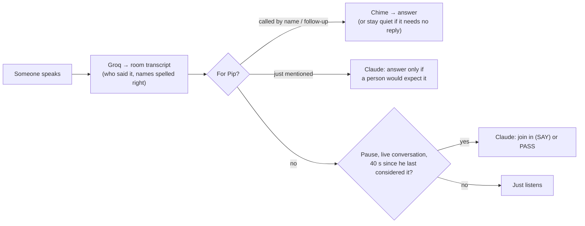
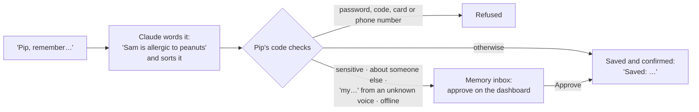
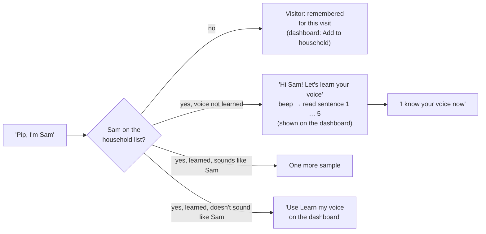
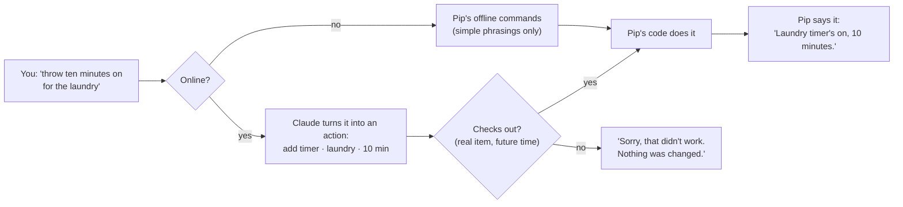
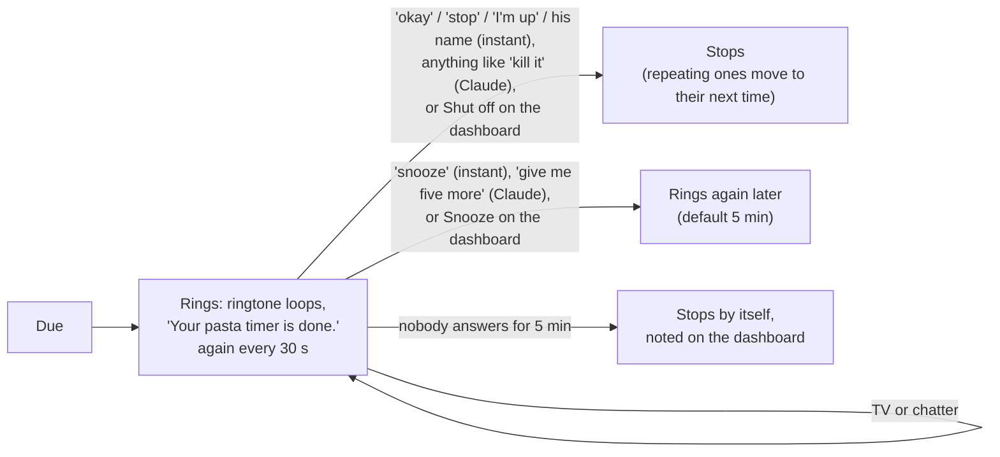
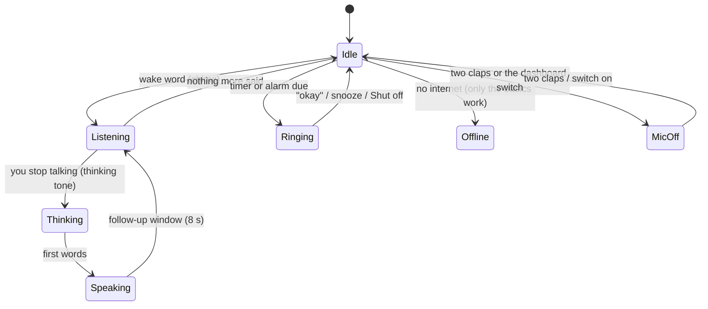
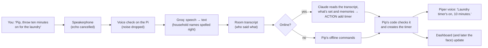

# Pip: what it does

The short, living description of Pip 2.0. Read this first.

**How the docs fit together (for building):** this page says *what* Pip does → [REQUIREMENTS.md](REQUIREMENTS.md) lists every requirement, and its **Detail** link opens the exact behaviour rules in the archived proposal ([archive/pip-v2-proposals-2026-11/](archive/pip-v2-proposals-2026-11/README.md)) → [DECISIONS.md](DECISIONS.md) (`D-nn`) **overrides** anything older, and REQUIREMENTS §0 lists the archived passages that have been overridden. What Ziggletron did (for parity) is in [archive/ziggletron-discovery/](archive/ziggletron-discovery/PRODUCT-OVERVIEW.md).

*Last updated 2026-11-07 · Phase: M1a building. Steps 1–5 done and installed (hearing, answers, timers/alarms/calendar, memory, people and voices). Step 6 built, waiting for your test: Pip listens to the room like Ziggletron and joins in, understands everything in natural language, two claps or a dashboard switch turn listening off, names spelled right, a small offline indicator. Dashboard: `http://100.118.171.118:8790`.*

## 1. In one paragraph

Pip is a playful companion living in a dorm room on a Raspberry Pi 5, with a USB speakerphone and a monitor showing his animated face. You call him with **"Hey Pip"** or **"Pippletron"**, or just talk to him by name. He hears the whole room like Ziggletron did, answers out loud in a sentence or two, like a roommate (D-79), understands whatever words you use for timers, alarms, reminders and the calendar, remembers what you approve, and now and then joins a conversation when he has something to add (D-92, D-94). He never claims to have done something he hasn't. He can explain how he works and why he did something, and he can propose changes to his own code, which you review and approve on the dashboard before they go live. He replaces Ziggletron, keeping what worked (the face, interruptions, real ringing alarms, the personality) and fixing what didn't.

## 2. What M0 has found so far

| Question | Answer | Decision |
|---|---|---|
| Which speech-to-text? | **Groq Whisper Turbo with a word list**: 1–7% of words wrong close up, 93% of names and terms right, answers in < 0.5 s | D-48 |
| Across the room? | 35–40% of words wrong (speakerphone position). Accepted: talk from nearer; Pip asks you to repeat when unsure | D-49 |
| Can the Pi transcribe the room itself? | No, the on-device models were too slow or inaccurate, so room speech goes to Groq, like Ziggletron | D-50, D-51 |
| Can Pip be interrupted? | Yes. Echo cancellation removes Pip's own voice almost completely, and speech over him was understood 6/6 | — |
| Is the name easy to detect? | "Pip" alone is too short. Trained **"Hey Pip"**: 85% heard up close, 14% across the room, 0 false wakes. Trained **"Pippletron"**: **100% up close**, 33% across the room, 1 false wake (on "Hey Ziggletron") in 181 clips. "Hey Pip" v2 (trained with half your recordings) did *worse* (67% vs 89% up close on the same clips). All-day false-wake checks: see the strictness row below | D-68 |
| Which voice? | **Piper "lessac"** (starts in 0.3 s). Your favourite, Kokoro "puck", adds 2–3 s per answer on this Pi | D-73 |
| Can self-changes be sandboxed? | Yes, with no installs: secrets, recordings, the repo and the internet were all blocked | — |
| Local AI fallback usable? | Yes for simple questions: first word ~0.6 s, reply ~4.5 s. **Qwen 2.5 1.5B** chosen (Llama 3.2 1B said leaving cooked rice out overnight was fine). Both falsely claimed to set a timer, so the fallback may **never** claim actions; real actions use Pip's offline commands | D-05, D-75 |
| Which wake word? | **Both "Pippletron" and "Hey Pip"** | D-74 |
| Your test of Pip (step 2) | Pippletron 5/5 close and fine across the room; Hey Pip ~12/15 close, weaker far; talking over Pip stopped him every time, never by itself; no false wakes in chat; "Ziggletron" didn't wake him | — |
| How fast does Pip answer? | First words about **2 s** after you finish (Groq 0.4 s + pre-started Claude 1.25 s + voice 0.3 s). Web searches take much longer (~19 s in M0), so weather comes from Open-Meteo instead and Pip says "Let me look that up" when he must search | — |
| Does "Ziggletron" wake Pip? | With synthetic speech, "Ziggletron" woke the Pippletron detector 13/20 times at strictness 0.5 and 4/20 at 0.8 ("Pippletron" itself: 19/20 at 0.8). So Pippletron uses **0.8**, step 3 adds a transcript check, and a retrain with more "Ziggletron" examples is planned | — |
| Why did step 3 feel worse than Ziggletron? (owner test) | Answers too long and assistant-like; the detector alone missed many "Hey Pip"s (Ziggletron reads the words instead); the default Claude model is slower (first words 2.3 s vs 0.9 s for sonnet); web search ~16 s with the "look that up" line not always said. Fixed by D-79 and D-80. Owner retest: hears his name "most of the time", never woke by mistake, but still too long and slower, because saying only the name made Pip wait 1.2 s, say "Yes?" over you, then start again. Fixed by D-81 (0.7 s waits, no "Yes?", joins a paused sentence, two-sentence cap). Web search is still ~15 s: that's Claude's search itself | — |
| Can the Pi hear commands with no internet? (D-83) | Yes, with **Whisper base on the Pi**: about 2.4 s per request on your recordings (vs 0.4 s for Groq). Without its built-in speech filter it "heard" *Pippletron* in plain noise (it copies the word list), which could stop an alarm by mistake, so the filter is always on: noise now gives nothing | D-83 |
| Can Pip tell a phantom "Thank you." from a real one? (D-85) | **Not from the words or Whisper's confidence**: Groq always reports "no speech" as 0%, and a click came back as "Thank you." more confidently than real speech said "Okay." A **voice detector on the Pi (Silero)** separated them perfectly: no voice in any of 12 noises (click, knock, hiss, breath, beep), voice found in all 56 real clips, including quiet one-word "yes" and "thank you", in about 10 ms each. Your step 4 test had 24 such phantoms in one day | D-85 |
| Can Claude turn odd wordings into timer/calendar actions? (D-84) | Yes: 5 of 5 tried came back as correct actions ("remove that", "Mom's birthday November 20th all day", "half an hour earlier than my alarm", "every Sunday evening at 8, laundry"); it asked rather than guess when a dentist visit already existed; ordinary questions were still answered in words | D-84 |
| Can Pip recognise who's talking? (D-87) | Yes, on the Pi: TitaNet small, ~40 ms per request. Learned from 8 of your M0 clips, it was **sure it was you 82%** of the time (probably-you 94%) and **never took any of 24 other voices for you**. With TV in the background it can't tell (you become "Someone"). The other voices were studio recordings, so it needs a check with a roommate | D-87 |
| Can two claps switch Pip off without false alarms? (D-91) | In generated tests, two claps were heard (quiet and noisy room); one clap, three claps, claps far apart, talking, claps then talking and ringing slams were not. Over all 197 of your M0 recordings (9 min) it went off **once** (a double click at the start of one recording) after tightening: a clap must be loudest straight away and short. Real claps through the speakerphone: your test | D-91 |
| Does Pip know when to join in, and when not to reply? (D-92) | With real Claude, 12/12 as intended: joined in with something useful (egg timing, a movie name), stayed quiet in a tense talk about rent, in two people's own plans and after being ignored; passed when merely mentioned, answered when invited; stays quiet on "never mind, we're good" but answers questions and thanks. About 2 s per decision | D-92 |
| Does Claude handle "remember / forget" well? (D-88) | Yes: 8 of 8 after one fix. It words memories in the third person ("Alex takes his coffee black"), marks health things sensitive (to the inbox), updates on "actually…", forgets the right one, and asks "Who's this?" when an unrecognised voice says "remember I like…" | D-88 |
| Can the Pi run Pip comfortably? | Yes: 10 min of everyday work used 16% CPU on average (55% peak), 1.5 GB memory, 68 °C; the wake detector never fell behind | — |
| How strict should the wake words be? (D-74) | **Keep Pippletron 0.8 and Hey Pip 0.5.** From 14:21 to 07:30 (17 h) they gave 0 unexplained "Hey Pip" wakes and 1 "Pippletron" (00:24), and all 55 times Pip woke someone really spoke. Looser settings would have added near-misses (Hey Pip 0.42, Pippletron 0.65). The room was silent 94% of the time, so this is about 1 h of real sound: keep watching it in daily use | D-74 |

Live results are on the dashboard (`http://100.118.171.118:8780`).

## 3. How Pip behaves

### Hearing and being called
- An on-device detector listens for **"Hey Pip"** and **"Pippletron"** (D-74). Everything said in the room is also transcribed, so he answers when he's called by name in the words, like Ziggletron (Pip, Pipp, Pippy, Pips, Pippletron and close mishearings; never "Ziggletron") (D-80, D-92).
- After an answer, anyone can follow up without the name for 8 s (12 s if he asked something).
- **Interruptions:** talking over him stops him instantly; he then hears what you said and decides whether it needs an answer ("never mind" gets silence). "Actually…" corrects your last request instead of making a new one (D-54, D-92).
- Long silence from the speakerphone means "muted or very quiet", shown as a status, never an error (D-38).

### Listening modes and privacy
- **Pip listens like Ziggletron** (D-92, built 2026-11-07). Everything said in the room is transcribed by Groq (D-51) and kept in a short room transcript, in memory only, with who said it. Claude sees it, so Pip follows the conversation:
  - **called** ("Pip, …", "thanks, Pip", the wake word, or right after he spoke) → he chimes and answers;
  - **mentioned** ("Pip's been glitchy") → Claude decides whether a person would expect him to answer, and usually stays quiet;
  - **neither** → after a short pause in a live conversation he **may join in**, at most every ~40 s ("normal" mood, a setting), never during private or tense talk.
  - He can always **choose not to reply** ("never mind, we're good" gets silence).

- **Privacy is the mic switch** (D-90, D-91): a **Listening** switch on the dashboard, or **two claps** (Pip plays a falling tone and stops listening; clap twice again for a rising tone and he's back). The two are separate: if the dashboard switched him off, claps can't turn him on. Clapped off, he hears nothing but claps; switched off on the dashboard, nothing at all. The speakerphone's mute button works too. "Leave me out" was removed. Pip's notice to new people uses your wording (D-61). You tell your roommate yourself (D-67).
- Quiet hours 23:00–07:00: no joining in or welcome-backs; alarms still ring (D-66).
- **Welcome back:** after the room was quiet for 20 minutes, someone he recognises gets "Hey Landen, welcome back." (once an hour).

### Personality and voice
- **Personality like Ziggletron's** (D-92): part of the household, warm and a bit cheeky, with opinions; mostly a few words, reacts like a person ("oh nice", "ugh, Mondays"). Short answers (D-79), "he" (D-55–D-59).
- Voice: Piper "lessac" for now. The voice engine is **swappable** in Settings (PIP-NEW-097, D-73).
- He says what actually happened ("Timer's on" only once the timer exists), asks one short question when unsure, and says so when he doesn't know.

### Memory (built in step 5)
- Saves things **when you ask** ("Pip, remember the bins go out Tuesday night"). **Never** saves overheard conversation. Never deletes old memories by itself (D-54). *Later:* Pip asking first ("Want me to remember that?").
- New memories are visible to the household by default; one can be made private, and then it's only used when its owner's voice is recognised for sure. Admins can read all memories (D-15, D-16).
- A **Memory Center** on the dashboard: an inbox to approve or reject, search, add, edit, make private, archive (kept but not used) and delete. Ziggletron's memories will be imported for review in step 8 (D-07).
- No conversation transcripts or recordings are kept as logs. Your test recordings and voice-trained models stay on the Pi (D-72).

| Say | Pip |
|---|---|
| "Remember the bins go out Tuesday night" · "remember I take my coffee black" | "Saved: The bins go out Tuesday night." (exact wording, so you know what he kept) |
| "Remember Sam is allergic to peanuts" (health, money, relationships, someone's whereabouts, children; or a preference about someone else) | "I'll remember that once it's approved in the memory inbox on the dashboard." |
| "Actually, I take it with oat milk now" · "forget what I said about coffee" | "Updated: …" · "Forgot: …" |
| "Remember the door code is 4821" | Refused: passwords, codes, card and phone numbers aren't memories |
| "What do you remember about me?" · "how do I take my coffee?" | Answers from what he remembers |

### People and voices (built in step 5)
- **People** are added on the dashboard (you first, as Admin). Pip recognises voices on the Pi; the voiceprints never leave it and are never sent to Claude (D-87, D-89).
- **Learning a voice:** once your name is on the list, **introduce yourself however you like** ("Pip, I'm Sam", "hey, it's Sam", "learn my voice"; Claude understands it, D-94). Pip says hi and beeps; **five short sentences appear on the dashboard**, and you read one after each beep (about a minute). If one is too short or he hears nothing, he asks again; if that happens twice in a row he stops. The "Learn my voice" button does the same, and the owner can use his M0 recordings instead (nothing to read). What you read is only turned into a voiceprint on the Pi, never transcribed.

- Pip is **sure** ("Landen"), **probably** ("Landen?") or doesn't know ("Someone"). Claude is told who's talking, so "my" and "me" mean the right person. The conversation feed shows the name.
- **Visitors** who say "Pip, I'm Jordan" are remembered for that visit only (forgotten after 2 hours of quiet or a restart).
- "Pip, who am I?" says who he thinks you are.
- **Names are spelled the household's way** (D-93): Groq is told the names on the list, and a name that sounds the same ("Landon") is corrected to "Landen" everywhere, so "Pip, I'm Landon" finds you instead of making a new person.
- Voice alone is never enough for admin things (settings, approving changes); those need the dashboard.

### Timers, reminders, calendar, lists
- Everything Ziggletron did (timers, repeating and person-targeted reminders, calendar, alarms that keep ringing until answered, "earned" alarms), plus voice snooze and dashboard creation.
- **Any wording** (D-94): there are no phrasings you have to learn. What you say goes to Claude, which turns it into an action; **Pip's own code checks it, does it and confirms**, so he only says "Timer's on" once it's really saved (PIP-NEW-039, D-84). It takes about 2 s (the thinking tone plays). If it's unclear, he asks.
- **Offline** (no internet), simple phrasings still work for the basics, understood on the Pi (D-83).

Examples (any similar wording works; tested with real Claude, test `natural-language`):

| Say | Pip |
|---|---|
| "Throw ten minutes on the clock for the laundry" | "Laundry timer's on, 10 minutes." |
| "I gotta be up at like quarter to seven" · "set an alarm for 6:30 every weekday" | "Alarm set for 6:45 AM tomorrow." |
| "Bug me about calling Mom at 6" · "every Monday at 9, bins" | "Okay, I'll remind you at 6 PM." |
| "Bump my alarm back half an hour" · "make it 15 minutes" · "move the dentist to Saturday" | Moves the **same** item (never adds a second one). Works for timers, alarms, reminders and events alike |
| "Ditch the pasta one" · "cancel that" · "take the dentist off the calendar" | "That" / "it" means the item just talked about, or the one that just rang |
| "What have I got going on?" · "how long's left on the pasta?" · "what time is it?" | Answers from what's set |
| While ringing: "okay" / "stop" / "snooze" / his name | Instant, no Claude needed |
| While ringing: "ugh, five more" · "I'm awake, kill it" | Claude: snoozes 5 minutes / turns it off |

A time with no AM/PM means the next one coming ("at 6" in the afternoon is 6 PM). A time already past means tomorrow. Repeats keep their clock time across daylight saving.

- **Survives restarts and power cuts**: saved the moment it's made. If Pip was off when something was due, it still rings if it's less than 30 minutes late; otherwise the dashboard shows it as missed.
- **The dashboard** (`:8790`) shows Pip's state, live countdowns, alarms, reminders and the next two weeks of the calendar. When something rings: one big **Shut off** and one **Snooze** (5 min; ▾ for other lengths). Plus Cancel, a "Start timer" form and a box to type a command.
- **Offline**: Whisper on the Pi hears the request (about 2.4 s, more mistakes), and Pip's simple built-in phrasings do the basics ("timer ten minutes", "stop", "snooze", "wake me up at 7"). Anything else: "I'm offline, so I can only do the basics right now." A small grey **offline** label shows at the top of the dashboard while he can't reach the internet (D-95).
- **Still to come**: alarms you have to earn (FEAT-038, needs Claude to judge), reminders for one person (needs person-bound delivery), ringtone and ring-length settings on the dashboard (step 8; four ringtones exist: classic, kitchen, chimes, gentle).
- Later (M3): shared shopping and to-do lists, Google Calendar sync, phone notifications via ntfy on the Pi (D-19, D-66).

### Pip's state (what the face will show)
Pip is always in one of seven states, shown on the dashboard and used by the face in step 7 (D-86, D-91). When a question goes to Claude, a **soft thinking tone** plays straight away (instead of "One sec."); it can be set to always, only-if-slow, or off.

Sounds without a human voice in them (a click, a cough, a hiss) are dropped before speech-to-text, so Pip no longer "hears" a phantom "Thank you." (D-85).

### Screen and dashboard
- The animated face on the monitor, with weather clothing and reactions (six-seven stays) (D-35, D-62).
- TV widgets show live data. Layout changes are checked, previewed and undoable.
- The dashboard works from your phone over Tailscale. Admin actions need a login with 2-factor; the conversation feed doesn't (D-10, D-35, D-53).

### Explaining himself
- Answers "how does your memory work?" from an up-to-date feature list, the docs and his own code (read-only), and says when the docs and code disagree (PIP-NEW-064–067).
- Answers "why didn't you answer me?" from a 48-hour record of what he decided and why, never by guessing (PIP-NEW-066).

### Changing himself
- You can ask by voice. He clarifies, writes a plan, codes it in a **sandbox**, tests it, and shows you the plan and then the actual change on the dashboard. **You approve twice**, and it goes live with automatic rollback if anything breaks (D-09, PIP-NEW-069–076).
- He can suggest improvements from recurring problems, but never acts on them himself (M4).

### Reliability
- Alarms and "stop" can never be blocked by slower work. A watchdog restarts stuck parts. Updates can be rolled back.
- Brain: your **Claude Pro subscription** via Claude Code, plus a small local model when Claude is unavailable (if the M0 speed test says it's usable). When usage runs low, he stops joining in and pauses self-changes first (D-05, D-17, D-65, D-69).
- Heavy jobs run under a memory cap (lesson from the M0 freeze).

### Devices (later, M3)
- Pip becomes the device hub on the Pi, with no Home Assistant: ESP32/ESPHome devices announce themselves over MQTT and appear on the dashboard for approval; Eightree plugs via the local Tuya protocol (D-18, D-36). New brands are added as one adapter module each.
- Music from local files on Pip's speaker (D-20).

## 4. A request, start to finish

### What Claude sees
Each time Pip asks Claude something (an answer, a mention, or whether to join in), Claude gets:
- **The room conversation**: the last 40 lines (up to 3 hours back), with who said each ("Landen", "Landen?" if he's only fairly sure, "Someone"), including Pip's own lines and where someone talked over him. Kept in memory only, never saved.
- **Who's speaking** and who lives here; **what's set** (timers, alarms, reminders, the next two weeks of the calendar, and what's ringing); **what Pip remembers** (household memories, plus the speaker's private ones if he's sure who it is); the date and time; the weather.
- **What's asked**: answer (it was said to you), decide (your name came up), or join in or stay quiet.

**Compared with Ziggletron:** the same idea, since step 6: Ziggletron also sent the recent conversation (40 lines, with speaker names) plus what's set and memories. Two differences: Ziggletron picked only memories that matched words in the conversation (Pip sends all active ones, up to 200), and Ziggletron added sound tags like "[sound: Doorbell]" (Pip doesn't detect sounds yet). Before step 6, Pip only sent his own back-and-forth with one person.

## 5. Building it

- **Milestones:** M0 measure (now) → architecture design (you review) → **M1a** groundwork + Ziggletron's features → **M1b** safe self-changes (switch over from Ziggletron) → **M2** smarter conversation and self-knowledge → **M3** devices, lists, calendar, music → **M4** self-improvement suggestions (D-08, D-29).
- **Made to be understood and extended** (D-70, D-71): plain-language docs and diagrams for every part; module templates so a new feature (a command, a widget, a device type) is fill-in-the-blanks; swappable speech, voice and AI services; a fresh clone of the repo works without anyone's personal data (PIP-NEW-091–097).
- **May be open-sourced later:** nothing personal ever goes to GitHub, enforced by a commit check.
- **How it's built:** [ARCHITECTURE.md](ARCHITECTURE.md) (approved, D-78).
- **Changing the project:** see [CONTRIBUTING.md](../CONTRIBUTING.md) and [PROJECT-MAP.md](PROJECT-MAP.md).
