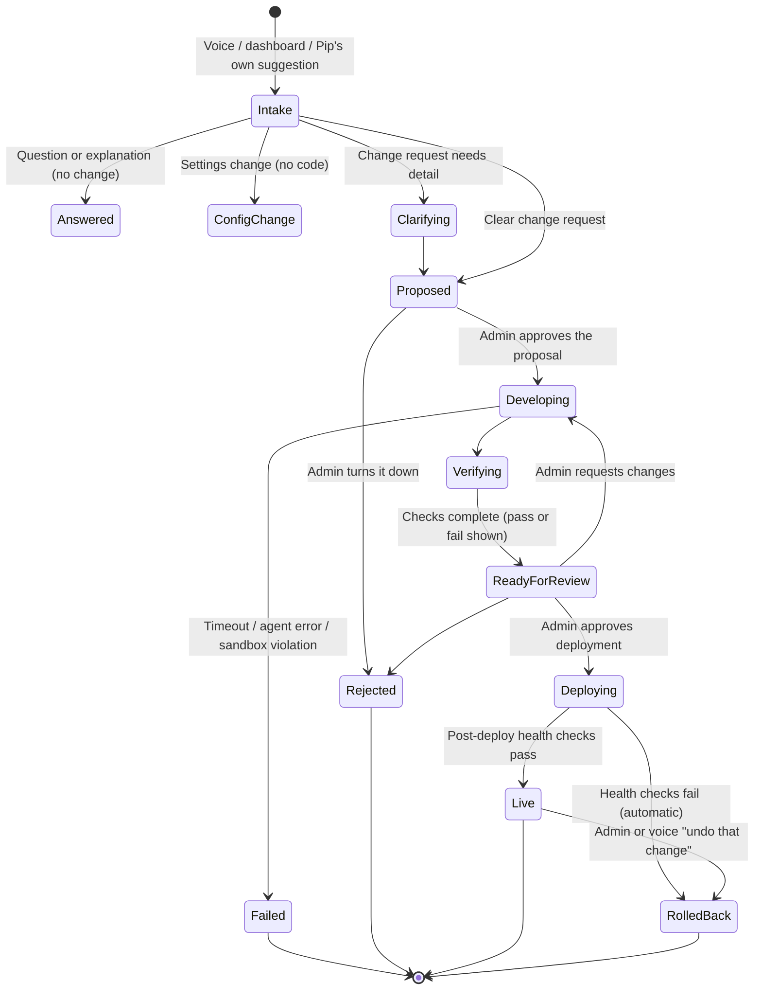

# Pip 2.0 — Safe Self-Modification (PROPOSAL)

> **Top priority for the owner. Owner decision: included in the parity release (M1), sandboxed, with diff review.**
> Ziggletron today: a recognised person asks; an admin approves **by voice**; Claude Code edits a git worktree in tmux; an import check and the test suite gate a fast-forward merge; restart. The agent's tests run unsandboxed with full user privileges (S-03). There is no diff review (S-04). Spoken requests appear verbatim in commits (V-06). The console edits live code (U-11). See FEAT-073–078, W15–W17.
> Requirement IDs: PIP-NEW-069–077. Acceptance criteria: [14 §J](14-ACCEPTANCE-CRITERIA.md#j-safe-self-modification).

## 1. Lifecycle

There are **two approval points**: before development (the proposal) and before deployment (diff and results). Low-risk changes may combine them if the admin enables "auto-approve proposals for cosmetic changes" (off by default).

## 2. Request intake and classification (PIP-NEW-069)

| Class | Example | Result |
|---|---|---|
| How something works | "How do your reminders work?" | Self-knowledge answer ([09](09-SELF-KNOWLEDGE-AND-DIAGNOSTICS.md)); no change |
| Bug report | "Your reminders are unreliable" | Pip investigates read-only (trace, events), reports findings, and **offers** a change. It may record a bug item |
| Enhancement idea | "It'd be nice if you blinked more naturally" | Recorded as an idea; Pip offers a proposal |
| Code change request | "Add a widget for the bin schedule" | Clarify if needed → proposal |
| Configuration change | "Talk a bit slower" | Settings change with the normal permission check; no code |
| History question | "What did you change last week?" | Change history answer |

Who can initiate: any **recognised household member** by voice, any member on the dashboard. Pip's own suggestions are initiated by Pip but go through the same path (§10).

## 3. Clarification (PIP-NEW-070)
- Ask **only** for what is needed to write a testable proposal: which feature, what should happen, what "done" looks like.
  - Example: "Make your voice better" → "Do you mean how naturally I speak, or how well I understand people?"
- Skip clarification when intent, scope and acceptance are already clear.
- At most 3 clarification turns by voice; after that, "I've put the questions on the dashboard."

## 4. Change proposal (PIP-NEW-071)

Shown on the dashboard (Developer → Changes) and summarised aloud:

| Section | Content |
|---|---|
| Summary | One plain sentence |
| Why | The problem or request, paraphrased (not verbatim speech) |
| Affected features | FEAT/PIP-NEW IDs from the capability registry |
| Risk tier | Cosmetic / behavioural / data-affecting / security-sensitive (§7) |
| Dependencies | New libraries or services; whether network access is needed |
| Data and settings impact | Migrations, new settings, retention changes |
| Test plan | Tests to add or extend; hardware checks |
| Rollback | How it will be undone |
| Estimate | Expected development time and Pi resource use |

## 5. Isolated development (PIP-NEW-072)

| Requirement | Proposal |
|---|---|
| Workspace | A fresh copy of the application source at the current release, in a temporary location. **Never the live install** |
| Execution sandbox | The coding agent's tool execution (shell, tests, builds) runs in a container or OS sandbox: no host filesystem except the workspace, unprivileged user, read-only system |
| Network | Denied by default. Allowed: the model provider endpoint (for the agent) and, only if the proposal declares new dependencies, the package index. Everything else is blocked and logged |
| Credentials | **No production credentials.** Test fixtures use fake keys. The coding agent's own model credential is scoped to the sandbox (see the risk below) |
| Private data | No access to memories, voice profiles, the data folder or logs. Explicit admin authorisation can mount a **redacted sample**, for one change |
| Limits | CPU and memory caps sized so Pip keeps running (e.g. 2 cores, 2 GB on the Pi 5, to be measured); 30-minute default timeout; disk quota |
| Generated tests | Treated as untrusted code, and run only inside the sandbox |
| Cleanup | Workspace and container removed on every outcome, including failure and restart (fixes P-02) |
| Watchability | Live terminal view of the agent on the dashboard (kept from Ziggletron); the admin can type to it, pause or stop |
| Where it runs | On the Pi by default. Optional: a separate development machine, if Pi resources prove too tight ([17](17-OPEN-QUESTIONS.md)) |

**Main remaining risk:** with Claude Code via the subscription (owner decision), the agent needs a model credential inside or next to the sandbox. Proposed mitigation: the agent process runs outside the sandbox with only that credential, and tool execution runs inside. If the agent must run inside, network egress is restricted to the provider only. To be validated in the architecture phase. **Owner decisions:** the agent runs **on the Pi** (D-23), with resource limits, and uses the **same Claude subscription** as conversation (D-17). Its runs therefore count against the plan's limits, and development pauses when the usage meter nears the limit.

## 6. Verification (PIP-NEW-073)

| Check | Notes |
|---|---|
| Build / syntax / startup | The app starts in the sandbox with simulated audio |
| Unit and integration tests | The existing suite plus new tests |
| Regression set | Acceptance tests for critical functions (alarms ring, stop works, offline timers) always run |
| Security checks | Dependency vulnerability scan; secret scan of the diff; forbidden-path check (changes to the sandbox, auth or permissions code raise the risk tier automatically) |
| Privacy checks | New persistence or logging of content flagged; new outbound network destinations flagged |
| Architecture compliance | Capability registry updated; component boundaries respected; no new unpermitted integrations |
| Hardware checks | Where applicable, a short live check after deploy (mic level, speaker test, TV render) |

**Passing all checks makes a change reviewable, not approved.** The review screen says this.

## 7. Human approval (PIP-NEW-074)

| Risk tier | Examples | Proposal approval | Deployment approval |
|---|---|---|---|
| Cosmetic | Face blink, colours, wording | Admin (dashboard), or optionally auto | Admin, dashboard |
| Behavioural | New widget, new routine step type, timing changes | Admin, dashboard | Admin, dashboard, after viewing the diff |
| Data-affecting | Storage format, migrations, retention | Admin | Admin + backup taken automatically before deploy |
| Security-sensitive | Auth, permissions, sandbox, credential handling, the self-modification pipeline itself, network exposure | Admin | Admin + **explicit second confirmation**, and the diff must have been opened |

Rules:
- **Voice can initiate and approve proposals, never deployments.** Approval is always by a signed-in admin on the dashboard.
- The review screen shows: summary, full diff (with file list), test and check results, affected features, risks, deployment plan, rollback option.

## 8. Safe deployment (PIP-NEW-075)
1. Wait for a quiet moment: no alarm ringing, no conversation in progress, no conditional alarm pending (kept from Ziggletron), or "deploy now" by the admin.
2. Install as a **new version alongside the current one**. The current version remains intact.
3. Switch over. Persistent alarm state is preserved.
4. **Post-deploy health checks** within 2 minutes: startup, audio input flowing, speaker test tone (optional, silent level check by default), alarm scheduler running, dashboard reachable, model reachable (if online).
5. On failure: **automatic rollback** to the previous version, plus a notice. Ringing alarms are re-armed.
6. Keep the last 3 versions for manual rollback ("Pip, undo yesterday's change" → confirmation on the dashboard).

## 9. Change history (PIP-NEW-076)
- Each change record: what changed (summary), when, why (paraphrased), who requested it, who approved the proposal and the deployment, test results, deployed or not, can it be reverted, and its rollback history.
- **Commit messages are generated from the approved summary**, and checked by the secret/PII scan before commit. Raw spoken request text is never written to git.
- The private request text (if kept at all) stays in the local change record, with 90-day retention.
- Pip can answer "what changed, when, why, who approved, did tests pass, is it live, can it be undone".

## 10. Self-improvement suggestions (PIP-NEW-077, M4)
- **Observation:** recurring failure patterns from diagnostics (e.g. 5 layout failures in a week, 3 audio restarts in a day, repeated transcription corrections of the same word).
- **Recommendation:** a suggestion card on the dashboard. Spoken only when asked ("anything you'd like to improve?") or as at most one weekly mention.
- **Development** starts only after a member requests it and an admin approves the proposal.
- Pip never moves itself from observation to development, or from verification to deployment. Each stage is separate and recorded.

## 11. Relation to the code console (FEAT-077)
The keyboard coding terminal stays, but opens on a sandboxed workspace, and its result goes through the **same verification, review and deployment path**. This removes the two-paths confusion (U-11). Direct edits to live code are not offered.
