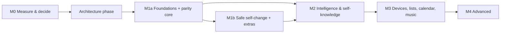

# Pip 2.0 — Prioritised Roadmap (PROPOSAL)

> **Owner decisions:**
> - Parity with Ziggletron first, including safe self-change (D-08, D-09).
> - **M1 is split into M1a and M1b** (D-29).
> - Next step after spec approval: **M0 measurements, then the architecture phase** (D-30).
> - Built on the Pi in Python, running side by side with Ziggletron (D-28, D-31).
>
> Foundations needed later by self-knowledge and self-modification (structured events, capability registry, accounts, sandbox) are built early regardless.

## Dependency spine

## M0 — Measure and decide (before building; no Pip code)

| Work | Output |
|---|---|
| Speakerphone check (USB): echo cancellation with Pip's own audio and with music, quiet and distant speech, TV in the background | Confirm or replace the mic |
| Pi 5 load test: continuous Moonshine transcription + speaker ID + sound tagging + Kokoro/Piper + TV kiosk | Go / no-go for Social-on-budget; voice engine |
| Local LLM speed on the Pi 5 (candidate small models) | Fallback model choice (AC-REL-04) |
| Speech benchmark stages 1–5 ([05](05-SPEECH-BENCHMARK-PLAN.md)), first with **Groq + local models only** (only Groq account available, D-40) and **one speaker** (the owner, D-41) | STT provider, segmentation, "Pip" vs "Hey Pip" |
| Sandbox feasibility on the Pi with the Claude Code agent and resource limits | Self-change approach |
| Eightree outlets: confirm they are Tuya-based and that local keys can be obtained | Device path for outlets |
| Hardware: speakerphone only (no SSD, no GPIO button: D-38, D-39). SD-card wear check | Hardware baseline |
| Read-only inventory of `~/ziggletron` for migration (names and shapes only, no values) | Migration mapping (deferred: owner said not to worry about Ziggletron for now) |
| Project setup: private GitHub repo `pip`, CLAUDE.md, secret/phone-number commit check | Repository |
| Local M0 dashboard on the Pi (separate folder `~/pip-dashboard`, Tailscale only) | Progress, tests and diagnostics at a glance |

Then the **architecture phase**: Python, using the approved spec. It must deliver diagrams, a plain-language overview and a module template the owner can follow without reading all the code (D-71, PIP-NEW-091/092).

## M1a — Foundations + parity core

| Group | Contents | IDs |
|---|---|---|
| Foundations | Structured events and decision trace; action lifecycle; accounts, roles and 2-factor for admins; remote access; client data scoping; audit; vault; settings UI; health and stall detection; versioned installs with rollback; capability registry | PIP-NEW-039, 052–059, 064, 066 (trace), 078–080 |
| Listening | Local address detection; pre-roll; adaptive endpointing; STT selection and fallback; vocabulary; local fast-path; media detection; Private and Social modes with opt-out; local room transcription | PIP-NEW-001–013 |
| Privacy hardware | Speakerphone mute detection | PIP-NEW-084 |
| Conversation | Answering, follow-up, chime, barge-in, cut-off, basic joining gates, greeting, personality, context, web search, typing | FEAT-003–006, 015–027; PIP-NEW-018 (basic), 022, 023 |
| Identity | Speaker labels, enrolment, corrections, management; guest rules; authorisation tiers | FEAT-010–013; PIP-NEW-025, 027 |
| Memory (core) | Categories (household default), inbox, basic Memory Center, no-loss retention, sensitive rules, import | PIP-NEW-028, 029, 031, 032, 034 (import) |
| Scheduling | Timers, reminders, targeted reminders, calendar, alarms, earned alarms, snooze, ringtones; offline command path; dashboard reminders; authorised acknowledgement | FEAT-033–042; PIP-NEW-044–046, 051 |
| Devices and presence | SMS, volume, stop/start listening, mic switch (persistent), speaker test, dozing, quiet hours, GPIO PIR | FEAT-043–050 |
| TV | Face, clothing, reactions, dashboards, layout validation and undo, live existing boxes, requested drawings and photos, own-drawings switch (off), privacy, resilience, weather, vitals | FEAT-052–065; PIP-NEW-060, 061 (validation, undo), 063 |
| Voice | Kokoro/Piper decision, cached phrases, pronunciation | PIP-NEW-014, 015 |
| Migration | Credentials and data import from `~/ziggletron` | PIP-NEW-058, 083 |

**M1a exit:** M1a acceptance criteria pass; Pip runs side by side with Ziggletron (only one holds the speakerphone at a time).

## M1b — Safe self-change and extras (completes parity)

| Contents | IDs |
|---|---|
| Classification, clarification, proposal, sandbox on the Pi, verification, dashboard approval, safe deploy, sanitised history; console via the sandbox | PIP-NEW-069–076; FEAT-073–078 |
| Usage meter with plan-limit warnings | PIP-NEW-089 |
| Memory Center remaining basics | PIP-NEW-030 |

**M1b exit:** switch over from Ziggletron. Ziggletron is stopped but left installed, as a rollback option.

## M2 — Intelligence and self-knowledge

| Contents | IDs |
|---|---|
| Full turn-taking, Room-Aware refinements, person-bound follow-up, corrections, pause/resume and ducking, long-answer offer | PIP-NEW-016–021 |
| Guided enrolment; persistent corrections | PIP-NEW-024, 026 |
| Forget a person; export; "why do you remember" | PIP-NEW-033–035 |
| Natural-language schedule editing | PIP-NEW-050 |
| **Self-knowledge Q&A, spoken "why" explanations, read-only inspection, spoken diagnostics** | PIP-NEW-065–068 |
| Local LLM fallback | PIP-NEW-081 |
| Richer face | PIP-NEW-062 |

## M3 — Devices, lists, calendar and music

| Contents | IDs |
|---|---|
| Device hub: MQTT broker, ESPHome discovery, Eightree via local Tuya; registry; contextual commands; risk classes; offline device control | PIP-NEW-036–040, 043 |
| Routines and scenes; sensor events; daily briefing | PIP-NEW-041, 042, 088 |
| Shopping list, to-dos, Google Calendar sync | PIP-NEW-047–049 |
| Phone notifications (ntfy); household messages | PIP-NEW-086, 087 |
| New live widgets; drag-and-drop layouts | PIP-NEW-060, 061 |
| Local music playback | PIP-NEW-090 (FEAT-088) |

## M4 — Advanced

| Contents | IDs |
|---|---|
| Self-improvement suggestions | PIP-NEW-077 |
| Optional ideas still open (e.g. multi-room satellites) | PIP-IDEA-* |

## Effort, value and risk (relative)

| Milestone | Effort | Value | Main risks |
|---|---|---|---|
| M0 | S | Very high | Results may change the hardware or mode plan |
| M1a | L–XL | Very high | Pi resources for local room transcription; scope |
| M1b | L | High (owner priority) | Sandbox on the Pi; subscription quota shared with the coding agent |
| M2 | L | High | Turn-taking tuning is subjective |
| M3 | L | High | Tuya firmware changes; Pip owning device state |
| M4 | M | Medium | Over-automation |
