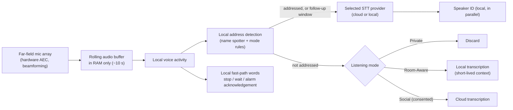

# Pip 2.0 — Speech Recognition, Audio Pipeline and Spoken Output (PROPOSAL)

> **Part A** covers speech recognition and the audio pipeline. **Part B** covers spoken output (TTS).
> Requirement IDs (PIP-NEW-001…017) are defined in [02-PROPOSED-FEATURE-CATALOG.md](02-PROPOSED-FEATURE-CATALOG.md#a-listening-and-speech).

### Owner decisions recorded 2026-11-03

| Topic | Decision | Consequence here |
|---|---|---|
| Wake form | Test "Pip" and "Hey Pip", then decide | §2.1; benchmark stage 4 |
| Default listening mode | **Social** | Room speech is followed by default, so it has to be transcribed continuously |
| Cloud budget | **Under $10/month** in total | **Room speech is transcribed locally.** Cloud STT is used only for addressed requests (§3.1 cost) |
| Microphone / speaker | Owner's "rayBit" conference speakerphone, **connected by USB and used as both mic and speaker** (D-12) | §2.2: the speakerphone's echo cancellation covers Pip's voice, ringtones and music. Its real performance is measured in M0 (R-01) |
| Voice | **Local voice only** | Part B |

# Part A — Speech recognition

> Proposed behaviour. Ziggletron's current hearing is described in [FEAT-001–008](../01-discovery/COMPLETE-FEATURE-CATALOG.md#a-hearing--speaker-identity) and [BEHAVIORAL-SPECIFICATION §3](../01-discovery/BEHAVIORAL-SPECIFICATION.md#3-hearing-pipeline).
> Provider facts were gathered on 2026-11-03. Each fact is tagged by how much it can be trusted:
> **[V]** vendor documentation or announcement · **[3P]** third-party article or aggregator · **[I]** independent benchmark, still not tested on Pip's audio · **[M]** my prior knowledge, not re-checked.
> **No figure here has been measured on Pip's hardware or in Pip's room.** The [benchmark plan](05-SPEECH-BENCHMARK-PLAN.md) exists to do that.

## 1. What actually limits accuracy today

Ziggletron's transcription errors probably come from the whole chain, not only the model. Discovery found these candidate causes:

| Stage | Ziggletron today | Likely effect on accuracy |
|---|---|---|
| Microphone | Default device; far-field array only recommended (HC-1) | Distance and reverberation are the largest error source for room speech |
| Echo | No acoustic echo cancellation (AEC); a loudness gate plus word and voice matching (FEAT-007) | Quiet interruptions get dropped as echo ("speak up a little") |
| Gain | Quiet audio boosted by up to +30 dB before STT | Boosts noise along with speech; may cause hallucinated words |
| Segmentation | Fixed 700 ms of silence ends an utterance; 0.5 s lead-in | Cuts people off mid-hesitation ("set a timer for… um… ten minutes") |
| Utterances while talking | Capped at 2.5 s | Long interruptions arrive in fragments |
| Model input | Batch upload after the pause; name-only hint | No context, so names and device words are mis-heard |
| Failure | 10 s cloud timeout, then local fallback; blocks the queue (R-01) | Slow and unpredictable when the cloud is unhealthy |

**Implication:** the new pipeline and the provider choice need to be tested together. Changing the provider alone may give a smaller gain than adding a far-field array with AEC.

## 2. Proposed pipeline (behavioural, not a library choice)

Key behaviours:

1. **Nothing leaves the house until Pip decides locally that it was addressed.** The exceptions are Social mode with consent, and the follow-up window. This fixes V-01.
2. **The name can still be anywhere in the sentence.** Audio is held in a rolling RAM buffer, so when the name spotter fires in "what's the weather tomorrow, Pip?", the whole speech segment that contains it is sent, including the words before the name. The buffer is never written to disk.
3. **Stop, wait and alarm acknowledgements are recognised locally.** A small keyword detector handles them without a transcription round trip, so stopping happens in well under 100 ms and still works offline. This replaces Ziggletron's "transcribe, then check the stop-phrase list" path.
4. **Transcription never blocks the queue.** Typed input, alarms, sounds and device events are handled while a transcription is in flight (fixes R-01).
5. **The local STT model is loaded only if a configured mode needs it**, i.e. fallback, Room-Aware or local-only (fixes R-04).

### 2.1 The name "Pip" is a detection risk

"Pip" is one short syllable. Short words make poor wake words: they are easily confused with *tip, pick, peep, pit, pip-pip*, and they turn up in ordinary speech. Ziggletron's four-syllable name was far easier to spot. Options, to be decided using the benchmark's false-activation numbers:

- **A.** Accept "Pip" alone, but require it to be its own clause (a pause on either side), which Ziggletron already required for direct address. Use a separate "probably said Pip" state for anything less certain.
- **B.** Recommend "Hey Pip" or "Okay Pip" as the trained form for the local spotter, and still accept "Pip, …" when the local detector is confident.
- **C.** Choose a longer formal name with "Pip" as a nickname.

**Recommendation:** train and test both "Pip" and "Hey Pip" before deciding. Do not commit to option A without measured false activations per hour in a real room with the TV on.

### 2.2 Echo cancellation and hardware

| Recommendation | Reason |
|---|---|
| **Owner's choice: the conference speakerphone.** Connect it by **USB** and use it as **both** Pip's microphone and Pip's speaker | Speakerphones run AEC on what they themselves play, so this works only if Pip's voice and ringtones go out through it. Over Bluetooth, the microphone usually falls back to the hands-free profile at 8–16 kHz, which hurts STT accuracy [M] |
| Measure before relying on it: does its noise reduction remove quiet or distant speech, or a voice over TV audio? | Conference processing is tuned for people seated around a table about 1–2 m away, and may gate out quieter speech further away. Benchmark stage 1 compares it with the current mic |
| If the speakerphone underperforms: a USB far-field array with on-board AEC, beamforming and noise suppression (XMOS XVF3800-class; vendors claim pickup to about 5 m and USB audio with no driver on a Pi [V/3P]) | Fallback option |
| Removing Pip's own voice in hardware before VAD and STT | Makes barge-in and alarm responses reliable |
| **Play Pip's audio through the array's output, or another output with a fixed-latency reference.** Do not rely on Bluetooth for the main voice | AEC needs a time-aligned copy of what is being played. Bluetooth adds variable delay (typically 100–300 ms [M]) that breaks hardware AEC. Ziggletron supports Bluetooth and has a 0.5 s "echo tail" to compensate |
| Software fallback: PipeWire's echo-cancel module (WebRTC AEC) | Ziggletron documented it but never verified it (UNKNOWN §1) |
| Keep the word, voice and loudness echo checks as a second line of defence | They work today [T]. Thresholds must be re-tuned once AEC is present |
| Capture at the device's native rate and resample once, to 16 kHz mono | Most STT APIs accept 16 kHz. Every extra resample adds artefacts |
| Prefer the array's AGC over software boosting. Make the +30 dB software boost a benchmarked option, not a default | Boosting quiet audio boosts noise, and STT models hallucinate in noise (FEAT-008) |

### 2.3 Segmentation and end of utterance

Ziggletron ends an utterance after a fixed 700 ms of silence. Proposed instead:

- **Lead-in buffer:** 0.8 s (was 0.5 s). **Trailing pad:** 0.3 s. Both are benchmark variables.
- **Adaptive end of utterance.** Start from a short silence threshold of about 500 ms. Extend it, up to about 1.5 s, while the partial text looks unfinished: it ends in "for", "and", "the", "um", or a number with no unit. If the chosen provider streams and has model-based end-of-turn detection (Deepgram Flux claims under 400 ms [V]; AssemblyAI exposes `min_turn_silence`/`max_turn_silence` [3P]), benchmark that against Pip's own rule. Pick whichever gives fewer truncations at acceptable latency.
- **Long interruptions while Pip is speaking are no longer cut into 2.5 s pieces.** With AEC this cap should not be needed. It returns only if the benchmark shows echo still causing problems.
- The benchmark measures **truncated utterances** directly (§3.5 of the brief), so the thresholds are set by data.

## 3. Provider comparison (2026-11-03)

| Provider / model | Mode | Language coverage | Context / vocabulary | Turn detection | Price (as found) | Notes |
|---|---|---|---|---|---|---|
| **Groq Whisper Large V3 Turbo** (Ziggletron's current) | Batch only | ~99 (Whisper) [M] | Free-text prompt (Whisper prompt, limited length [M]) | None. Pip does its own | $0.04/audio-hour; **10 s minimum billed per request** [V via 3P] | Very fast batch (vendor "216× real time"). The free tier showed a 2,000 requests/day limit on the live device [R]. Rate-limit figures conflict between sources |
| **Groq Whisper Large V3** | Batch | Same | Same | None | $0.111/hour, same minimum [3P] | Slightly more accurate than Turbo per general reports; costs more and is a little slower |
| **Deepgram Nova-3** | Streaming and batch | Monolingual and multilingual variants | **Keyterm prompting** (paid add-on, ~$0.0013/min [3P]) | Endpointing on silence | Streaming base figures conflict: $0.0048–0.0077/min [3P] | One independent benchmark placed it much lower on accuracy than others; possibly a method problem [I, unverified] |
| **Deepgram Flux** | Streaming, built for voice agents | English, plus Flux Multilingual with 10 languages (GA 2026-04-29) [V] | Keyterms [M, verify] | **Model-based end of turn, claimed under 400 ms**; early end-of-turn events [V] | ~$0.0065/min English [3P] | Fastest in one independent latency benchmark [I]. Its built-in turn detection fits Pip's turn-taking needs |
| **ElevenLabs Scribe v2 Realtime** | Streaming (batch Scribe v2 separate) | Wide multilingual [M] | Keyterms (add-on, ~$0.05/hour [3P]) | VAD and manual commit [3P] | $0.39/hour realtime; $0.22/hour batch [3P] | ~150 ms latency claimed [V]. Top accuracy (about 2.2% WER) on one independent leaderboard, as cited second-hand [I/3P] |
| **OpenAI GPT-Live-Transcribe** | Streaming (Realtime transcription endpoint) | 57 languages [V] | **Free-form context**, keyword hints, language hints; tunable latency [V] | Realtime API turn handling [M, verify] | $0.017/min [V] | The most expensive streaming option here. Free-form context may suit names and household jargon |
| **OpenAI GPT-Transcribe** | Batch (files) | 57 languages [V] | Prompt/context [V] | None | ~$0.0045/min [V via 3P] | Direct batch alternative to Groq |
| **AssemblyAI Universal-Streaming / Universal-3.x Pro streaming** | Streaming | English (Universal-Streaming); more for Pro [3P] | `keyterms_prompt` (up to 1,000 terms), custom prompt [3P] | Confidence-based (Universal-Streaming) or punctuation-plus-pause (Pro); tunable silence limits [3P] | $0.15/hour English streaming; ~$0.45/hour Pro realtime [3P] | Vendor reports P50 317 ms / P90 597 ms [V] |
| **Soniox** (added) | Streaming | Multilingual | Context [M] | Endpoint detection [M] | Not checked | Strong result in a third-party benchmark (reported by the vendor) [I/V]. Worth including in the benchmark |
| **Local: Moonshine** (Tiny/Base/Medium streaming) | On device, streaming | English plus some others [V] | Limited | None | Free | Pi 5 figures: Tiny real-time factor about 0.06–0.10 [3P]; Medium streaming about 0.8 s latency, 6.65% WER [V]. **Best candidate for continuous local transcription in Room-Aware mode** |
| **Local: faster-whisper / whisper.cpp** (tiny…small) | On device, batch | Whisper | Prompt | None | Free | Ziggletron's current fallback. Tiny takes about 2–3 s for a 10 s clip on a Pi 5 [3P] |
| **Local: Parakeet (via sherpa-onnx)** | On device | English (v2), more (v3) [M] | — | — | Free | No Pi 5 figures found. Benchmark only if time allows |
| **Local grammar recogniser** (Vosk-style, limited vocabulary) | On device | — | Fixed command grammar | — | Free | Not for general speech. A candidate for **offline core commands** (timers, stop, lights) |

### 3.1 What can and cannot be concluded

- **No provider wins on the evidence available.** Independent leaderboards disagree, sometimes wildly (Nova-3 at about 5% on one and about 25% WER on another). Nearly all are built on telephone or podcast audio, not a living room at 3 m with a TV on.
- **Batch vs streaming is the real architectural fork.** Ziggletron's batch approach already reaches about 0.5 s from end of speech to text [D]. Streaming helps only if (a) it lowers end-of-turn latency without more truncation, or (b) model-based turn detection beats Pip's own rule. Both are measurable.
- **Cost is negligible in Private mode and matters in Social mode.** About 100 addressed requests a day at about 5 s each is roughly 8 minutes of audio a day, which is cents per month with any provider. Note that Groq's 10 s minimum bills at least double for short commands. Social mode with cloud transcription of all room speech is different. Two hours of speech a day costs about $2/day on GPT-Live-Transcribe, against about $0.80/day on Flux at the prices above. Show the estimated monthly cost on the provider selection screen.
- **Privacy terms differ per provider** (retention, training use, opt-outs, region). They were not checked here. They must be recorded per provider before any is enabled for Social mode.

## 4. Custom vocabulary

**Source of terms** (built automatically, editable in Settings → Vocabulary):

| Source | Examples |
|---|---|
| Pip's names | Pip, nicknames; "Ziggletron" kept as a legacy name for one release, then removable |
| People | Household member names and spellings from the people list |
| Devices and rooms | Friendly names and aliases from the smart-home registry ([07-SMART-HOME-AND-INTEGRATIONS.md](07-SMART-HOME-AND-INTEGRATIONS.md)) |
| User-added | Technical terms, projects, pet names |

**Rules that avoid Ziggletron-style hallucinated names:**

1. **Wake detection never relies on the cloud transcript.** The local name spotter decides whether Pip was addressed. Cloud vocabulary hints can therefore improve spelling, but cannot by themselves create a false activation.
2. If a transcript contains Pip's name but the local spotter scored low, treat the line as "mentioned", not "called". Ziggletron's name-hint re-check (FEAT-008) becomes unnecessary.
3. Cap the list (start at about 50 terms, the most-used first). The benchmark measures **insertion rate**: vocabulary words appearing in transcripts where nobody said them. Terms that cause insertions are flagged for removal.
4. Use each provider's native mechanism (keyterms, prompt, context, keyword hints) through one Pip vocabulary list, translated per provider.
5. The same list feeds TTS pronunciation ([Part B](#part-b--spoken-output-tts)).

## 5. Provider selection, fallback and monitoring

Keep it simple. The routing has one justified split: **local address detection always; selected STT for addressed speech.** No per-use-case routing unless the benchmark shows a clear benefit.

| Setting | Options | Default |
|---|---|---|
| Transcription provider | Any configured cloud provider, or Local only | Chosen from benchmark results |
| Fallback | Local model, or a second cloud provider, or none | Local |
| Local-only mode | One switch: nothing audio-related leaves the house | Off |
| Cloud timeout | Batch: about 3 s after upload; streaming: no final result within about 2 s of end of speech | Not 10 s as today |

**Health behaviour:**
- Two consecutive failures or timeouts switch to fallback, with one dashboard notice. Probe the primary once a minute and switch back after one success. This is the same idea as Ziggletron's, but faster.
- Record per-request latency, failures, fallback time and audio minutes per provider. Show them on a **Speech** dashboard panel: today, 7 days, estimated monthly cost, remaining free quota where the provider exposes it.
- The Speech panel's **"Was that right?"** feature lets an admin mark a transcript wrong and type the correction. This is stored only as aggregate counts per provider (error rate trend), never as audio, unless the person explicitly saves it to the benchmark set ([plan §2](05-SPEECH-BENCHMARK-PLAN.md)).

## 6. Recommendation given the owner's decisions

1. **Room speech in Social mode is transcribed by a local streaming model**, starting with Moonshine. It stays within budget and keeps room audio in the house. Only the *text* of the room context goes to the model provider, and only under the consent rules in [03 §1.2](03-CONVERSATION-AND-PERSONALITY.md#12-consent-rules-for-social-mode-owner-decision-d-13-opt-out).
2. **Addressed requests use one cloud STT provider.** At about 240 addressed minutes a month, every candidate costs under $5/month. Groq Turbo costs about $0.30 even with its 10 s minimum per request. The benchmark therefore decides on accuracy and latency, not price.
3. **Benchmark shortlist** (accounts needed):
   - Groq Whisper Large V3 Turbo (baseline; already configured).
   - OpenAI GPT-Transcribe (batch).
   - Deepgram Flux (streaming with turn detection).
   - ElevenLabs Scribe v2 Realtime.
   - AssemblyAI Universal-Streaming.
   - Local Moonshine Medium (both for room transcription and as the fallback).

   OpenAI GPT-Live-Transcribe is optional; its $0.017/min is fine for addressed speech only.
4. **If continuous local transcription doesn't fit on the Pi 5** (benchmark: Pi resource use), Social mode degrades to the Room-Aware triggers that need no transcript, and this is shown on the dashboard. **Sending all room audio to the cloud is not an acceptable fallback within the stated budget.**

## Sources

- [OpenAI: GPT-Live-Transcribe and GPT-Transcribe announcement](https://community.openai.com/t/gpt-live-transcribe-and-gpt-transcribe-two-new-transcription-models-in-the-api/1388318) · [GPT-Live-Transcribe model page](https://developers.openai.com/api/docs/models/gpt-live-transcribe) · [Migrating from Whisper cookbook](https://developers.openai.com/cookbook/examples/migrating_from_whisper_to_gpt_transcribe) · [Slator coverage](https://slator.com/openai-two-new-models-transcription/)
- [Deepgram Flux Multilingual press release](https://deepgram.com/blog/deepgram-launches-flux-multilingual-press-release) · [SiliconANGLE on Flux](https://siliconangle.com/2026/04/29/deepgram-expands-flux-10-languages-mid-call-switching-voice-agents/) · [Deepgram pricing summary (third party)](https://www.activepieces.com/blog/deepgram-pricing-2026-per-minute-rates-and-add-ons) · [Nova-3 pricing (third party)](https://convertaudiototext.com/blog/deepgram-nova-3-explained)
- [ElevenLabs realtime STT](https://elevenlabs.io/realtime-speech-to-text) · [Scribe v2 pricing (third party)](https://www.activepieces.com/blog/elevenlabs-realtime-scribe-v2-pricing-and-features.md)
- [AssemblyAI pricing](https://www.assemblyai.com/pricing.md) · [AssemblyAI streaming benchmarks](https://assemblyai.com/docs/streaming/benchmarks) · [LiveKit AssemblyAI plugin docs](https://docs.livekit.io/agents/models/stt/assemblyai)
- [Groq pricing](https://groq.com/pricing) · [Groq Whisper Large v3 Turbo docs](https://console.groq.com/docs/model/whisper-large-v3-turbo) · [Groq rate limits (third party)](https://www.developersdigest.tech/rate-limits/groq)
- [Coval independent STT benchmarks](https://www.coval.dev/blog/best-speech-to-text-providers-in-2026-independent-benchmarks-and-how-to-choose) · [FutureAGI July 2026 roundup](https://futureagi.com/blog/best-voice-ai-july-2026/) · [Soniox benchmark claim](https://soniox.com/blog/soniox-named-best-in-class-for-voice-agents)
- [Moonshine benchmarks](https://www.mintlify.com/moonshine-ai/moonshine/models/benchmarks) · [Moonshine Tiny Pi 5 figures](https://huggingface.co/devendradhakad/autodroid-litert-community-moonshine-tiny) · [Offline STT on Pi guide](https://www.fast.io/resources/openclaw-raspberry-pi-speech-recognition-offline-voice-agent.md)
- [openWakeWord](https://github.com/jbflow/openWakeWord) · [microWakeWord](https://backiee.wasmer.app/https_github_com/OHF-Voice/micro-wake-word) · [Getting a wake word model in 2026](https://dev.to/buguatec/how-to-get-a-wake-word-model-in-2026-3amo)
- [ReSpeaker XVF3800 (retailer listing)](https://thepihut.com/products/respeaker-xmos-xvf3800-ai-powered-4-mic-array-for-clear-voice-even-in-noise)

---

# Part B — Spoken output (TTS)

> Ziggletron today: a local Piper voice (`en_US-lessac-medium`) at speech rate 1.05. It synthesises the next sentence while the current one plays, stops within about 50 ms, and strips links, markdown and emoji ([FEAT-016](../01-discovery/COMPLETE-FEATURE-CATALOG.md#feat-016--spoken-output-text-to-speech)). First sentence to first audio is about 0.15–0.2 s [D].
> **Owner decision: local voice only.** Cloud TTS is out of scope for now. Revisit only if the budget changes (see [16-ADDITIONAL-RECOMMENDATIONS](16-ADDITIONAL-RECOMMENDATIONS.md)).

## B1. Goals, in priority order
1. **Responsiveness:** Pip must not get slower to start speaking than Ziggletron's local voice.
2. **Interruption within 100 ms**, whatever the engine.
3. **Always available:** works offline.
4. **Naturalness**, where 1–3 are not compromised.

## B2. Proposed behaviour

| Element | Proposal | ID |
|---|---|---|
| Engine | Evaluate **Kokoro-82M** (more natural, Apache-2.0) against **Piper** on the Pi 5. No sourced real-time figure exists for Kokoro on a Pi, so it must be measured. Keep Piper if Kokoro's first-audio time is more than about 0.4 s P90, or its CPU use starves listening | PIP-NEW-014 |
| Fixed phrases | Alarms, confirmations and system phrases are pre-synthesised and cached, so they play instantly even if the engine is busy | PIP-NEW-014 |
| Pronunciation | A pronunciation list (word → phonetic spelling), shared with the STT vocabulary. Household names get an entry when added. Editable on the dashboard with a ▶ test button | PIP-NEW-015 |
| Sentence timing | Keep streaming by sentence. Add about 150 ms between sentences, and a slightly longer pause before a question back to the listener | FEAT-016 (improve) |
| Long answers | After about 3 spoken sentences, offer instead of continuing ("That's the short version, want more?"), or put the detail on the TV | PIP-NEW-017 |
| Pause and ducking | "Wait" pauses and holds the reply for 30 s; "go on" resumes. Pip's volume ducks when someone else starts talking ([03 §3](03-CONVERSATION-AND-PERSONALITY.md#3-interruptions)) | PIP-NEW-016 |
| Echo rejection | Pip learns its own voice for every installed voice at startup (FEAT-007) | FEAT-007 (improve) |

## B3. Evaluation (run with the speech benchmark)
- First-audio latency, P50/P90, on the Pi, while listening and local transcription are running.
- CPU use and real-time factor over 10 minutes of continuous synthesis.
- Blind A/B naturalness score by household members on 20 typical replies.
- Pronunciation of 30 household and device names.
- Stop time when interrupted.
