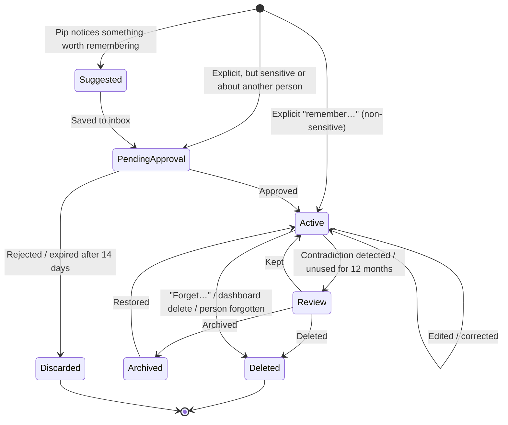

# Pip 2.0 — Memory and Data Policy (PROPOSAL)

> Ziggletron today: up to 150 free-text memories of four kinds (rule, household, person, note), saved when asked **or overheard**. The oldest are dropped silently beyond the cap. The dashboard can delete and re-sort memories but cannot add or edit them. There is no export. Room transcript lines are mirrored to the system log. See [FEAT-028–032](../01-discovery/COMPLETE-FEATURE-CATALOG.md#c-household-memory), [DATA D2–D8](../01-discovery/DATA-AND-PERSISTENCE-INVENTORY.md), and V-03/V-05/V-08.

> Requirement IDs PIP-NEW-028…035 are in [02-PROPOSED-FEATURE-CATALOG.md](02-PROPOSED-FEATURE-CATALOG.md#d-memory-and-data). Logging and credentials are covered in more depth in [11-SECURITY-AND-PERMISSIONS](11-SECURITY-AND-PERMISSIONS.md).
>
> **Owner decisions (2026-11-03):**
> - **Import Ziggletron's memories, reviewed first.** All 58 arrive in the Memory Inbox as *pending*, tagged "imported from Ziggletron", and none is active until approved.
> - **Import reminders, calendar events and TV layouts** directly (functional records), with a summary for the owner to check.
> - **Do not import voice profiles.** Everyone re-enrols.
> - The import is read-only on the Ziggletron side and never modifies or deletes its data ([11 §6](11-SECURITY-AND-PERMISSIONS.md#6-migration-from-ziggletron-credentials-and-data-pip-new-058-083)).

## 1. What persists and what never does

| Persists | Never persists automatically |
|---|---|
| Credentials (secrets store, not memory) | Raw microphone audio |
| Settings | Conversation history or transcripts |
| Approved long-term memories | Model prompts and responses |
| Functional records: timers, reminders, alarms, calendar, TV layouts | Intermediate audio artefacts (segments, embeddings of unknown voices) |
| Consented voice profiles | Room context in Room-Aware/Social modes |
| Privacy-safe operational logs (§6) | Content-level debug logs, unless switched on for a time-limited debug session |

## 2. Memory categories

| # | Category | Examples | Owner | Who can see / use | Approval to save | Retention | Sent to the model |
|---|---|---|---|---|---|---|---|
| 1 | **User preferences** | "Alex likes the lights warm in the evening" | The person | **Household by default** (D-16); can be marked private | The person confirms | Until changed or deleted | When that person is the identified speaker, or the topic needs it |
| 2 | **Household facts** | "Bins go out Tuesday night", "Wi-Fi router is in the hall" | Household | All members | Any member; contested edits go to the inbox | Until changed | When relevant |
| 3 | **Assistant rules** | "Don't join in during dinner", "Always use Celsius" | Household | All members can view; admins edit | Admin, or a member with the rule applying only to themselves | Until changed | Always |
| 4 | **Personal memories** | "Sam is allergic to peanuts", "Jordan's birthday is 3 May" | The subject, if a member; otherwise whoever added it | **Household by default** (owner decision D-16); can be marked private | Explicit; **sensitive kinds require the subject's approval** (§4) | Until deleted; stale review (§3.3) | When the subject is mentioned or present |
| 5 | **Temporary conversational context** | Recent turns, "it" = the desk lamp | — | Pip only | — | RAM only. Cleared 10 minutes after the last turn, on mode change to Private, and on restart | Within the current conversation only |
| 6 | **Scheduled tasks and reminders** | Timers, reminders, events | Creator (and target person) | Household; reminders marked private show only "a reminder for Alex" to others | Created by request | Until done, then a 7-day "recently finished" list, then deleted. Past events kept 90 days (setting) | Upcoming items, as today |
| 7 | **Device and environment information** | Device aliases, room names, "the desk light is Alex's" | Household | All members | Admins and members | Until changed | When a device request is made |
| 8 | **Voice identity profiles** (optional) | Voice embeddings | The person | Admins see existence and metadata only | Explicit consent (see [conversation §4](03-CONVERSATION-AND-PERSONALITY.md#43-guests-and-expiry)) | Expiry rules | Never (local only) |

Credentials are **not memories** and live in the secrets store. Pip refuses to save text that looks like a credential, card number, password or full phone number as a memory, and explains where it belongs instead.

## 3. Lifecycle

### 3.1 How memories are created

| Source | Behaviour |
|---|---|
| **Explicit request** ("Pip, remember Sam is allergic to peanuts") | Non-sensitive and about the speaker or the household: saved immediately and confirmed out loud with the exact wording ("Saved: Sam is allergic to peanuts"). Sensitive, or about another member: saved as *pending*, and the subject is asked (now if present, otherwise in their inbox) |
| **Suggestion** (Pip noticed a lasting preference while being addressed) | Pip asks at a natural point: "Want me to remember you take your coffee black?" Yes → saved; no → nothing. Suggestions can also wait silently in the inbox (setting: "Ask me out loud / put suggestions in the inbox / never suggest") |
| **Overheard** (not addressed) | **Never saved.** In Social mode a suggestion may go to the inbox for the people involved, never directly active. Fixes V-03 |
| **Dashboard** | Add and edit directly |

Each memory records: text · category · subject people · owner · visibility (private / household) · **status: confirmed by the person vs. inferred by Pip** · source (who said it, when, which channel; no transcript) · sensitivity flag · created, last used, last confirmed · supersedes (if it replaced another).

### 3.2 Duplicates and contradictions
- On save, Pip checks for near-duplicates and contradictions in the same category and subject. A duplicate is merged ("I already knew that"). A contradiction ("Sam's birthday is 5 May" vs "3 May") is not silently overwritten: Pip asks which is right, or creates a review item.

### 3.3 No silent loss
- **No count cap with eviction** (replaces Ziggletron's 150 cap).
- **Stale review:** memories unused for 12 months appear in a monthly "Still true?" review list. Nothing is deleted without someone acting.
- **Archive:** archived memories are kept but not sent to the model; they can be searched and restored.
- **Retrieval stays simple:** category, subject people and keyword/fuzzy matching (as Ziggletron, plus synonyms from the model at save time). Semantic search with embeddings is added only if measured misses justify it. A household is unlikely to exceed a few thousand memories.

## 4. Privacy rules

1. **Sensitive kinds** need explicit approval from the subject: health, medical, finances, relationships, religion or politics, whereabouts and schedules of a named person, anything about a child.
2. **Private memories** are used only when their owner is the speaker recognised "sure", and are **never spoken aloud while an unrecognised voice is present** (Pip says "I can tell you that privately on your phone").
3. **Inferred vs confirmed:** inferred items (Pip's own conclusions) are always shown as such, are not used for anything sensitive, and expire after 30 days unless confirmed.
4. **Forgetting a person** ("forget everything about Sam", admin or Sam themselves): deletes their voice profile, memories about them (or anonymises household facts that mention them, after review), their last-heard data, their private reminders, and their vocabulary and pronunciation entries. One confirmation screen lists what will be removed.
5. **Who can inspect or modify whose memories:**

| Role | Own memories | Household memories | Another member's private memories |
|---|---|---|---|
| Member | View, edit, delete | View, edit (inbox if contested) | No access |
| Admin | Same | Full | **Full read, edit and delete** (owner decision D-15). Members are told this in the Memory Center ("Admins can read your memories"), and every admin read of another member's private memory is recorded in the audit trail |
| Child account (not needed for the current household; kept as a future option) | View; edit via a parent | View | No |
| Guest | No dashboard access | — | — |

6. **Export and import:** each person can export their own memories, and admins the household's, as a readable JSON or Markdown file. Import goes through the inbox for review (no blind bulk import).
7. **"Delete everything"** (admin): wipes memories, voice profiles, schedules and logs, keeping settings and credentials unless also selected. Fixes V-08.

## 5. Memory Center (dashboard)

| Area | Functions |
|---|---|
| **Inbox** | Suggested and pending memories with Approve / Edit / Reject; contradictions; stale-review items; a badge count |
| **Browse** | Filter by category, person, visibility, confirmed/inferred, archived; full-text search |
| **Memory detail** | Text (editable); category; who and what it concerns; why it was saved (source line, e.g. "Alex asked by voice, 3 Nov 18:40"); when last used; visibility; Archive / Delete; history of edits |
| **Add** | Form with category, subject and visibility |
| **People** | Per person: their memories, voice profile, consent settings, export, forget |
| **Settings** | Suggestion behaviour; stale-review interval; past-event retention; admin visibility policy |

Pip can also explain itself by voice: "Why do you think I hate mushrooms?" → "Because you told me on 2 November. Want me to forget it?"

## 6. Logs (privacy-safe by default)

| Logged by default (kept 30 days) | Not logged by default |
|---|---|
| Event types and timings (heard an addressed request, 2.4 s; action: timer.create OK) | Transcribed text, reply text |
| Errors with codes, provider names, latency | Memory contents |
| Mode changes, sign-ins, admin actions (the audit trail) | Names of people in conversation lines |

An admin can switch on **content debug logging** for at most 24 hours. It shows a visible indicator on the dashboard and TV, and is deleted automatically when the period ends. Ziggletron's live conversation feed on the dashboard is kept, but **in memory only and only for signed-in members** (it currently has no login and is mirrored to the system journal: S-01, V-05).

Self-change records and commit messages are written from the **approved change summary**, never from raw speech (fixes V-06).
